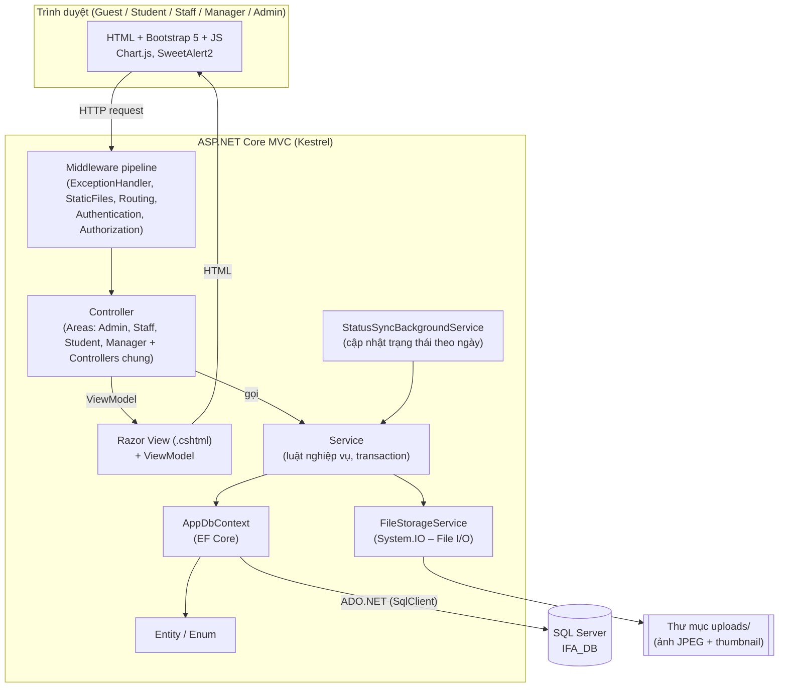
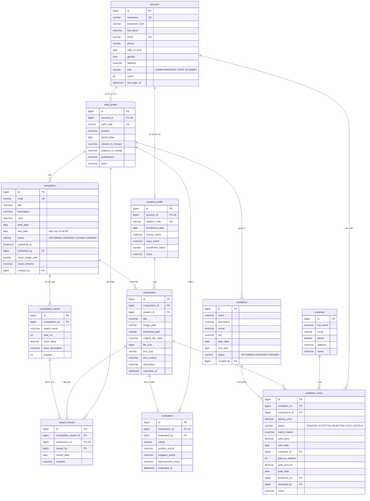
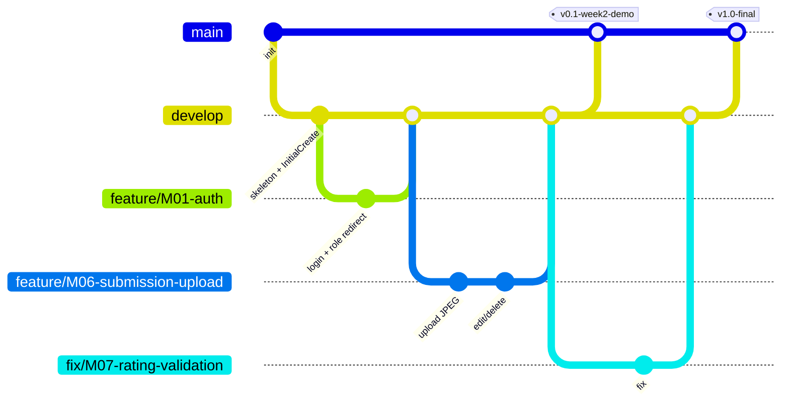

# 02 – Kiến trúc, Công nghệ & Thiết kế CSDL

> Phần 2 của bộ kế hoạch eProject **Institute of Fine Arts**. Đọc cùng: `01_Phan_tich_nghiep_vu_BA.md` (nguồn chuẩn của luật nghiệp vụ), `03_...` (tiến độ), `04_...` (kiểm thử & tài liệu).
>
> **Công nghệ đã chốt (theo yêu cầu giảng viên): .NET** – ASP.NET Core MVC (.NET 10 LTS) + Entity Framework Core + SQL Server.
> Tên chuẩn dùng chung: vai trò `ADMIN`, `MANAGER`, `STAFF`, `STUDENT` (+ `GUEST`); 11 entity `Account`, `StaffProfile`, `StudentProfile`, `Competition`, `CompetitionAward`, `Submission`, `Evaluation`, `AwardIssued`, `Exhibition`, `ExhibitionEntry`, `Customer`; module M01–M11 (+ M12+ tùy chọn).

## Mục lục
1. [Phân tích yêu cầu công nghệ & lý do chọn ASP.NET Core](#1-phân-tích-yêu-cầu-công-nghệ--lý-do-chọn-aspnet-core)
2. [Tech stack chính (bắt buộc)](#2-tech-stack-chính-bắt-buộc)
3. [Công nghệ tùy chọn (100% miễn phí)](#3-công-nghệ-tùy-chọn-100-miễn-phí)
4. [Kiến trúc tổng thể & xử lý File I/O](#4-kiến-trúc-tổng-thể--xử-lý-file-io)
5. [Cấu trúc solution / thư mục](#5-cấu-trúc-solution--thư-mục)
6. [Thiết kế cơ sở dữ liệu](#6-thiết-kế-cơ-sở-dữ-liệu)
7. [Bảo mật](#7-bảo-mật)
8. [Bảng URL / route theo module](#8-bảng-url--route-theo-module)
9. [Quy ước code, cấu hình, xử lý lỗi, logging, validation](#9-quy-ước-code-cấu-hình-xử-lý-lỗi-logging-validation)
10. [Môi trường phát triển & setup – Git – backup](#10-môi-trường-phát-triển--setup--git--backup)
11. [Seed data & script backup/restore](#11-seed-data--script-backuprestore)

---

## 1. Phân tích yêu cầu công nghệ & lý do chọn ASP.NET Core

### 1.1. Những gì đề bài & đặc tả bắt buộc
| # | Nguồn | Yêu cầu |
|---|---|---|
| R1 | Đặc tả – Phần mềm | Dùng 1 hoặc kết hợp: HTML/Java editor, Dreamweaver/JavaScript, j2sdk / **.Net** / J2EE, JSP/Servlets, EJB/Struts, JDBC, **SQL Server 2000 (hoặc mới hơn)** / Oracle 9i / MS Access |
| R2 | Đề bài – Ghi chú | “Để tải lên, chỉnh sửa, tải xuống ảnh/tranh **phải dùng File I/O**” |
| R3 | Đề bài | Website có 4 phân hệ: Manager, Administrator, Staff, Student + trang chủ công khai |
| R4 | Đặc tả – Standards plan | Mọi khối code phải có chú thích; giải thích logic; tài liệu đầy đủ |
| R5 | Giảng viên | **Bắt buộc làm bằng .NET** |

### 1.2. Bảng đối chiếu: Yêu cầu ↔ Công nghệ dùng ↔ Thỏa mãn thế nào
| Yêu cầu | Công nghệ dùng | Thỏa mãn thế nào |
|---|---|---|
| .Net (R1, R5) | **ASP.NET Core MVC trên .NET 10 (LTS)**, ngôn ngữ C# | Đúng nền tảng .NET; .NET 10 là bản hỗ trợ dài hạn mới nhất, máy nhóm đã có SDK 10 |
| SQL Server 2000 hoặc mới hơn (R1) | **SQL Server 2022/2025** + EF Core provider `Microsoft.EntityFrameworkCore.SqlServer` | “Hoặc mới hơn” ✔ |
| JavaScript / HTML editor (R1) | Razor View (`.cshtml`) + HTML5 + Bootstrap 5 + JavaScript | ✔ |
| File I/O (R2) | `System.IO` (`FileStream`, `File`, `Directory`, `Path`) + `IFormFile.CopyToAsync` | Ảnh lưu thành file trên ổ đĩa, đọc/ghi/xóa bằng File I/O; CSDL chỉ lưu đường dẫn |
| 4 phân hệ (R3) | **Areas** (`Admin`, `Staff`, `Student`, `Manager`) + Cookie Authentication + `[Authorize(Roles = ...)]` | Mỗi phân hệ một Area riêng, phân quyền rõ ràng |
| Comment & tài liệu (R4) | XML doc comment `///` + comment trong từng khối code | Quy ước mục 9.2 |

### 1.3. Vì sao ASP.NET Core MVC (mà không phải Web Forms, Razor Pages hay Web API + SPA)?
| Lựa chọn | Nhận xét | Kết luận |
|---|---|---|
| **ASP.NET Core MVC** | Mô hình Model–View–Controller rõ ràng, đúng nội dung học Sem 3, render HTML phía server (đơn giản cho FE), hỗ trợ Areas cho 4 phân hệ | **Chọn** |
| ASP.NET Web Forms (.NET Framework) | Công nghệ cũ, chỉ chạy trên .NET Framework 4.x, không còn phát triển | Không dùng |
| Razor Pages | Đơn giản nhưng ít phù hợp khi nhiều phân hệ và nhiều luồng nghiệp vụ | Không dùng |
| Web API + React/Angular | Phải làm 2 dự án, FE phải học thêm framework JS, tốn thời gian với 4 tuần | Không dùng |

### 1.4. Vì sao Cookie Authentication tự viết thay vì ASP.NET Core Identity?
| | Cookie Authentication + bảng `account` riêng | ASP.NET Core Identity |
|---|---|---|
| CSDL | Dùng đúng bảng `account` đã thiết kế (mục 6) | Tự sinh ~7 bảng `AspNet*`, phải map lại thiết kế |
| Độ khó | Dễ hiểu, ít “phép màu”, nhóm tự giải thích được khi bảo vệ | Nhiều cấu hình ẩn |
| Tính năng cần | Đăng nhập, đăng xuất, phân quyền theo vai trò, khóa tài khoản, đổi mật khẩu → đủ | Thừa (2FA, external login…) |
| Kết luận | **Chọn** – mật khẩu băm bằng **BCrypt.Net-Next** | Không dùng |

---

## 2. Tech stack chính (bắt buộc)

| Lớp | Công nghệ | Phiên bản | Ghi chú |
|---|---|---|---|
| Nền tảng | **.NET SDK** | **10.0** (LTS) | Máy đã có SDK 10.0.401 |
| Ngôn ngữ | **C#** | 14 | Bật `Nullable`, `ImplicitUsings` |
| Web | **ASP.NET Core MVC** (Kestrel) | 10.0 | Controller + Razor View, Areas |
| View | **Razor** (`.cshtml`) + Tag Helpers | 10.0 | `_Layout.cshtml`, partial view, view component |
| UI | **Bootstrap** (có sẵn trong template) + Bootstrap Icons | 5.3.3 / 1.13.x | Đặt trong `wwwroot/lib/` (không phụ thuộc Internet khi demo) |
| Validation phía client | jQuery + jQuery Validation Unobtrusive | có sẵn trong template | Hiện lỗi ngay trên form |
| ORM | **Entity Framework Core** + `Microsoft.EntityFrameworkCore.SqlServer` | 10.0.x | Code-First, LINQ |
| Migration | **EF Core Migrations** (`dotnet-ef`) | 10.0.x | Thay cho việc chạy tay script SQL |
| Tên bảng/cột | `EFCore.NamingConventions` (`UseSnakeCaseNamingConvention`) | 10.0.x | Giữ đúng tên `snake_case` như thiết kế mục 6 |
| Xác thực | **Cookie Authentication** (có sẵn trong ASP.NET Core) | 10.0 | Claims: Id, tên, vai trò |
| Mật khẩu | **BCrypt.Net-Next** | 4.2.x | MIT |
| Ảnh thu nhỏ | **SkiaSharp** | 4.x | MIT, chạy tốt trên Windows |
| Logging | `ILogger<T>` (có sẵn) + **Serilog.AspNetCore** (ghi file) | 10.0.x | Apache 2.0 |
| CSDL | **SQL Server** Developer/Express + **SSMS** | 2022 (16.x) / 2025 (17.x) | |
| Test | **xUnit** + **Moq** + `Microsoft.EntityFrameworkCore.InMemory` | 2.9 / 4.21 / 10.0.14 | Unit test Service |
| Quản lý mã nguồn | Git + GitHub (private repo) | | |
| IDE | **Visual Studio Community** (workload *ASP.NET and web development*) hoặc VS Code + C# Dev Kit | bản mới nhất hỗ trợ .NET 10 | |

### 2.1. Các gói NuGet (file `InstituteOfFineArts.Web.csproj`, rút gọn)
```xml
<!-- Project web ASP.NET Core MVC chạy trên .NET 10 -->
<Project Sdk="Microsoft.NET.Sdk.Web">
  <PropertyGroup>
    <TargetFramework>net10.0</TargetFramework>
    <Nullable>enable</Nullable>
    <ImplicitUsings>enable</ImplicitUsings>
  </PropertyGroup>
  <ItemGroup>
    <!-- EF Core cho SQL Server + công cụ migration -->
    <PackageReference Include="Microsoft.EntityFrameworkCore.SqlServer" Version="10.0.14" />
    <PackageReference Include="Microsoft.EntityFrameworkCore.Design" Version="10.0.14" PrivateAssets="all" />
    <PackageReference Include="Microsoft.EntityFrameworkCore.Tools" Version="10.0.14" PrivateAssets="all" />
    <!-- Giữ tên bảng/cột dạng snake_case -->
    <PackageReference Include="EFCore.NamingConventions" Version="10.0.1" />
    <!-- Băm mật khẩu BCrypt -->
    <PackageReference Include="BCrypt.Net-Next" Version="4.2.0" />
    <!-- Tạo ảnh thu nhỏ -->
    <PackageReference Include="SkiaSharp" Version="4.154.0" />
    <!-- Ghi log ra file -->
    <PackageReference Include="Serilog.AspNetCore" Version="10.0.0" />
    <!-- Nâng gói phụ của SqlClient lên bản đã vá lỗ hổng (bản mặc định 9.0.11 bị cảnh báo NU1903) -->
    <PackageReference Include="System.Security.Cryptography.Pkcs" Version="10.0.14" />
  </ItemGroup>
</Project>
```
> Phiên bản trên là bản đã cài trong khung project (30/10/2026). File `global.json` cố định .NET SDK 10.0.401 (cho phép bản vá mới hơn) để 4 máy build giống nhau.

---

## 3. Công nghệ tùy chọn (100% miễn phí)

Mức độ khó: ⭐ dễ · ⭐⭐ trung bình · ⭐⭐⭐ khó. Khuyến nghị: **Nên dùng** / **Tùy chọn** (tuần 4 nếu dư thời gian) / **Bỏ qua**.

### 3.1. Thư viện backend
| Công nghệ | Mục đích | Lợi ích | Độ khó | Khuyến nghị |
|---|---|---|---|---|
| **EF Core Migrations** | Quản lý phiên bản schema | 4 máy có CSDL giống hệt; xuất được script SQL để nộp | ⭐ | **Nên dùng** (đã đưa vào stack chính) |
| **BackgroundService** (có sẵn) | Đồng bộ trạng thái cuộc thi UPCOMING→ONGOING→CLOSED, triển lãm UPCOMING→ONGOING→FINISHED, entry ACCEPTED→UNSOLD | Thể hiện “tự động hóa quy trình”, trang chủ luôn đúng | ⭐ | **Nên dùng** |
| **SkiaSharp** | Tạo thumbnail khi upload | Trang danh sách tải nhanh | ⭐ | **Nên dùng** |
| **Serilog.AspNetCore** | Ghi log ra file `logs/` | Dễ tìm lỗi khi demo | ⭐ | **Nên dùng** |
| **ClosedXML** (MIT) | Xuất báo cáo Excel (M14) | Giảng viên hay hỏi “xuất Excel được không” | ⭐⭐ | **Tùy chọn** – ưu tiên làm trước PDF |
| **QuestPDF** (Community License – miễn phí cho cá nhân/dự án học tập) | Xuất báo cáo PDF | Báo cáo đẹp | ⭐⭐ | **Tùy chọn** |
| **MailKit** (MIT) + **Mailtrap** (sandbox) | Email thông báo (M12) | Điểm cộng | ⭐⭐ | **Tùy chọn** |
| **FluentValidation** | Validate phức tạp | DataAnnotations đã đủ cho dự án | ⭐⭐ | **Bỏ qua** |
| **AutoMapper** | Map Entity ↔ ViewModel | Bản mới đã đổi giấy phép; viết hàm map tay dễ hiểu hơn | ⭐⭐ | **Bỏ qua** – viết map tay trong `Mappers/` |
| **ASP.NET Core Identity** | Quản lý người dùng | Xem mục 1.4 | ⭐⭐⭐ | **Bỏ qua** |
| Repository pattern riêng | Bọc DbContext | `DbContext` đã là Unit of Work + Repository | ⭐⭐ | **Bỏ qua** – Service dùng `AppDbContext` trực tiếp |
| Swagger / Web API | Tài liệu REST API | App render server-side, gần như không có API | ⭐ | **Bỏ qua** |
| Docker | Chạy SQL Server trong container | Máy đã cài SQL Server | ⭐⭐ | **Bỏ qua** |

### 3.2. Thư viện frontend (đặt trong `wwwroot/lib/`)
| Công nghệ | Mục đích | Độ khó | Khuyến nghị |
|---|---|---|---|
| **Chart.js** 4.5.x | Biểu đồ dashboard Manager/Admin | ⭐ | **Nên dùng** |
| **SweetAlert2** 11.x | Hộp thoại xác nhận xóa, thông báo | ⭐ | **Nên dùng** |
| **DataTables** 2.x (bản Bootstrap 5) | Sắp xếp/tìm kiếm phía client cho bảng nhỏ | ⭐ | **Tùy chọn** – bảng chính vẫn phân trang phía server |
| Toastr | Thông báo góc màn hình | ⭐ | **Bỏ qua** (Bootstrap Toast đủ dùng) |

### 3.3. Công cụ nhóm / thiết kế / kiểm thử
| Công cụ | Mục đích | Khuyến nghị |
|---|---|---|
| **GitHub** (private repo) + **GitHub Projects** (Kanban) | Lưu code, Pull Request, giao task | **Nên dùng** |
| **draw.io** | ERD, Use Case, sơ đồ kiến trúc, flowchart | **Nên dùng** |
| **Figma (Free)** | Wireframe giao diện | **Tùy chọn** |
| **xUnit + Moq** | Unit test Service (luật hạn nộp, chấm bài, bán tranh) | **Nên dùng** |
| **Selenium IDE** (extension trình duyệt) | Ghi lại thao tác test giao diện – tester không cần biết code | **Nên dùng** |
| **SonarQube for IDE** | Bắt lỗi code ngay trong IDE | **Nên dùng** |
| Postman | Thử request tải file | **Tùy chọn** |

### 3.4. Tóm tắt khuyến nghị
- **Dùng ngay từ tuần 1:** EF Core Migrations, EFCore.NamingConventions, BCrypt.Net-Next, BackgroundService, SkiaSharp, Serilog, Chart.js, SweetAlert2, GitHub + Projects, draw.io, xUnit + Moq, Selenium IDE, SonarQube for IDE.
- **Tùy chọn (tuần 4):** ClosedXML (Excel) → QuestPDF (PDF) → MailKit + Mailtrap → DataTables, Figma, Postman.
- **Bỏ qua:** FluentValidation, AutoMapper, ASP.NET Core Identity, Repository pattern riêng, Swagger, Docker.

---

## 4. Kiến trúc tổng thể & xử lý File I/O

### 4.1. Kiến trúc phân lớp (MVC, render phía server)



**Quy tắc phụ thuộc (bắt buộc):**
| Lớp | Được gọi | KHÔNG được |
|---|---|---|
| Controller | Service, ViewModel, Mapper | Truy cập `AppDbContext` trực tiếp; chứa luật nghiệp vụ; đưa Entity thẳng ra form (dùng ViewModel) |
| Service | `AppDbContext`, `IFileStorageService`, Service khác | Biết về `HttpContext`, `ViewBag`, `TempData` |
| `AppDbContext` / Entity | – | Chứa luật nghiệp vụ |

Tất cả Service đăng ký bằng **Dependency Injection** trong `Program.cs` (`builder.Services.AddScoped<ISubmissionService, SubmissionService>()`), Controller nhận qua constructor.

### 4.2. Luồng một request điển hình – Học viên nộp tranh

```mermaid
sequenceDiagram
    autonumber
    actor St as Student
    participant Auth as Authentication/Authorization
    participant C as Student/SubmissionsController
    participant S as SubmissionService
    participant FS as FileStorageService
    participant DB as SQL Server (EF Core)
    participant Disk as uploads/

    St->>Auth: POST /student/submissions (multipart, anti-forgery token)
    Auth->>Auth: Kiểm tra cookie đăng nhập + vai trò STUDENT + token
    Auth->>C: chuyển tiếp request
    C->>C: ModelState.IsValid (SubmissionFormVm: Title, TextType, TextContent, Description, ImageFile)
    C->>S: CreateAsync(form, currentStudentId)
    S->>DB: Lấy Competition; kiểm tra start_date ≤ now ≤ end_date 23:59:59 (BR-13)
    S->>DB: Kiểm tra học viên chưa nộp cuộc thi này (BR-15)
    S->>FS: SaveSubmissionImageAsync(file, competitionId)
    FS->>FS: Kiểm tra đuôi/MIME/magic bytes/kích thước
    FS->>Disk: Ghi file {Guid}.jpg + thumbnail (FileStream)
    FS-->>S: StoredFile(relativePath, thumbPath, size)
    S->>DB: SaveChangesAsync() – INSERT submission
    alt Lỗi lưu CSDL
        S->>FS: Delete(relativePath) – dọn file mồ côi
    end
    S-->>C: Id bài mới
    C-->>St: RedirectToAction("Details") + TempData "Nộp bài thành công"
```

### 4.3. Thiết kế xử lý file (File I/O) – đáp ứng yêu cầu bắt buộc của đề bài

**Cấu trúc thư mục lưu trữ (ngoài `wwwroot`, không commit lên Git):**
```
src/InstituteOfFineArts.Web/uploads/       ← Upload:RootPath (cấu hình trong appsettings.json)
├── submissions/
│   └── {competitionId}/
│       └── 3f2a9c1e-....jpg               ← ảnh gốc, tên Guid
├── thumbnails/
│   └── {competitionId}/
│       └── 3f2a9c1e-....jpg               ← ảnh thu nhỏ 400px (SkiaSharp)
└── competitions/
    └── {competitionId}/cover-{Guid}.jpg   ← ảnh bìa cuộc thi
```

**Quy tắc:**
| Hạng mục | Quy tắc |
|---|---|
| Định dạng (BR-16) | Chỉ **JPEG**: đuôi `.jpg`/`.jpeg` **và** `ContentType == "image/jpeg"` **và** 3 byte đầu `FF D8 FF` **và** giải mã được bằng SkiaSharp (chặn file đổi đuôi) |
| Kích thước (BR-17) | Tối đa **5 MB**/file: `[RequestSizeLimit(6_000_000)]` trên action + `FormOptions.MultipartBodyLengthLimit` + kiểm tra `file.Length` trong `JpegValidator`; cạnh ngắn < 600 px → chỉ **cảnh báo** |
| Đặt tên | Không dùng tên file người dùng để lưu. Lưu `Guid.NewGuid() + ".jpg"`; tên gốc lưu cột `original_file_name` (chỉ để hiển thị) |
| Đường dẫn trong CSDL | Lưu **đường dẫn tương đối** so với `Upload:RootPath`, ví dụ `submissions/12/3f2a...jpg` |
| Ghi file | `await using var fs = new FileStream(tempPath, FileMode.CreateNew)` → `await file.CopyToAsync(fs)` → `File.Move(tempPath, target)` |
| Sửa ảnh | Ghi file mới → `SaveChangesAsync()` thành công → mới xóa file cũ (`File.Delete`). Nếu lưu CSDL lỗi → xóa file mới |
| Xóa bài | Xóa bản ghi → sau khi lưu thành công xóa file gốc + thumbnail |
| Tải xuống / hiển thị | Ảnh **không** đặt trong `wwwroot`. Truy cập qua `FilesController` `GET /files/submissions/{id}` (và `/thumb`) → kiểm tra quyền → mở `FileStream` và trả `File(stream, "image/jpeg")`; `?download=true` thì trả kèm tên file để trình duyệt tải về |
| Quyền xem ảnh (BR-20) | Guest/Student khác: chỉ ảnh bài **BEST hoặc đạt giải của cuộc thi đã GRADED**. Student: ảnh của mình. Staff/Manager: tất cả |
| Chống path traversal | Đường dẫn luôn tạo từ dữ liệu trong DB, không nhận path từ URL; kiểm tra `Path.GetFullPath(target).StartsWith(rootFullPath)` |
| Khởi động | `Directory.CreateDirectory(root)` khi ứng dụng chạy |
| Backup | Thư mục `uploads/` được nén cùng file `.bak` hằng ngày (mục 11.2) |

**Snippet minh họa (có comment theo quy ước):**
```csharp
/// <summary>
/// Lưu ảnh JPEG của bài dự thi xuống đĩa bằng File I/O.
/// </summary>
/// <param name="file">File người dùng tải lên</param>
/// <param name="competitionId">Id cuộc thi – dùng làm thư mục con</param>
/// <returns>Thông tin file đã lưu (đường dẫn tương đối, kích thước)</returns>
public async Task<StoredFile> SaveSubmissionImageAsync(IFormFile file, long competitionId)
{
    // 1. Kiểm tra file hợp lệ: đuôi, MIME, magic bytes, kích thước
    await _jpegValidator.ValidateAsync(file);

    // 2. Tạo tên file ngẫu nhiên, KHÔNG dùng tên gốc để tránh trùng & path traversal
    var fileName = $"{Guid.NewGuid()}.jpg";
    var dir = Path.Combine(_rootPath, "submissions", competitionId.ToString());
    var target = Path.GetFullPath(Path.Combine(dir, fileName));

    // 3. Đảm bảo đường dẫn đích vẫn nằm trong thư mục gốc uploads/
    if (!target.StartsWith(_rootPath, StringComparison.OrdinalIgnoreCase))
        throw new FileStorageException("Đường dẫn file không hợp lệ");

    // 4. Tạo thư mục nếu chưa có rồi ghi file xuống đĩa bằng FileStream
    Directory.CreateDirectory(dir);
    await using (var stream = new FileStream(target, FileMode.CreateNew))
    {
        await file.CopyToAsync(stream);
    }

    // 5. Tạo thumbnail phục vụ trang danh sách
    var thumbPath = await _thumbnailService.CreateAsync(target, competitionId, fileName);

    // 6. Trả về đường dẫn tương đối để lưu vào CSDL
    var relative = Path.GetRelativePath(_rootPath, target).Replace('\\', '/');
    return new StoredFile(relative, thumbPath, file.Length);
}
```

```csharp
/// <summary>
/// Trả ảnh bài dự thi về trình duyệt (đọc file bằng File I/O).
/// Quyền xem được kiểm tra trong SubmissionService.GetImageForViewerAsync().
/// </summary>
[HttpGet("files/submissions/{id:long}")]
public async Task<IActionResult> Submission(long id, bool download = false)
{
    // Lấy thông tin file sau khi đã kiểm tra quyền của người xem
    var image = await _submissionService.GetImageForViewerAsync(id, User);

    // Mở luồng đọc file từ ổ đĩa
    var stream = new FileStream(image.FullPath, FileMode.Open, FileAccess.Read);

    // download = true → trình duyệt tải về với tên gốc; ngược lại hiển thị trực tiếp
    return download
        ? File(stream, "image/jpeg", image.DownloadName)
        : File(stream, "image/jpeg");
}
```

### 4.4. Luật nghiệp vụ cốt lõi (đặt trong Service – phải có unit test)
Mã luật lấy **đúng theo tài liệu BA** (`01_Phan_tich_nghiep_vu_BA.md`, mục 4). Bảng dưới chỉ ra luật nào được hiện thực ở đâu.

| Mã BA | Luật (tóm tắt) | Hiện thực |
|---|---|---|
| BR-01 | `username`, `email`, `student_code`, `staff_code` duy nhất | UNIQUE trong DB + kiểm tra ở `AccountService` |
| BR-02 | Mật khẩu ≥ 8 ký tự, có chữ và số; lưu BCrypt | `StaffFormVm/StudentFormVm` + `IPasswordHasher` (BCrypt.Net-Next) |
| BR-03 | 1 Account = 1 role; không tự đổi role; không khóa/xóa ADMIN cuối cùng, không tự xóa mình | `AccountService` |
| BR-04, BR-05 | Account đã phát sinh dữ liệu → **không xóa cứng**, chỉ `active = 0`; account bị khóa không đăng nhập được | `AccountService` + `AuthService` (đăng nhập) |
| BR-06 | `start_date ≤ end_date`; hạn nộp = **23:59:59 ngày `end_date`** | Attribute `[DateRange]` + `CompetitionService` + CHECK |
| BR-07 | Trạng thái **UPCOMING / ONGOING / CLOSED tính từ ngày** (không nhập tay); **GRADED** chỉ khi Staff công bố | `CompetitionStatusResolver` (dùng khi đọc) + `StatusSyncBackgroundService` (đồng bộ cột `status`) |
| BR-08 | Công bố (→ GRADED) chỉ khi đang CLOSED **và 100% bài nộp đã có Evaluation** | `CompetitionService.PublishResultsAsync()` |
| BR-09 | Có ≥ 1 CompetitionAward (cảnh báo); `rank ≥ 1`, `prize_value ≥ 0`, `quantity ≥ 1` | `CompetitionService` + CHECK |
| BR-10 | Đã có bài: không sửa `start_date`, chỉ **gia hạn** `end_date`; GRADED: chỉ xem | `CompetitionService` |
| BR-11 | Chỉ xóa cuộc thi khi **chưa có Submission** (xóa kèm CompetitionAward) | `CompetitionService` + FK CASCADE award |
| BR-13, BR-14 | Chỉ nộp/sửa/thay ảnh/xóa khi cuộc thi **ONGOING** (kiểm tra ở server); quá hạn → từ chối. DISQUALIFIED dùng cho bài nhập bù sau hạn hoặc vi phạm thể lệ | `SubmissionService`, `EvaluationService` |
| BR-15 | Mỗi học viên **tối đa 1 bài / 1 cuộc thi** | UNIQUE (`competition_id`, `student_id`) |
| BR-16..BR-18 | JPEG (đuôi + MIME + magic bytes `FF D8 FF`), ≤ 5 MB, lưu `uploads/submissions/{competitionId}/{uuid}.jpg`; thay ảnh → ghi file mới rồi xóa file cũ; xóa bài → xóa file | `JpegValidator`, `FileStorageService` |
| BR-19 | Bắt buộc `title` ≤ 150, ảnh, `description` ≤ 2000, `text_content` ≤ 4000 + `text_type` ∈ POEM/QUOTATION/STORY/OTHER | `SubmissionFormVm` (DataAnnotations) + CHECK |
| BR-20 | Học viên chỉ xem/sửa/xóa/tải bài của mình; ảnh luôn đi qua controller kiểm tra quyền | `SubmissionService.GetImageForViewerAsync()` |
| BR-21 | Chỉ chấm khi cuộc thi **CLOSED**; sửa/xóa Evaluation khi **chưa GRADED** | `EvaluationService` |
| BR-22 | **Tối đa 1 Evaluation / Submission**; lưu `evaluated_by`, `evaluated_at` (người sửa cuối ghi đè) | UNIQUE `evaluation.submission_id` |
| BR-23 | `rating` bắt buộc; DISQUALIFIED bắt buộc lý do (`negative_points`); rating khác bắt buộc `positive_points` | `EvaluationFormVm` + `EvaluationService` + CHECK |
| BR-24 | Học viên chỉ thấy Evaluation của mình **sau khi GRADED** | `EvaluationService`, `Student/ResultsController` |
| BR-30 | Chỉ trao giải cho bài **rating = BEST** của đúng cuộc thi; DISQUALIFIED tuyệt đối không | `AwardIssuedService` |
| BR-31 | Số giải trao ≤ `quantity`; **tối đa 1 giải / học viên / cuộc thi** | `AwardIssuedService` + UNIQUE `award_issued.submission_id` |
| BR-32, BR-33 | Trao giải khi CLOSED hoặc GRADED; chỉ công khai khi GRADED; thu hồi phải ghi lý do | `AwardIssuedService` |
| BR-40 | Chỉ bài **BEST/BETTER** của cuộc thi **GRADED** được gửi triển lãm | `ExhibitionEntryService` |
| BR-41 | `asking_price` > 0 do học viên quyết định; Staff tạo trực tiếp phải nhập đúng giá học viên báo | `ExhibitionEntryService` + CHECK |
| BR-42 | Chỉ gửi tới triển lãm **UPCOMING**; trạng thái triển lãm tính tự động UPCOMING/ONGOING/FINISHED; chỉ xóa triển lãm khi chưa có entry | `ExhibitionService` |
| BR-43 | 1 Submission chỉ có **1 entry hiệu lực (PENDING/ACCEPTED)**; đã SOLD thì không gửi nữa; UNSOLD/REJECTED được gửi lại | Filtered UNIQUE index + `ExhibitionEntryService` |
| BR-44 | SOLD bắt buộc `sold_price` > 0, `sold_date` (trong khoảng ngày triển lãm), `customer_id` | CHECK + `ExhibitionEntryService` |
| BR-45 | Trả toàn bộ tiền cho học viên: `paid_to_student = 1`, `paid_amount` (mặc định = `sold_price`), `paid_date ≥ sold_date`; chỉ khi SOLD | CHECK + `ExhibitionEntryService` |
| BR-46 | Học viên sửa giá/rút đề xuất chỉ khi entry **PENDING** | `ExhibitionEntryService` |
| BR-47 | Tiền VNĐ `DECIMAL(18,2)`, không âm | CHECK |

**Trạng thái hiển thị của Submission** (SUBMITTED / LOCKED / EVALUATED / AWARDED / DISQUALIFIED – BA mục 4.7b) **được suy ra** từ dữ liệu (cuộc thi, Evaluation, AwardIssued) → **không lưu cột `status`** trong bảng `submission`.

---

---

## 5. Cấu trúc solution / thư mục

```
institute-of-fine-arts/                         ← thư mục gốc repo
├── InstituteOfFineArts.sln                     ← mở bằng Visual Studio
├── README.md, .gitignore, .editorconfig
├── src/
│   └── InstituteOfFineArts.Web/                ← project ASP.NET Core MVC
│       ├── Program.cs                          ← cấu hình DI, middleware, xác thực, route
│       ├── appsettings.json                    ← chuỗi kết nối, cấu hình upload
│       ├── appsettings.Development.json
│       ├── Areas/
│       │   ├── Admin/   {Controllers, Views}   ← M03, M04, dashboard Admin
│       │   ├── Staff/   {Controllers, Views}   ← M05, M07, M08, M09, xem học viên
│       │   ├── Student/ {Controllers, Views}   ← M06, kết quả, triển lãm của học viên
│       │   └── Manager/ {Controllers, Views}   ← M11, quản lý triển lãm
│       ├── Controllers/                        ← HomeController (M02), AccountController (M01),
│       │                                          ProfileController, FilesController, ReportsController (M10), ErrorController
│       ├── Views/
│       │   ├── Home/, Account/, Profile/, Reports/, Error/
│       │   └── Shared/                         ← _Layout.cshtml, _LayoutDashboard.cshtml, _Sidebar, _Pagination, _Alerts
│       ├── Models/
│       │   ├── Entities/                       ← 11 entity + BaseEntity (CreatedAt/UpdatedAt)
│       │   └── Enums/                          ← Role, Gender, EnrollmentStatus, CompetitionStatus, TextType,
│       │                                          Rating, ExhibitionStatus, EntryStatus
│       ├── ViewModels/                         ← *FormVm (dữ liệu nhập, có DataAnnotations), *Vm (hiển thị), PagedResult
│       ├── Data/
│       │   ├── AppDbContext.cs
│       │   ├── Configurations/                 ← IEntityTypeConfiguration<T>: khóa, CHECK, index cho từng bảng
│       │   ├── Migrations/                     ← sinh bởi dotnet ef
│       │   └── Seed/                           ← DbSeeder (dữ liệu mẫu, chạy ở môi trường Development)
│       ├── Services/
│       │   ├── Interfaces/                     ← IAccountService, ICompetitionService, ISubmissionService, IEvaluationService,
│       │   │                                      IAwardService, IExhibitionService, IExhibitionEntryService, ICustomerService,
│       │   │                                      IReportService, IFileStorageService, IAuthService
│       │   └── Implementations/
│       ├── Infrastructure/
│       │   ├── FileStorage/                    ← FileStorageService, ThumbnailService, UploadOptions
│       │   ├── Security/                       ← cấu hình cookie, ClaimsPrincipal extensions (lấy Id người dùng)
│       │   └── BackgroundJobs/                 ← StatusSyncBackgroundService
│       ├── Helpers/                            ← JpegValidator, DateTimeHelper, CompetitionStatusResolver, Constants
│       ├── Validation/                         ← attribute tự viết: [DateRange], [JpegFile]
│       ├── Exceptions/                         ← BusinessException, NotFoundException, FileStorageException
│       ├── Mappers/                            ← hàm map tay Entity ↔ ViewModel
│       ├── wwwroot/                            ← css/, js/, img/ (ảnh giao diện), lib/ (bootstrap, chart.js, sweetalert2)
│       └── uploads/                            ← ảnh dự thi (File I/O) – KHÔNG commit
├── tests/
│   └── InstituteOfFineArts.Tests/              ← xUnit: Services/, Helpers/
├── database/                                   ← 01_schema.sql, 02_seed_data.sql, backups/, seed-images/ (để nộp)
├── scripts/                                    ← backup-db.cmd, restore-db.cmd
└── docs/                                       ← kế hoạch, tài liệu nộp, test case, báo cáo tiến độ
```

**Quy ước tên lớp:** `XxxController`, `IXxxService` / `XxxService`, `XxxFormVm` (dữ liệu nhập), `XxxVm` (dữ liệu hiển thị), `XxxConfiguration` (cấu hình EF), `XxxMapper`, `XxxException`.

---

## 6. Thiết kế cơ sở dữ liệu

- **Tên CSDL:** `IFA_DB` · **Collation:** `Vietnamese_100_CI_AS_SC_UTF8` (hoặc mặc định + dùng `NVARCHAR` cho mọi cột chữ tiếng Việt).
- **Quy ước:** tên bảng/cột `snake_case` số ít, khóa chính `id BIGINT IDENTITY(1,1)`, khóa ngoại `<bảng>_id`, thời gian `DATETIME2(0)`, tiền `DECIMAL(18,2)` (VND), cờ `BIT`.
- **Enum:** lưu dạng `VARCHAR` + `CHECK` constraint (C#: enum + `.HasConversion<string>()` trong EF Core) – dễ đọc trong SSMS, không cần bảng lookup.
- **Audit:** mọi bảng có `created_at DATETIME2(0) NOT NULL DEFAULT SYSDATETIME()` và `updated_at DATETIME2(0) NULL` (gán tự động trong `AppDbContext.SaveChangesAsync` cho mọi entity kế thừa `BaseEntity`).
- **Quan hệ người dùng:** `account` (đăng nhập + thông tin cá nhân chung + role) 1–1 `staff_profile` (ADMIN, MANAGER, STAFF – đều là nhân sự học viện) hoặc 1–1 `student_profile` (STUDENT).

### 6.1. ERD (Mermaid)



> Mọi bảng có thêm `created_at`, `updated_at` (không vẽ trong ERD cho gọn). ERD chính thức để nộp: vẽ lại bằng **draw.io** từ chính file `database/01_schema.sql` (xuất từ EF Core migration).

### 6.2. Chi tiết từng bảng

#### 6.2.1. `account` – Tài khoản đăng nhập + thông tin cá nhân chung (Entity `Account`)
| Cột | Kiểu SQL Server | Null | Ràng buộc / Mặc định | Ghi chú |
|---|---|---|---|---|
| id | BIGINT IDENTITY(1,1) | ✘ | **PK** | |
| username | VARCHAR(50) | ✘ | **UNIQUE** | Tên đăng nhập |
| password_hash | VARCHAR(100) | ✘ | | BCrypt (60 ký tự) |
| full_name | NVARCHAR(100) | ✘ | | |
| email | VARCHAR(100) | ✘ | **UNIQUE** | |
| phone | VARCHAR(20) | ✔ | | |
| date_of_birth | DATE | ✔ | | |
| gender | CHAR(1) | ✔ | CHECK (`M`,`F`,`O`) | |
| address | NVARCHAR(255) | ✔ | | |
| role | VARCHAR(20) | ✘ | CHECK (`ADMIN`,`MANAGER`,`STAFF`,`STUDENT`) | 1 tài khoản 1 role (BR-03) |
| active | BIT | ✘ | DEFAULT 1 | `0` = khóa/vô hiệu hóa (BR-04, BR-05) – thay cho xóa cứng |
| last_login_at | DATETIME2(0) | ✔ | | Cập nhật ở LoginSuccessHandler |
| created_at / updated_at | DATETIME2(0) | ✘ / ✔ | DEFAULT SYSDATETIME() | Audit |

Index: `UX_account_username`, `UX_account_email`, `IX_account_role`.

#### 6.2.2. `staff_profile` – Thông tin công việc của nhân sự (Entity `StaffProfile`)
| Cột | Kiểu | Null | Ràng buộc | Ghi chú |
|---|---|---|---|---|
| id | BIGINT IDENTITY | ✘ | **PK** | |
| account_id | BIGINT | ✘ | **FK → account(id)**, **UNIQUE** | 1–1 |
| staff_code | VARCHAR(20) | ✘ | **UNIQUE** | VD: `NV0001` |
| position | NVARCHAR(100) | ✔ | | Giảng viên, Trưởng bộ môn… |
| joined_date | DATE | ✘ | | Ngày vào làm |
| classes_in_charge | NVARCHAR(255) | ✔ | | Lớp phụ trách (chuỗi, VD “HH01, HH02”) |
| subjects_in_charge | NVARCHAR(255) | ✔ | | Môn phụ trách |
| qualification | NVARCHAR(255) | ✔ | | Trình độ |
| notes | NVARCHAR(MAX) | ✔ | | Ghi chú (đề bài yêu cầu) |
| created_at / updated_at | DATETIME2(0) | | | |

> Lớp/môn lưu dạng chuỗi để đơn giản (đề bài không yêu cầu quản lý lớp/môn). Mở rộng M12 có thể tách bảng `class_room`, `subject`.

#### 6.2.3. `student_profile` – Thông tin nhập học (Entity `StudentProfile`)
| Cột | Kiểu | Null | Ràng buộc | Ghi chú |
|---|---|---|---|---|
| id | BIGINT IDENTITY | ✘ | **PK** | |
| account_id | BIGINT | ✘ | **FK → account(id)**, **UNIQUE** | |
| student_code | VARCHAR(20) | ✘ | **UNIQUE** | VD: `HV0001` |
| enrollment_date | DATE | ✘ | | Ngày nhập học |
| course_name | NVARCHAR(100) | ✘ | | Khóa: Hội họa, Hoạt hình… |
| class_name | NVARCHAR(50) | ✔ | | |
| enrollment_status | VARCHAR(20) | ✘ | DEFAULT `STUDYING`, CHECK (`STUDYING`,`GRADUATED`,`SUSPENDED`,`DROPPED`) | |
| notes | NVARCHAR(MAX) | ✔ | | |
| created_at / updated_at | DATETIME2(0) | | | |

Index: `IX_student_profile_class_name`.

#### 6.2.4. `competition` – Cuộc thi (Entity `Competition`)
| Cột | Kiểu | Null | Ràng buộc | Ghi chú |
|---|---|---|---|---|
| id | BIGINT IDENTITY | ✘ | **PK** | |
| code | VARCHAR(20) | ✘ | **UNIQUE** | VD: `CT2026-01` |
| title | NVARCHAR(200) | ✘ | | |
| description | NVARCHAR(MAX) | ✔ | | Chi tiết |
| rules | NVARCHAR(MAX) | ✔ | | Thể lệ/điều kiện |
| start_date | DATE | ✘ | | Mở nhận bài từ 00:00 |
| end_date | DATE | ✘ | CHECK (`end_date >= start_date`) (BR-06) | **Hạn nộp = 23:59:59 ngày này** |
| status | VARCHAR(20) | ✘ | DEFAULT `UPCOMING`, CHECK (`UPCOMING`,`ONGOING`,`CLOSED`,`GRADED`) | UPCOMING/ONGOING/CLOSED **tính từ ngày** (BR-07), `StatusSyncBackgroundService` chỉ đồng bộ cột; **GRADED** chỉ đặt khi Staff công bố (BR-08) |
| published_at | DATETIME2(0) | ✔ | | Thời điểm công bố kết quả |
| published_by | BIGINT | ✔ | **FK → staff_profile(id)** | Staff công bố |
| cover_image_path | VARCHAR(500) | ✔ | | Ảnh bìa (File I/O) |
| result_remarks | NVARCHAR(MAX) | ✔ | | Nhận xét chung về cuộc thi |
| created_by | BIGINT | ✘ | **FK → staff_profile(id)** | |
| created_at / updated_at | DATETIME2(0) | | | |

Index: `IX_competition_status_dates (status, start_date, end_date)`.

#### 6.2.5. `competition_award` – Giải thưởng dự kiến của cuộc thi (Entity `CompetitionAward`)
| Cột | Kiểu | Null | Ràng buộc | Ghi chú |
|---|---|---|---|---|
| id | BIGINT IDENTITY | ✘ | **PK** | |
| competition_id | BIGINT | ✘ | **FK → competition(id)** ON DELETE CASCADE | |
| award_name | NVARCHAR(100) | ✘ | UNIQUE (`competition_id`, `award_name`) | Giải Nhất, Nhì, Khuyến khích… |
| rank_no | INT | ✘ | CHECK (≥ 1) (BR-09) | 1 = cao nhất (thuộc tính C# `Rank`, map sang cột `rank_no` – tránh trùng hàm `RANK` của SQL) |
| prize_value | DECIMAL(18,2) | ✘ | DEFAULT 0, CHECK (≥ 0) | **Giá trị giải (yêu cầu tài chính)** |
| prize_description | NVARCHAR(500) | ✔ | | Hiện vật, giấy khen… |
| quantity | INT | ✘ | DEFAULT 1, CHECK (> 0) | Số suất |
| created_at / updated_at | DATETIME2(0) | | | |

#### 6.2.6. `submission` – Bài dự thi (Entity `Submission`)
| Cột | Kiểu | Null | Ràng buộc | Ghi chú |
|---|---|---|---|---|
| id | BIGINT IDENTITY | ✘ | **PK** | |
| competition_id | BIGINT | ✘ | **FK → competition(id)** | |
| student_id | BIGINT | ✘ | **FK → student_profile(id)** | |
| title | NVARCHAR(150) | ✘ | | Tên tranh (BR-19) |
| image_path | VARCHAR(500) | ✘ | | Đường dẫn tương đối file JPEG |
| thumbnail_path | VARCHAR(500) | ✔ | | |
| original_file_name | NVARCHAR(255) | ✘ | | Chỉ để hiển thị/tải xuống |
| file_size | BIGINT | ✘ | CHECK (> 0) | byte |
| text_type | VARCHAR(20) | ✘ | CHECK (`POEM`,`QUOTATION`,`STORY`,`OTHER`) | Loại phần chữ kèm (BR-19) |
| text_content | NVARCHAR(4000) | ✘ | | Thơ/trích dẫn/câu chuyện (≤ 4000) |
| description | NVARCHAR(2000) | ✘ | | Vì sao sáng tác, vì sao xứng đáng nhất… (≤ 2000) |
| submitted_at | DATETIME2(0) | ✘ | DEFAULT SYSDATETIME() | Ngày đăng |
| created_at / updated_at | DATETIME2(0) | | | `updated_at` = lần sửa gần nhất |

> Không có cột `status`: trạng thái hiển thị (SUBMITTED/LOCKED/EVALUATED/AWARDED/DISQUALIFIED) được suy ra (mục 4.4).

Ràng buộc/Index: **UNIQUE (`competition_id`, `student_id`)** (BR-15), `IX_submission_competition_submitted (competition_id, submitted_at)` (phục vụ báo cáo theo khoảng ngày), `IX_submission_student`.

#### 6.2.7. `evaluation` – Kết quả chấm (Entity `Evaluation`)
| Cột | Kiểu | Null | Ràng buộc | Ghi chú |
|---|---|---|---|---|
| id | BIGINT IDENTITY | ✘ | **PK** | |
| submission_id | BIGINT | ✘ | **FK → submission(id)**, **UNIQUE** | Tối đa 1 Evaluation / bài (BR-22) |
| evaluated_by | BIGINT | ✘ | **FK → staff_profile(id)** | Người chấm/sửa cuối (BR-22) |
| rating | VARCHAR(20) | ✘ | CHECK (`BEST`,`BETTER`,`GOOD`,`MODERATE`,`NORMAL`,`DISQUALIFIED`) | Xuất sắc nhất → Bị loại |
| positive_points | NVARCHAR(MAX) | ✔ | | Điểm mạnh; bắt buộc khi rating ≠ DISQUALIFIED (BR-23) |
| negative_points | NVARCHAR(MAX) | ✔ | | Điểm yếu; **bắt buộc** khi DISQUALIFIED (lý do – BR-23) |
| improvement_areas | NVARCHAR(MAX) | ✔ | | Điểm cần cải thiện |
| evaluated_at | DATETIME2(0) | ✘ | DEFAULT SYSDATETIME() | |
| created_at / updated_at | DATETIME2(0) | | | |

Index: `IX_evaluation_rating (rating)` (lọc theo xếp loại – yêu cầu đề bài).
```sql
-- BR-23: bài bị loại phải có lý do (ghi vào negative_points)
CONSTRAINT CK_evaluation_dq_reason CHECK (rating <> 'DISQUALIFIED' OR negative_points IS NOT NULL)
```

#### 6.2.8. `award_issued` – Giải đã trao (Entity `AwardIssued`)
| Cột | Kiểu | Null | Ràng buộc | Ghi chú |
|---|---|---|---|---|
| id | BIGINT IDENTITY | ✘ | **PK** | |
| competition_award_id | BIGINT | ✘ | **FK → competition_award(id)** | Giải nào (suy ra cuộc thi nào) |
| submission_id | BIGINT | ✘ | **FK → submission(id)**, **UNIQUE** | Bài nào (suy ra học viên nào) – UNIQUE ⇒ **tối đa 1 giải / học viên / cuộc thi** (BR-31, hệ quả BR-15) |
| issued_by | BIGINT | ✘ | **FK → staff_profile(id)** | |
| issued_date | DATE | ✘ | DEFAULT CAST(SYSDATETIME() AS DATE) | |
| remarks | NVARCHAR(MAX) | ✔ | | Nhận xét khi trao giải / nhận xét về cuộc thi |
| created_at / updated_at | DATETIME2(0) | | | |

> `AwardIssuedService` kiểm tra: bài có Evaluation **rating = BEST** (BR-30), giải và bài cùng cuộc thi, cuộc thi CLOSED/GRADED (BR-32), không vượt `quantity` (BR-31). Thu hồi giải phải ghi lý do vào log (BR-33).

#### 6.2.9. `exhibition` – Triển lãm (Entity `Exhibition`)
| Cột | Kiểu | Null | Ràng buộc | Ghi chú |
|---|---|---|---|---|
| id | BIGINT IDENTITY | ✘ | **PK** | |
| name | NVARCHAR(200) | ✘ | | |
| description | NVARCHAR(MAX) | ✔ | | |
| venue | NVARCHAR(255) | ✘ | | Địa điểm |
| city | NVARCHAR(100) | ✘ | | Tỉnh/thành (triển lãm trong nước) |
| organizer | NVARCHAR(200) | ✔ | | Đơn vị tổ chức |
| start_date | DATE | ✘ | | |
| end_date | DATE | ✘ | CHECK (`end_date >= start_date`) | |
| status | VARCHAR(20) | ✘ | DEFAULT `UPCOMING`, CHECK (`UPCOMING`,`ONGOING`,`FINISHED`) | Tính tự động theo ngày (BR-42), `StatusSyncBackgroundService` đồng bộ |
| created_by | BIGINT | ✘ | **FK → staff_profile(id)** | Staff hoặc Manager |
| created_at / updated_at | DATETIME2(0) | | | |

#### 6.2.10. `exhibition_entry` – Tranh gửi triển lãm & bán tranh (Entity `ExhibitionEntry`)
| Cột | Kiểu | Null | Ràng buộc | Ghi chú |
|---|---|---|---|---|
| id | BIGINT IDENTITY | ✘ | **PK** | |
| exhibition_id | BIGINT | ✘ | **FK → exhibition(id)** | |
| submission_id | BIGINT | ✘ | **FK → submission(id)** | Chỉ bài BEST/BETTER của cuộc thi GRADED (BR-40) |
| asking_price | DECIMAL(18,2) | ✘ | CHECK (> 0) | **Giá do học viên quyết định** (BR-41) |
| status | VARCHAR(20) | ✘ | DEFAULT `PENDING`, CHECK (`PENDING`,`ACCEPTED`,`REJECTED`,`SOLD`,`UNSOLD`) | HV đề xuất → `PENDING`; Staff tạo trực tiếp → `ACCEPTED`; triển lãm kết thúc không bán → `UNSOLD` |
| reject_reason | NVARCHAR(500) | ✔ | | Bắt buộc khi `REJECTED` |
| sold_price | DECIMAL(18,2) | ✔ | CHECK (> 0) | **Giá bán thực tế** (mặc định = `asking_price`) |
| sold_date | DATE | ✔ | | Trong khoảng ngày triển lãm (BR-44) |
| customer_id | BIGINT | ✔ | **FK → customer(id)** | Người mua |
| paid_to_student | BIT | ✘ | DEFAULT 0 | Đã trả tiền cho học viên chưa (BR-45) |
| paid_amount | DECIMAL(18,2) | ✔ | CHECK (≥ 0) | Số tiền đã trả (mặc định = `sold_price`) |
| paid_date | DATE | ✔ | CHECK (`paid_date >= sold_date`) | |
| proposed_by | BIGINT | ✘ | **FK → account(id)** | Người tạo entry (học viên hoặc staff) |
| reviewed_by | BIGINT | ✔ | **FK → staff_profile(id)** | Staff duyệt/từ chối/ghi nhận bán |
| notes | NVARCHAR(500) | ✔ | | |
| created_at / updated_at | DATETIME2(0) | | | |

CHECK nghiệp vụ (BR-44, BR-45) – trạng thái thanh toán `paymentStatus` (N/A → UNPAID → PAID) **suy ra**, không lưu:
```sql
-- Đã bán thì bắt buộc có giá bán, ngày bán và khách hàng
CONSTRAINT CK_entry_sold CHECK (status <> 'SOLD' OR (sold_price IS NOT NULL AND sold_date IS NOT NULL AND customer_id IS NOT NULL)),
-- Chỉ được đánh dấu đã trả tiền cho học viên khi tranh đã bán, phải có số tiền và ngày trả
CONSTRAINT CK_entry_paid CHECK (paid_to_student = 0 OR (status = 'SOLD' AND paid_amount IS NOT NULL AND paid_date IS NOT NULL)),
-- Từ chối thì phải có lý do
CONSTRAINT CK_entry_reject CHECK (status <> 'REJECTED' OR reject_reason IS NOT NULL)
```
```sql
-- BR-43: mỗi bài chỉ có 1 entry đang hiệu lực (PENDING/ACCEPTED) – filtered unique index của SQL Server
CREATE UNIQUE INDEX UX_entry_active_submission ON exhibition_entry (submission_id)
    WHERE status IN ('PENDING','ACCEPTED');
-- BR-43: tranh đã SOLD không được gửi lần nữa → kiểm tra ở ExhibitionEntryService
```
Index: `IX_entry_exhibition_status (exhibition_id, status)`. (Không đặt UNIQUE `exhibition_id, submission_id` vì tranh REJECTED có thể đề xuất lại.)

#### 6.2.11. `customer` – Khách mua tranh (Entity `Customer`)
| Cột | Kiểu | Null | Ràng buộc | Ghi chú |
|---|---|---|---|---|
| id | BIGINT IDENTITY | ✘ | **PK** | |
| full_name | NVARCHAR(100) | ✘ | | |
| email | VARCHAR(100) | ✔ | | |
| phone | VARCHAR(20) | ✔ | | |
| address | NVARCHAR(255) | ✔ | | |
| notes | NVARCHAR(500) | ✔ | | |
| created_at / updated_at | DATETIME2(0) | | | |

Index: `IX_customer_phone`.

### 6.3. Trích đoạn script tạo bảng (mẫu – 2 bảng)

> Schema được tạo bằng **EF Core Code-First Migrations**. Script SQL dưới đây là kết quả mong muốn (xuất bằng `dotnet ef migrations script` → `database/01_schema.sql` để nộp).
```sql
-- =============================================================
-- 01_schema.sql : Tạo toàn bộ bảng cho IFA_DB (sinh từ EF Core migrations)
-- =============================================================

-- Bảng tài khoản đăng nhập (dùng chung cho mọi role)
CREATE TABLE account (
    id             BIGINT IDENTITY(1,1) NOT NULL CONSTRAINT PK_account PRIMARY KEY,
    username       VARCHAR(50)   NOT NULL CONSTRAINT UX_account_username UNIQUE,
    password_hash  VARCHAR(100)  NOT NULL,              -- BCrypt hash, không lưu mật khẩu thô
    full_name      NVARCHAR(100) NOT NULL,              -- NVARCHAR để lưu tiếng Việt có dấu
    email          VARCHAR(100)  NOT NULL CONSTRAINT UX_account_email UNIQUE,
    phone          VARCHAR(20)   NULL,
    date_of_birth  DATE          NULL,
    gender         CHAR(1)       NULL CONSTRAINT CK_account_gender CHECK (gender IN ('M','F','O')),
    address        NVARCHAR(255) NULL,
    role           VARCHAR(20)   NOT NULL CONSTRAINT CK_account_role
                       CHECK (role IN ('ADMIN','MANAGER','STAFF','STUDENT')),
    active         BIT           NOT NULL CONSTRAINT DF_account_active DEFAULT 1,  -- 0 = khóa (BR-04)
    last_login_at  DATETIME2(0)  NULL,
    created_at     DATETIME2(0)  NOT NULL CONSTRAINT DF_account_created DEFAULT SYSDATETIME(),
    updated_at     DATETIME2(0)  NULL
);

-- Bảng bài dự thi: mỗi học viên chỉ 1 bài cho 1 cuộc thi (BR-15); trạng thái hiển thị được suy ra, không lưu
CREATE TABLE submission (
    id                 BIGINT IDENTITY(1,1) NOT NULL CONSTRAINT PK_submission PRIMARY KEY,
    competition_id     BIGINT        NOT NULL CONSTRAINT FK_submission_competition REFERENCES competition(id),
    student_id         BIGINT        NOT NULL CONSTRAINT FK_submission_student REFERENCES student_profile(id),
    title              NVARCHAR(150) NOT NULL,          -- BR-19: ≤ 150 ký tự
    image_path         VARCHAR(500)  NOT NULL,          -- đường dẫn tương đối trong uploads/
    thumbnail_path     VARCHAR(500)  NULL,
    original_file_name NVARCHAR(255) NOT NULL,
    file_size          BIGINT        NOT NULL CONSTRAINT CK_submission_size CHECK (file_size > 0),
    text_type          VARCHAR(20)   NOT NULL CONSTRAINT CK_submission_text_type
                           CHECK (text_type IN ('POEM','QUOTATION','STORY','OTHER')),
    text_content       NVARCHAR(4000) NOT NULL,         -- thơ/trích dẫn/câu chuyện
    description        NVARCHAR(2000) NOT NULL,         -- vì sao sáng tác tranh này
    submitted_at       DATETIME2(0)  NOT NULL CONSTRAINT DF_submission_submitted DEFAULT SYSDATETIME(),
    created_at         DATETIME2(0)  NOT NULL CONSTRAINT DF_submission_created DEFAULT SYSDATETIME(),
    updated_at         DATETIME2(0)  NULL,
    CONSTRAINT UX_submission_competition_student UNIQUE (competition_id, student_id)
);
-- Index phục vụ báo cáo "bài nộp trong khoảng thời gian cho 1 cuộc thi"
CREATE INDEX IX_submission_competition_submitted ON submission (competition_id, submitted_at);
```

**Thứ tự tạo bảng:** `account` → `staff_profile` → `student_profile` → `customer` → `competition` → `competition_award` → `submission` → `evaluation` → `award_issued` → `exhibition` → `exhibition_entry`.

**Quản lý schema:** chỉ thay đổi CSDL bằng migration (`dotnet ef migrations add <Ten>` → `dotnet ef database update`). Không sửa tay bảng trong SSMS; migration đã merge vào `develop` thì không sửa, muốn đổi thì tạo migration mới.

### 6.4. Truy vấn báo cáo mẫu (M10)
```sql
-- Báo cáo: bài nộp của 1 cuộc thi trong khoảng thời gian, lọc theo xếp loại (VD: BEST)
SELECT s.id, sp.student_code, a.full_name, s.title, s.submitted_at,
       e.rating, e.improvement_areas
FROM submission s
JOIN student_profile sp ON sp.id = s.student_id          -- lấy mã học viên
JOIN account a          ON a.id  = sp.account_id          -- lấy họ tên
LEFT JOIN evaluation e  ON e.submission_id = s.id         -- bài chưa chấm vẫn hiện
WHERE s.competition_id = @competitionId
  AND s.submitted_at BETWEEN @fromDate AND @toDate
  AND (@rating IS NULL OR e.rating = @rating)
ORDER BY s.submitted_at;
```
Các báo cáo khác: số bài nộp theo cuộc thi; phân bố xếp loại; danh sách đạt giải theo cuộc thi; doanh thu triển lãm (tổng `sold_price`, đã trả/chưa trả học viên).

---

## 7. Bảo mật

### 7.1. Tổng quan
| Hạng mục | Thiết kế |
|---|---|
| Xác thực | **Cookie Authentication**: `GET/POST /login`, `POST /logout`. `AuthService` đọc bảng `account` theo `username`, so mật khẩu bằng `BCrypt.Verify`; tài khoản `active = 0` không đăng nhập được (BR-05) |
| Claims trong cookie | `NameIdentifier` (account id), `Name` (username), `GivenName` (họ tên), `Role` (ADMIN/MANAGER/STAFF/STUDENT) |
| Mật khẩu (BR-02) | **BCrypt** (`BCrypt.Net.BCrypt.HashPassword`, work factor 11). Không bao giờ lưu/ghi log mật khẩu thô |
| Chính sách mật khẩu | ≥ 8 ký tự, có chữ và số (BR-02; `[RegularExpression]` trong `StaffFormVm/StudentFormVm`) |
| Sau đăng nhập | Chuyển trang theo vai trò: ADMIN→`/admin`, MANAGER→`/manager`, STAFF→`/staff`, STUDENT→`/student`; cập nhật `last_login_at` |
| Phân quyền | `[Authorize(Roles = "STAFF")]` đặt ở **base controller của từng Area** (ví dụ `StaffBaseController`); trang công khai dùng `[AllowAnonymous]` |
| Phân quyền theo dữ liệu (ownership) | Học viên chỉ xem/sửa **bài của chính mình**: Service so sánh `submission.Student.AccountId == User.GetAccountId()`, sai → trả 403 (`Forbid()`). Không tin Id trên URL |
| Anti-forgery (CSRF) | Bật toàn cục: `options.Filters.Add(new AutoValidateAntiforgeryTokenAttribute())`; form dùng Tag Helper `asp-action` tự chèn token |
| Cookie | `HttpOnly`, `SameSite=Lax`, hết hạn sau **30 phút** không hoạt động (`SlidingExpiration = true`) |
| Ghi nhớ đăng nhập | Tùy chọn (checkbox, cookie 7 ngày) |
| XSS | Razor tự mã hóa HTML khi dùng `@Model.X`; **cấm** `@Html.Raw` với dữ liệu người dùng (thơ, mô tả) |
| SQL Injection | Chỉ dùng LINQ / `FromSqlInterpolated` (tham số hóa) – cấm nối chuỗi SQL |
| Upload | Mục 4.3 (JPEG, 5 MB, Guid, chống path traversal) |
| Trang lỗi | `app.UseExceptionHandler("/error/500")` + `app.UseStatusCodePagesWithReExecute("/error/{0}")` – không lộ chi tiết lỗi |

### 7.2. Ma trận phân quyền URL
| Mẫu URL | GUEST | STUDENT | STAFF | MANAGER | ADMIN |
|---|:-:|:-:|:-:|:-:|:-:|
| `/`, `/competitions/**`, `/winners/**`, `/exhibitions/**` (trang công khai) | ✔ | ✔ | ✔ | ✔ | ✔ |
| `/login`, `/css/**`, `/js/**`, `/img/**`, `/lib/**`, `/error/**` | ✔ | ✔ | ✔ | ✔ | ✔ |
| `/files/**` (ảnh – kiểm tra quyền chi tiết trong Service) | ✔* | ✔* | ✔ | ✔ | ✔ |
| `/profile/**` (hồ sơ cá nhân, đổi mật khẩu) | | ✔ | ✔ | ✔ | ✔ |
| `/student/**` | | ✔ | | | |
| `/staff/**` | | | ✔ | | |
| `/manager/**` | | | | ✔ | |
| `/reports/**` (từng báo cáo kiểm tra vai trò chi tiết) | | | ✔ | ✔ | ✔ |
| `/admin/**` | | | | | ✔ |

(*) chỉ ảnh công khai / ảnh của mình. Mỗi phân hệ là một vai trò riêng đúng như đề bài (Admin quản lý tài khoản, không chấm bài).

```csharp
// ===== Program.cs (trích) – cấu hình xác thực & phân quyền =====

// Đăng nhập bằng cookie; chuyển về /login nếu chưa đăng nhập, /error/403 nếu sai quyền
builder.Services.AddAuthentication(CookieAuthenticationDefaults.AuthenticationScheme)
    .AddCookie(options =>
    {
        options.LoginPath = "/login";
        options.LogoutPath = "/logout";
        options.AccessDeniedPath = "/error/403";
        options.ExpireTimeSpan = TimeSpan.FromMinutes(30);   // hết hạn sau 30 phút không hoạt động
        options.SlidingExpiration = true;
        options.Cookie.HttpOnly = true;
    });

// Bật kiểm tra anti-forgery token cho mọi form POST
builder.Services.AddControllersWithViews(options =>
    options.Filters.Add(new AutoValidateAntiforgeryTokenAttribute()));

// ...
app.UseAuthentication();   // đọc cookie → User
app.UseAuthorization();    // kiểm tra [Authorize(Roles = ...)]

// Route cho Areas (Admin, Staff, Student, Manager) đặt trước route mặc định
app.MapControllerRoute("areas", "{area:exists}/{controller=Dashboard}/{action=Index}/{id?}");
app.MapControllerRoute("default", "{controller=Home}/{action=Index}/{id?}");
```

```csharp
/// <summary>
/// Controller gốc của phân hệ Staff: mọi controller trong Area Staff kế thừa lớp này
/// nên chỉ người dùng có vai trò STAFF mới truy cập được.
/// </summary>
[Area("Staff")]
[Authorize(Roles = "STAFF")]
public abstract class StaffBaseController : Controller
{
}
```

### 7.3. Tài khoản seed mặc định (CHỈ môi trường Development/demo)
| Username | Role | Ghi chú |
|---|---|---|
| `admin01` | ADMIN | |
| `manager01` | MANAGER | |
| `staff01` … `staff03` | STAFF | |
| `student01` … `student10` | STUDENT | `student10` bị khóa để test |

- Mật khẩu demo ghi trong `README.md` và tài liệu cài đặt (xem PLAN/04 mục 4.4).
- `DbSeeder` băm mật khẩu bằng BCrypt ngay khi tạo dữ liệu – **không** phải tự gõ hash.

---

## 8. Bảng URL / route theo module

Quy ước: danh sách `GET /xxx?keyword=&page=&size=`; form tạo `GET /xxx/new` + `POST /xxx`; form sửa `GET /xxx/{id}/edit` + `POST /xxx/{id}`; xóa `POST /xxx/{id}/delete` (form có CSRF, không dùng GET để xóa). Sau POST thành công → **redirect** (PRG pattern) + thông báo qua `TempData`.

> Hiện thực trong ASP.NET Core: mỗi vai trò là một **Area** (`Areas/Admin`, `Areas/Staff`, `Areas/Student`, `Areas/Manager`); URL đặt bằng **attribute routing** (`[Route("staff/competitions")]`, `[HttpGet("{id}/edit")]`…) để giữ đúng bảng dưới. Form POST luôn có anti-forgery token (`asp-action` tự chèn).

### M01 – Auth
| Method | URL | Role | Mô tả |
|---|---|---|---|
| GET | `/login` | Guest | Form đăng nhập |
| POST | `/login` | Guest | `AccountController` kiểm tra mật khẩu, tạo cookie đăng nhập |
| POST | `/logout` | Đã đăng nhập | Đăng xuất |
| GET/POST | `/profile` | Đã đăng nhập | Xem/sửa thông tin cá nhân (không đổi role) |
| GET/POST | `/profile/change-password` | Đã đăng nhập | Đổi mật khẩu |
| GET | `/error/403`, `/error/404` | Tất cả | Trang lỗi |

### M02 – Public home
| Method | URL | Role | Mô tả |
|---|---|---|---|
| GET | `/` | Tất cả | Trang chủ: cuộc thi sắp diễn ra, đang diễn ra (kèm **tổng số bài đã nộp**), học viên đạt giải cuộc thi trước, triển lãm sắp tới |
| GET | `/competitions` | Tất cả | Danh sách cuộc thi (lọc theo trạng thái) |
| GET | `/competitions/{id}` | Tất cả | Chi tiết, thể lệ, giải thưởng |
| GET | `/winners` | Tất cả | Danh sách đạt giải theo cuộc thi |
| GET | `/exhibitions` | Tất cả | Triển lãm sắp/đang diễn ra |
| GET | `/files/submissions/{id}` , `/files/submissions/{id}/thumb` | Theo quyền | Stream ảnh (File I/O); `?download=true` để tải về |
| GET | `/files/competitions/{id}/cover` | Tất cả | Ảnh bìa cuộc thi |

### M03 – Admin quản lý nhân sự (Staff/Manager/Admin)
| Method | URL | Role | Mô tả |
|---|---|---|---|
| GET | `/admin` | ADMIN | Dashboard (số NV, HV, cuộc thi) |
| GET | `/admin/staff` | ADMIN | Danh sách + tìm kiếm (tên, mã, môn, role) |
| GET/POST | `/admin/staff/new`, `/admin/staff` | ADMIN | Thêm nhân sự (account + staff_profile trong 1 transaction) |
| GET | `/admin/staff/{id}` | ADMIN | Chi tiết |
| GET/POST | `/admin/staff/{id}/edit`, `/admin/staff/{id}` | ADMIN | Sửa |
| POST | `/admin/staff/{id}/toggle-active` | ADMIN | Khóa/mở tài khoản (`active`) – không khóa ADMIN cuối cùng (BR-03) |
| POST | `/admin/staff/{id}/reset-password` | ADMIN | Đặt lại mật khẩu |
| POST | `/admin/staff/{id}/delete` | ADMIN | Xóa cứng chỉ khi chưa phát sinh dữ liệu, ngược lại chuyển `active = 0` (BR-04) |

### M04 – Admin quản lý học viên
| Method | URL | Role | Mô tả |
|---|---|---|---|
| GET | `/admin/students` | ADMIN | Danh sách + tìm kiếm (tên, mã, lớp, khóa, trạng thái) |
| GET/POST | `/admin/students/new`, `/admin/students` | ADMIN | Thêm học viên (account + student_profile) |
| GET | `/admin/students/{id}` | ADMIN | Chi tiết |
| GET/POST | `/admin/students/{id}/edit`, `/admin/students/{id}` | ADMIN | Sửa |
| POST | `/admin/students/{id}/toggle-active`, `/reset-password`, `/delete` | ADMIN | Khóa / reset / xóa (BR-04) |

### M05 – Cuộc thi & giải thưởng (Staff)
| Method | URL | Role | Mô tả |
|---|---|---|---|
| GET | `/staff` | STAFF | Dashboard Staff (bài chờ chấm, cuộc thi sắp hết hạn) |
| GET | `/staff/students`, `/staff/students/{id}` | STAFF | Xem thông tin học viên (chỉ đọc) |
| GET | `/staff/competitions` | STAFF | Danh sách + tìm kiếm |
| GET/POST | `/staff/competitions/new`, `/staff/competitions` | STAFF | Tạo cuộc thi (+ ảnh bìa); không chọn trạng thái – tính từ ngày (BR-07) |
| GET | `/staff/competitions/{id}` | STAFF | Chi tiết + danh sách giải + số bài |
| GET/POST | `/staff/competitions/{id}/edit`, `/staff/competitions/{id}` | STAFF | Sửa (đã có bài: chỉ gia hạn `end_date`; GRADED: chỉ xem – BR-10) |
| POST | `/staff/competitions/{id}/delete` | STAFF | Xóa – chỉ khi chưa có bài (BR-11) |
| POST | `/staff/competitions/{id}/publish` | STAFF | **Công bố kết quả** CLOSED → GRADED, chỉ khi 100% bài đã chấm (BR-08) |
| POST | `/staff/competitions/{id}/awards` | STAFF | Thêm giải dự kiến |
| POST | `/staff/competitions/{id}/awards/{awardId}` , `/delete` | STAFF | Sửa / xóa giải |

### M06 – Bài dự thi (Student)
| Method | URL | Role | Mô tả |
|---|---|---|---|
| GET | `/student` | STUDENT | Dashboard học viên |
| GET | `/student/competitions` , `/student/competitions/{id}` | STUDENT | Cuộc thi sắp/đang diễn ra + giải, thể lệ |
| GET | `/student/submissions` | STUDENT | Bài của tôi (tìm theo tên, cuộc thi) |
| GET/POST | `/student/competitions/{id}/submit`, `/student/submissions` | STUDENT | Nộp bài: upload JPEG + thơ/trích dẫn + mô tả (BR-13, BR-15..19) |
| GET | `/student/submissions/{id}` | STUDENT | Chi tiết bài + kết quả chấm (nếu có) |
| GET/POST | `/student/submissions/{id}/edit`, `/student/submissions/{id}` | STUDENT | Đổi ảnh/nội dung – chỉ khi ONGOING (BR-13) |
| POST | `/student/submissions/{id}/delete` | STUDENT | Xóa bài + file – chỉ khi ONGOING (BR-13, BR-18) |
| GET | `/student/results` | STUDENT | Xếp loại & nhận xét mọi bài đã tham gia (chỉ cuộc thi GRADED – BR-24) |
| GET | `/student/awards` | STUDENT | Giải đã trao theo cuộc thi |
| GET | `/student/best-works` | STUDENT | Tất cả bài BEST (mọi HV, cuộc thi GRADED) + nhận xét |
| GET | `/student/exhibitions` | STUDENT | Triển lãm sắp tới + tranh của tôi đang triển lãm (giá, đã bán, đã nhận tiền) |
| GET | `/student/exhibitions/entries` | STUDENT | Tất cả tranh đã gửi triển lãm kèm trạng thái |
| POST | `/student/exhibitions/{id}/entries` | STUDENT | Gửi tranh BEST/BETTER (cuộc thi GRADED) + `asking_price` → entry `PENDING` (BR-40..43) |
| POST | `/student/entries/{id}` , `/student/entries/{id}/withdraw` | STUDENT | Sửa giá / rút đề xuất – chỉ khi `PENDING` (BR-46) |

### M07 – Chấm bài (Staff)
| Method | URL | Role | Mô tả |
|---|---|---|---|
| GET | `/staff/submissions` | STAFF | Tất cả bài, lọc theo cuộc thi / xếp loại / đã-chưa chấm / ngày nộp |
| GET | `/staff/submissions/{id}` | STAFF | Xem bài (ảnh, thơ, mô tả, ngày đăng) |
| GET/POST | `/staff/submissions/{id}/evaluate` | STAFF | Chấm: rating + điểm mạnh/yếu/cần cải thiện – chỉ khi CLOSED (BR-21..23) |
| POST | `/staff/evaluations/{id}` | STAFF | Sửa kết quả chấm – khi chưa GRADED (BR-21) |
| POST | `/staff/evaluations/{id}/delete` | STAFF | Xóa kết quả chấm – chưa GRADED, chưa trao giải/gửi triển lãm |

### M08 – Trao giải (Staff)
| Method | URL | Role | Mô tả |
|---|---|---|---|
| GET | `/staff/awards` | STAFF | Danh sách giải đã trao, lọc theo cuộc thi |
| GET/POST | `/staff/awards/new`, `/staff/awards` | STAFF | Trao giải: cuộc thi CLOSED/GRADED → giải → **chỉ bài BEST** chưa đạt giải (BR-30..32) |
| GET/POST | `/staff/awards/{id}/edit`, `/staff/awards/{id}` | STAFF | Sửa nhận xét |
| POST | `/staff/awards/{id}/delete` | STAFF | Thu hồi – bắt buộc nhập lý do (BR-33) |
| POST | `/staff/competitions/{id}/publish` | STAFF | Công bố kết quả → `GRADED` (BR-08), hiển thị trang chủ (route chính thuộc M05) |

### M09 – Triển lãm & bán tranh (Staff; Manager quản lý triển lãm)
| Method | URL | Role | Mô tả |
|---|---|---|---|
| GET | `/staff/exhibitions` | STAFF | CRUD + tìm kiếm triển lãm |
| GET/POST | `/staff/exhibitions/new`, `/staff/exhibitions`, `/{id}/edit`, `/{id}`, `/{id}/delete` | STAFF | Thêm/sửa/xóa triển lãm |
| GET | `/staff/exhibitions/{id}/entries` | STAFF | Tranh của triển lãm + giá + trạng thái |
| GET | `/staff/exhibitions/{id}/candidates?rating=BEST` | STAFF | Tìm bài BEST/BETTER (cuộc thi GRADED) để gửi đi (BR-40) |
| POST | `/staff/exhibitions/{id}/entries` | STAFF | Thêm tranh trực tiếp → `ACCEPTED` (nhập `asking_price` học viên đã báo – BR-41) |
| POST | `/staff/entries/{id}/accept` | STAFF | Duyệt đề xuất PENDING → `ACCEPTED` |
| POST | `/staff/entries/{id}/reject` | STAFF | Từ chối → `REJECTED` + `reject_reason` |
| GET/POST | `/staff/entries/{id}/sell` | STAFF | ACCEPTED → `SOLD`: khách hàng (chọn/tạo mới), `sold_price`, `sold_date` (BR-44) |
| POST | `/staff/entries/{id}/pay` | STAFF | Ghi nhận trả tiền: `paid_amount`, `paid_date` (BR-45) |
| POST | `/staff/entries/{id}/unsold` , `/delete` | STAFF | Đánh dấu `UNSOLD` (`StatusSyncBackgroundService` cũng tự làm khi triển lãm FINISHED) / xóa entry chưa bán |
| GET/POST | `/staff/customers`, `/staff/customers/new`, `/{id}/edit`… | STAFF | Quản lý khách hàng |
| GET/POST | `/manager/exhibitions/**` (cùng các thao tác CRUD triển lãm) | MANAGER | Manager quản lý triển lãm sắp tổ chức (dùng chung `ExhibitionService`) |

### M10 – Báo cáo
| Method | URL | Role | Mô tả |
|---|---|---|---|
| GET | `/reports` | STAFF, MANAGER, ADMIN | Danh sách báo cáo (SCR-33) |
| GET | `/reports/{code}?...` | STAFF, MANAGER, ADMIN (theo từng RPT) | Chạy báo cáo `RPT-xx` theo BA mục 7, VD `/reports/RPT-01?competitionId=&from=&to=&rating=` |
| GET | `/reports/{code}/export?format=xlsx\|pdf` | như trên | (Tùy chọn) xuất Excel/PDF |

### M11 – Manager (chỉ xem + quản lý triển lãm)
| Method | URL | Role | Mô tả |
|---|---|---|---|
| GET | `/manager` | MANAGER | Dashboard + biểu đồ Chart.js |
| GET | `/manager/students`, `/manager/students/{id}` | MANAGER | Xem học viên |
| GET | `/manager/staff`, `/manager/staff/{id}` | MANAGER | Xem nhân viên |
| GET | `/manager/competitions`, `/manager/competitions/{id}` | MANAGER | Cuộc thi đã tổ chức |
| GET | `/manager/awards` | MANAGER | Giải đã trao |
| GET | `/manager/submissions?competitionId=` | MANAGER | Tất cả bài theo cuộc thi |
| GET | `/manager/submissions/{id}` | MANAGER | Xếp loại & nhận xét của 1 bức tranh |
| GET | `/manager/exhibition-entries` | MANAGER | Tranh đã đưa đi triển lãm + chi tiết |

### M12+ – Tùy chọn
| Tính năng | URL gợi ý |
|---|---|
| Thông báo email (MailKit) | (nội bộ, không có URL) |
| Xuất PDF/Excel | `/reports/{code}/export` |
| Thư viện tranh công khai đạt giải | `/gallery` |
| Quên mật khẩu qua email | `/forgot-password` |

---

## 9. Quy ước code, cấu hình, xử lý lỗi, logging, validation

### 9.1. Quy ước đặt tên (theo chuẩn C#)
| Đối tượng | Quy ước | Ví dụ |
|---|---|---|
| Namespace | PascalCase theo thư mục | `InstituteOfFineArts.Web.Services.Implementations` |
| Class, method, property | PascalCase | `SubmissionService`, `CreateAsync`, `EndDate` |
| Interface | Tiền tố `I` | `ISubmissionService` |
| Method bất đồng bộ | Hậu tố `Async` | `GetByIdAsync` |
| Biến cục bộ, tham số | camelCase | `competitionId` |
| Field private | `_camelCase` | `_dbContext` |
| Hằng số | PascalCase | `MaxImageSizeBytes` |
| View | trùng tên action | `Views/Submissions/Create.cshtml` |
| Bảng/cột SQL | `snake_case` (tự sinh bởi `UseSnakeCaseNamingConvention`) | `submission.submitted_at` |

### 9.2. Quy ước comment – BẮT BUỘC (đặc tả: “Mọi code block phải có comment”)
- Mọi **class** và **method public** có XML doc comment `/// <summary>…</summary>` (kèm `<param>`, `<returns>` nếu có).
- Mỗi **khối xử lý** trong method (kiểm tra điều kiện, gọi CSDL, ghi file, vòng lặp…) có 1 dòng `//` giải thích **vì sao**, không chỉ “làm gì”.
- Razor View: đầu file có `@* Mô tả trang, vai trò được xem *@`; các khối lớn (form, bảng) có comment.
- Code review từ chối Pull Request thiếu comment.

### 9.3. Cấu hình `appsettings.json`
```json
{
  // Chuỗi kết nối: mặc định dùng Windows Authentication trên máy local
  "ConnectionStrings": {
    "DefaultConnection": "Server=localhost;Database=IFA_DB;Trusted_Connection=True;TrustServerCertificate=True;MultipleActiveResultSets=true"
  },
  // Cấu hình lưu ảnh bằng File I/O
  "Upload": {
    "RootPath": "uploads",
    "MaxFileSizeBytes": 5242880,
    "ThumbnailWidth": 400
  },
  "Logging": { "LogLevel": { "Default": "Information", "Microsoft.AspNetCore": "Warning" } },
  "AllowedHosts": "*"
}
```
- **SQL Server Express:** đổi `Server=localhost\\SQLEXPRESS`.
- **Dùng tài khoản SQL (không dùng Windows Authentication):** không ghi mật khẩu vào file; dùng **User Secrets**:
  ```powershell
  dotnet user-secrets set "ConnectionStrings:DefaultConnection" "Server=localhost;Database=IFA_DB;User Id=ifa_app;Password=<mật khẩu>;TrustServerCertificate=True" --project src/InstituteOfFineArts.Web
  ```
- Múi giờ: lưu thời gian theo giờ Việt Nam (`DateTimeHelper.Now` = `TimeZoneInfo.ConvertTime(DateTime.UtcNow, "SE Asia Standard Time")`) để hạn nộp 23:59:59 đúng ngày.

### 9.4. Xử lý lỗi toàn cục
| Loại lỗi | Cách xử lý |
|---|---|
| `BusinessException` (vi phạm luật nghiệp vụ, ví dụ “Đã quá hạn nộp bài”) | Controller bắt, thêm vào `ModelState` hoặc `TempData["Error"]`, hiển thị lại form |
| `NotFoundException` | Trả `NotFound()` → trang 404 |
| Không đủ quyền | `Forbid()` → trang 403 |
| File quá lớn | Bắt lỗi giới hạn request → thông báo “Ảnh tối đa 5 MB” |
| Lỗi không lường trước | `UseExceptionHandler("/error/500")` → trang 500 thân thiện; chi tiết ghi vào log |

### 9.5. Validation
- **Phía server:** DataAnnotations trên ViewModel (`[Required]`, `[StringLength]`, `[EmailAddress]`, `[Range]`, `[RegularExpression]`) + attribute tự viết (`[DateRange]`, `[JpegFile]`); controller luôn kiểm tra `ModelState.IsValid`.
- **Phía client:** jQuery Validation Unobtrusive (có sẵn) hiện lỗi ngay khi nhập; **không thay** cho kiểm tra phía server.
- Thông báo lỗi tiếng Việt, ghi trực tiếp trong attribute (`ErrorMessage = "Vui lòng nhập tiêu đề"`).
- Luật liên quan nhiều bảng (hạn nộp, 1 bài/cuộc thi, chỉ trao giải cho BEST…) kiểm tra trong **Service**.

### 9.6. Logging
- Dùng `ILogger<T>` inject vào Service/Controller; Serilog ghi ra `logs/ifa-<ngày>.log` (giữ 7 ngày).
- Ghi log: đăng nhập thất bại, lỗi lưu file, lỗi không lường trước, thao tác quan trọng (công bố kết quả, bán tranh).
- **Không** ghi mật khẩu, nội dung cookie, chuỗi kết nối.

---

## 10. Môi trường phát triển & setup – Git – backup

### 10.1. Phần mềm cần cài (tất cả miễn phí)
| Phần mềm | Ai cài | Ghi chú |
|---|---|---|
| **.NET SDK 10** | Cả nhóm | `dotnet --version` → 10.x |
| **Visual Studio Community** (workload *ASP.NET and web development*) **hoặc** VS Code + C# Dev Kit | Cả nhóm | Tester có thể chỉ cần VS Code |
| Công cụ EF Core | BE, FE | `dotnet tool install --global dotnet-ef` |
| **SQL Server 2022/2025 Developer** (hoặc Express) + **SSMS** | Cả nhóm | Mặc định dùng Windows Authentication |
| Git for Windows + tài khoản GitHub | Cả nhóm | |
| Trình duyệt Chrome/Edge + **Selenium IDE** | Tester | |
| draw.io Desktop, WPS/Word | Docs | |
| SonarQube for IDE | Dev | Extension của Visual Studio / VS Code |

### 10.2. Setup từng bước (ngày 1)
**Lead Backend (1 lần):**
1. Tạo solution (đã làm sẵn trong repo – xem `README.md`): `dotnet new mvc`, `dotnet new xunit`, `dotnet new sln`.
2. Thêm các gói NuGet ở mục 2.1.
3. Tạo `AppDbContext`, 11 entity, cấu hình EF; tạo migration đầu tiên: `dotnet ef migrations add InitialCreate`.
4. Tạo repo GitHub private, push nhánh `main` và `develop`, bật **branch protection** (cấm push thẳng `main`/`develop`, bắt buộc 1 review).
5. Tạo GitHub Project (Kanban: *Backlog → To do → In progress → Review → Done*) và issue theo module M01–M11.

**Mỗi thành viên:**
1. Cài phần mềm ở mục 10.1.
2. `git clone <repo>` → `git checkout develop`.
3. Tạo CSDL và bảng (EF Core tự tạo database `IFA_DB` nếu chưa có):
   ```powershell
   dotnet ef database update --project src/InstituteOfFineArts.Web
   ```
4. Chạy ứng dụng: bấm **F5** trong Visual Studio, hoặc:
   ```powershell
   dotnet run --project src/InstituteOfFineArts.Web
   ```
   Ở môi trường Development, `DbSeeder` tự thêm dữ liệu mẫu và chép ảnh mẫu vào `uploads/` nếu CSDL còn trống.
5. Mở địa chỉ hiện trong cửa sổ console (ví dụ `https://localhost:7xxx`), đăng nhập bằng tài khoản seed (mục 7.3).

### 10.3. Git branching

| Nhánh | Mục đích | Quy tắc |
|---|---|---|
| `main` | Bản ổn định để demo/nộp | Chỉ merge từ `develop` cuối mỗi tuần, gắn tag `v0.x` |
| `develop` | Tích hợp hằng ngày | Merge qua Pull Request, Lead review |
| `feature/Mxx-mo-ta` | Mỗi task 1 nhánh | Tạo từ `develop`, sống ≤ 2–3 ngày |
| `fix/Mxx-mo-ta` | Sửa lỗi do tester báo | Gắn số issue |
| `docs/...` | Tài liệu (thành viên docs) | |

Quy tắc: `git pull origin develop` mỗi sáng trước khi code; **không** commit `bin/`, `obj/`, `uploads/`, mật khẩu, file `.bak`; **migration đã merge thì không sửa** – muốn đổi schema thì tạo migration mới; chỉ **1 người (BE) tạo migration** tại một thời điểm để tránh xung đột `AppDbContextModelSnapshot.cs`, tạo xong báo nhóm trên chat.

### 10.4. Phân vai kỹ thuật gợi ý
| Thành viên | Phạm vi kỹ thuật |
|---|---|
| Lead Backend (BE) | Kiến trúc, xác thực/phân quyền, Entity + EF Core migration, FileStorageService, Service có luật nghiệp vụ (M06–M09), review Pull Request |
| Frontend (FE) | `_Layout`, Bootstrap, toàn bộ Razor View, Chart.js, JS xem trước ảnh; Controller đơn giản (M02, M11) khi đã quen |
| T1 (tester) | Test case, Selenium IDE, nhập dữ liệu mẫu, Unit Testing Check List, báo lỗi bằng GitHub Issue |
| T2 (docs) | ERD draw.io, tài liệu nộp (Problem Definition, CRS, GUI Standards, Task Sheet…), backup hằng ngày, báo cáo tiến độ |

### 10.5. Backup hằng ngày (đặc tả yêu cầu)
| Thứ cần backup | Cách | Tần suất | Người phụ trách |
|---|---|---|---|
| Mã nguồn | `git push` lên GitHub (là backup ngoài máy) | Mỗi ngày làm việc | Từng thành viên |
| CSDL `IFA_DB` | `scripts/backup-db.cmd` (BACKUP DATABASE … `.bak`) | 1 lần/ngày, 22:00 (Task Scheduler) | Thành viên docs (máy demo) |
| Thư mục `uploads/` | Nén `.zip` cùng tên ngày | Cùng lúc với CSDL | |
| Tài liệu Word/ERD | Thư mục `docs/` trong Git + Google Drive | Mỗi ngày | Thành viên docs |
| Lưu giữ | Giữ 7 bản gần nhất trên máy + chép bản cuối tuần lên Google Drive/USB | | |

> SQL Server **Express không có SQL Server Agent** → dùng **Windows Task Scheduler** gọi `backup-db.cmd`.

---

## 11. Seed data & script backup/restore

### 11.1. Chiến lược seed
| Cách | Dùng khi | Quyết định |
|---|---|---|
| **`DbSeeder` (C#)** chạy lúc khởi động ở môi trường Development | Dữ liệu demo cố định, mọi máy giống nhau | **Chọn** – áp dụng migration (`Database.MigrateAsync()`), nếu bảng `account` trống thì thêm dữ liệu mẫu; mật khẩu băm bằng BCrypt trong code |
| `HasData()` trong EF Core | Dữ liệu tĩnh ít thay đổi | Không dùng (khó với dữ liệu có ngày tương đối và mật khẩu băm) |
| Script `02_seed_data.sql` | Nộp bài / cài trên máy chấm | Xuất từ SSMS (*Generate Scripts → Data only*) ở Day 26 |

- Ngày tháng trong seed tính **tương đối theo ngày chạy** (`DateTimeHelper.Today.AddDays(-5)`…) để cuộc thi “đang diễn ra / sắp diễn ra” luôn đúng khi demo.
- `DbSeeder` chép ảnh mẫu từ `database/seed-images/` vào `uploads/submissions/...` nếu chưa có; đường dẫn trong dữ liệu phải khớp tên file.
- Chi tiết số lượng và tài khoản: **PLAN/04 mục 4** (15 tài khoản, 7 cuộc thi, 27 bài nộp…).

**Nội dung dữ liệu mẫu (tối thiểu):**
| Bảng | Số bản ghi | Ghi chú |
|---|---|---|
| account | 14 | 1 admin, 1 manager, 2 staff, 10 student |
| staff_profile / student_profile | 4 / 10 | |
| competition | 4 | 1 `GRADED` (đã công bố, có giải – hiện trang chủ “đạt giải cuộc thi trước”), 1 `CLOSED` (chờ chấm), 1 `ONGOING`, 1 `UPCOMING` |
| competition_award | ~10 | Nhất/Nhì/Ba/Khuyến khích kèm `prize_value` |
| submission | ~25 | Kèm ảnh JPEG mẫu (ảnh tự vẽ/ảnh public domain) trong `scripts/seed-images/` |
| evaluation | ~15 | 100% bài của cuộc thi GRADED có đánh giá; đủ 6 mức rating, có 1 `DISQUALIFIED` (kèm lý do) |
| award_issued | 4 | Cho các bài BEST của cuộc thi `GRADED` |
| exhibition | 3 | 1 `UPCOMING`, 1 `ONGOING`, 1 `FINISHED` (để có entry SOLD/UNSOLD) |
| exhibition_entry | 6 | Đủ PENDING / ACCEPTED / REJECTED / SOLD (đã trả & chưa trả học viên) / UNSOLD – chỉ dùng bài BEST/BETTER của cuộc thi GRADED |
| customer | 3 | |


**Reset dữ liệu dev:**
```powershell
# Xóa CSDL rồi tạo lại từ migration; lần chạy kế tiếp DbSeeder sẽ thêm lại dữ liệu mẫu
dotnet ef database drop --force --project src/InstituteOfFineArts.Web
dotnet ef database update --project src/InstituteOfFineArts.Web
```
Xóa thêm thư mục `uploads/` để seeder chép lại ảnh.

**Xuất script SQL để nộp (Day 26):**
```powershell
# Script tạo toàn bộ bảng từ các migration
dotnet ef migrations script --idempotent --output database/01_schema.sql --project src/InstituteOfFineArts.Web
```

### 11.2. Script backup – `scripts/backup-db.cmd`
```bat
@echo off
REM ==========================================================
REM backup-db.cmd : Sao lưu CSDL IFA_DB + nén thư mục uploads
REM Lên lịch chạy hằng ngày bằng Windows Task Scheduler
REM ==========================================================
setlocal

REM --- Cấu hình: đổi theo máy (SQLEXPRESS dùng localhost\SQLEXPRESS) ---
set SERVER=localhost
set DB=IFA_DB
set BACKUP_DIR=D:\ifa-backup
set UPLOAD_DIR=D:\ProjectSem3\institute-of-fine-arts\src\InstituteOfFineArts.Web\uploads

REM --- Lấy ngày dạng yyyyMMdd để đặt tên file ---
for /f %%i in ('powershell -NoProfile -Command "Get-Date -Format yyyyMMdd_HHmm"') do set STAMP=%%i

REM --- Tạo thư mục backup nếu chưa có ---
if not exist "%BACKUP_DIR%" mkdir "%BACKUP_DIR%"

REM --- Backup CSDL bằng sqlcmd (-E = Windows Authentication) ---
sqlcmd -S %SERVER% -E -b -Q "BACKUP DATABASE [%DB%] TO DISK = N'%BACKUP_DIR%\%DB%_%STAMP%.bak' WITH INIT, COMPRESSION, CHECKSUM, NAME = N'%DB% daily backup'"
if errorlevel 1 (
    echo [LOI] Backup CSDL that bai & exit /b 1
)

REM --- Nén thư mục ảnh (File I/O) đi kèm ---
powershell -NoProfile -Command "Compress-Archive -Path '%UPLOAD_DIR%\*' -DestinationPath '%BACKUP_DIR%\uploads_%STAMP%.zip' -Force"

REM --- Chỉ giữ 7 ngày gần nhất ---
forfiles /p "%BACKUP_DIR%" /m *.* /d -7 /c "cmd /c del @path" 2>nul

echo [OK] Da backup %DB% va uploads luc %STAMP%
endlocal
```
> SQL Server **Express không hỗ trợ `COMPRESSION`** → bỏ tùy chọn này nếu dùng Express. Tài khoản Windows chạy script cần quyền ghi vào `D:\ifa-backup` (và dịch vụ SQL Server cần quyền ghi vào thư mục đó).

**Lên lịch (chạy 1 lần, PowerShell):**
```powershell
# Tạo tác vụ chạy backup-db.cmd lúc 22:00 mỗi ngày
schtasks /Create /TN "IFA Daily Backup" /TR "D:\ProjectSem3\institute-of-fine-arts\scripts\backup-db.cmd" /SC DAILY /ST 22:00
```

### 11.3. Script restore – `scripts/restore-db.cmd`
```bat
@echo off
REM ==========================================================
REM restore-db.cmd : Khôi phục IFA_DB từ file .bak
REM Cách dùng: restore-db.cmd D:\ifa-backup\IFA_DB_20261029_2200.bak
REM ==========================================================
setlocal
set SERVER=localhost
set DB=IFA_DB
set BAK=%~1

REM --- Bắt buộc truyền đường dẫn file .bak ---
if "%BAK%"=="" ( echo Thieu duong dan file .bak & exit /b 1 )

REM --- Đưa DB về SINGLE_USER để ngắt kết nối của ứng dụng, restore, rồi mở lại MULTI_USER ---
sqlcmd -S %SERVER% -E -b -Q "ALTER DATABASE [%DB%] SET SINGLE_USER WITH ROLLBACK IMMEDIATE; RESTORE DATABASE [%DB%] FROM DISK = N'%BAK%' WITH REPLACE, CHECKSUM; ALTER DATABASE [%DB%] SET MULTI_USER;"
if errorlevel 1 ( echo [LOI] Restore that bai & exit /b 1 )

echo [OK] Da khoi phuc %DB%. Nho giai nen file uploads_*.zip tuong ung vao thu muc uploads.
endlocal
```
> Restore sang máy khác: dùng thêm `WITH MOVE 'IFA_DB' TO '...mdf', MOVE 'IFA_DB_log' TO '...ldf'` nếu đường dẫn data khác; sau đó tạo lại user `ifa_app` (`ALTER USER ifa_app WITH LOGIN = ifa_app`). **Bản backup và bản zip ảnh phải cùng mốc thời gian** để đường dẫn trong DB khớp file trên đĩa.

---

## Phụ lục – Bảng tra nhanh tên chuẩn (dùng chung cho các phần kế hoạch 01/03/04)
| Entity (C#) | Bảng (SQL) | Enum liên quan |
|---|---|---|
| `Account` | `account` | `Role`: ADMIN, MANAGER, STAFF, STUDENT · `Gender`: M, F, O · cờ `active` |
| `StaffProfile` | `staff_profile` | – |
| `StudentProfile` | `student_profile` | `EnrollmentStatus`: STUDYING, GRADUATED, SUSPENDED, DROPPED |
| `Competition` | `competition` | `CompetitionStatus`: UPCOMING, ONGOING, CLOSED (tính từ ngày), GRADED (Staff công bố) |
| `CompetitionAward` | `competition_award` | – |
| `Submission` | `submission` | `TextType`: POEM, QUOTATION, STORY, OTHER · trạng thái hiển thị suy ra: SUBMITTED, LOCKED, EVALUATED, AWARDED, DISQUALIFIED |
| `Evaluation` | `evaluation` | `Rating`: BEST, BETTER, GOOD, MODERATE, NORMAL, DISQUALIFIED |
| `AwardIssued` | `award_issued` | – |
| `Exhibition` | `exhibition` | `ExhibitionStatus`: UPCOMING, ONGOING, FINISHED |
| `ExhibitionEntry` | `exhibition_entry` | `EntryStatus`: PENDING, ACCEPTED, REJECTED, SOLD, UNSOLD · `paymentStatus` suy ra: N/A, UNPAID, PAID |
| `Customer` | `customer` | – |
