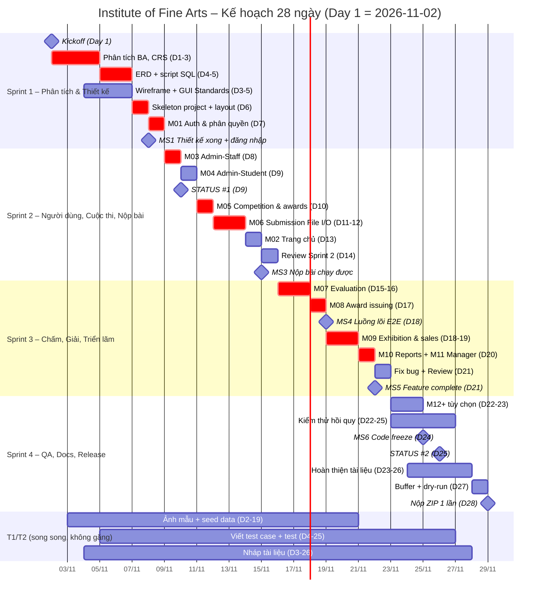

# Phần 3 – Kế hoạch tiến độ & Phân công công việc

**Dự án:** Institute of Fine Arts (Học viện Mỹ thuật) – eProject Aptech Học kỳ 3
**Vai trò soạn thảo:** Project Manager (PM) – kiêm nhiệm bởi BE (Tech Lead)
**Thời gian:** 4 tuần = 28 ngày (Day 1 = ngày Kickoff, Day 28 = ngày nộp bài cuối)
**Công nghệ:** .NET 10 · ASP.NET Core MVC (C#) · Entity Framework Core · SQL Server · Razor + Bootstrap 5 · File I/O lưu ảnh · GitHub

> Tài liệu này là **Project Plan + Task Sheet** của nhóm, đồng thời là nguồn để viết các mục "Kế hoạch dự án (Project Plan)", "Bảng phân công công việc (Task Sheet)" và "Báo cáo đánh giá và theo dõi dự án (Project Review and Monitoring Report)" trong bộ tài liệu nộp cuối.

---

## 0. Thành viên nhóm & vai trò

| Ký hiệu | Vai trò | Năng lực | Trách nhiệm chính |
|---|---|---|---|
| **BE** | Lead Backend Developer, Tech Lead, kiêm PM | Mạnh nhất nhóm | Kiến trúc, CSDL (ERD, script SQL), đăng nhập & phân quyền (Cookie Authentication), toàn bộ Service/Controller/EF Core, xử lý File I/O, code review & merge PR, chốt kỹ thuật, gửi email STATUS/DOUBT/SUBMISSION |
| **FE** | Frontend Developer | Khá | Wireframe (Figma/draw.io), GUI Standards, layout Razor (`_Layout.cshtml`, partial header/footer/sidebar), toàn bộ View, CSS/JS, validation phía client, responsive Bootstrap 5, chụp màn hình cho Interface Design Document |
| **T1** | Thành viên hỗ trợ (QA + Tài liệu) | Còn yếu | Viết test case, kiểm thử thủ công, ghi biên bản họp, điền form Báo cáo tiến độ, soạn nháp tài liệu (Problem Definition, Unit Testing Check List, Final Check List), chụp màn hình |
| **T2** | Thành viên hỗ trợ (Dữ liệu + Tài liệu) | Còn yếu | Thu thập/tạo ảnh mẫu JPEG + thơ/trích dẫn, nhập seed data (Excel → SQL INSERT), vẽ wireframe nháp trên giấy/draw.io, kiểm thử thủ công, soạn nháp User Guide, Task Sheet, GUI Standards (cùng FE) |

**Nguyên tắc phân công cho T1/T2:** luôn có việc mỗi ngày nhưng **không bao giờ nằm trên đường găng (critical path)** – nếu T1/T2 trễ thì dự án không bị dừng. Mọi việc của T1/T2 đều có "người kèm" (BE hoặc FE) để hỏi và để review.

---

## 1. Quy trình tổng thể (các giai đoạn)

```
Khởi động → Phân tích BA → Thiết kế (CSDL, wireframe UI, kiến trúc) → Phát triển theo sprint
→ Kiểm thử → Hoàn thiện tài liệu → Đóng gói & nộp bài (1 lần duy nhất) → Demo / bảo vệ
```

| # | Giai đoạn | Thời gian | Mục tiêu | Đầu ra chính |
|---|---|---|---|---|
| P1 | Khởi động (Kickoff) | Day 1 | Mọi người hiểu đề, thống nhất công cụ, vai trò, lịch họp | Biên bản Kickoff, repo GitHub, nhóm chat, bảng Kanban |
| P2 | Phân tích BA | Day 1–3 | Hiểu đúng & đủ yêu cầu; liệt kê chức năng theo 4 vai trò + Guest | Problem Definition, Customer Requirement Specification (CRS), danh sách User Story + tiêu chí chấp nhận, danh sách câu hỏi DOUBT |
| P3 | Thiết kế | Day 4–6 | Chốt CSDL, giao diện và khung kiến trúc trước khi code hàng loạt | ERD + script tạo bảng, wireframe tất cả màn hình, GUI Standards Document, sơ đồ kiến trúc/package |
| P4 | Phát triển theo sprint | Day 6–23 | Xây dựng M01→M11 theo thứ tự phụ thuộc, sau đó M12+ (tùy chọn) | Mã nguồn chạy được, mỗi module có test case |
| P5 | Kiểm thử | Liên tục từ Day 8; tập trung Day 21–26 | Phát hiện & sửa lỗi; kiểm thử hồi quy toàn hệ thống | Unit Testing Check List, bảng test case có kết quả Pass/Fail, danh sách bug |
| P6 | Tài liệu | Nháp liên tục; hoàn thiện Day 23–27 | Đủ 13 tài liệu theo đặc tả + User Guide | Bộ báo cáo dự án (Word/PDF) |
| P7 | Đóng gói & nộp | Day 27–28 | 1 file ZIP đầy đủ, nộp **một lần duy nhất** | `Batch_Group_ProjectTitle.zip`, email "PROJECT SUBMISSION:" + Phiếu phản hồi |
| P8 | Demo / bảo vệ | Sau Day 28 (theo lịch trung tâm) | Trình bày luồng nghiệp vụ, trả lời câu hỏi | Kịch bản demo, slide ngắn (nếu GV yêu cầu) |

### 1.1. Làm gì TRƯỚC và VÌ SAO (thứ tự phụ thuộc)

| Thứ tự | Việc | Vì sao phải làm trước |
|---|---|---|
| 1 | **Phân tích BA** (đọc kỹ đề, user story theo vai trò) | Hiểu sai đề là rủi ro lớn nhất – sửa ở giai đoạn này rẻ nhất. Ví dụ: đề ghi **Staff** quản lý cuộc thi/giải thưởng/triển lãm, **Manager** chỉ xem + quản lý triển lãm, **Admin** quản lý nhân viên & học viên. |
| 2 | **ERD + script SQL** | Mọi module đều đọc/ghi CSDL. Đổi bảng khi đã code nhiều là tốn kém nhất (sửa Entity, migration, Service, View). |
| 3 | **Skeleton project + M01 Auth** (đăng nhập, phân quyền 4 vai trò) | Tất cả màn hình đều cần biết "ai đang đăng nhập" và chặn quyền theo URL. Layout chung (header/menu theo vai trò) cũng phụ thuộc vào đây. |
| 4 | **M03, M04** (Admin quản lý Staff/Student) | Tạo ra người dùng thật để các module sau có dữ liệu (Staff chấm bài, Student nộp bài). |
| 5 | **Luồng lõi: M05 Competition → M06 Submission → M07 Evaluation → M08 Award** | Đây là "xương sống" của đề bài, phụ thuộc tuần tự: không có cuộc thi thì không nộp bài; không có bài thì không chấm; không chấm thì không trao giải. |
| 6 | **M02 Trang chủ** | Cần dữ liệu từ M05/M06/M08 (cuộc thi sắp/đang diễn ra, tổng số bài nộp, học viên đạt giải cuộc thi trước). |
| 7 | **M09 Exhibition & bán tranh** | Phụ thuộc M07 (chỉ gửi tranh đã xếp loại tốt đi triển lãm). |
| 8 | **M10 Báo cáo, M11 Manager xem** | Chỉ là truy vấn/hiển thị trên dữ liệu đã có → làm sau cùng trong phần bắt buộc. |
| 9 | **M12+ tùy chọn** (email, xuất PDF/Excel, biểu đồ, thumbnail, quên mật khẩu) | Chỉ làm khi phần bắt buộc đã đạt Definition of Done. Không bao giờ đánh đổi phần bắt buộc lấy phần "điểm cộng". |

---

## 2. Mô hình làm việc: Scrum-lite, 4 sprint × 1 tuần

### 2.1. Các sprint

| Sprint | Ngày | Mục tiêu sprint (Sprint Goal) | Module |
|---|---|---|---|
| **Sprint 1** | Day 1–7 | Hiểu đề, thiết kế xong, có project chạy được + đăng nhập phân quyền | Phân tích, ERD, wireframe, skeleton, **M01** |
| **Sprint 2** | Day 8–14 | Quản lý người dùng, cuộc thi, nộp bài (upload File I/O), trang chủ | **M03, M04, M05, M06, M02** |
| **Sprint 3** | Day 15–21 | Chấm bài, trao giải, triển lãm & bán tranh, báo cáo, màn hình Manager → **Feature complete** | **M07, M08, M09, M10, M11** |
| **Sprint 4** | Day 22–28 | Tùy chọn (nếu kịp), sửa lỗi, **code freeze Day 24**, kiểm thử hồi quy, tài liệu, đóng gói, nộp | **M12+**, QA, Docs, Release |

### 2.2. Nghi thức (ceremonies)

| Hoạt động | Khi nào | Thời lượng | Người chủ trì | Nội dung |
|---|---|---|---|---|
| **Daily stand-up** | Mỗi ngày 8h30 (hoặc 21h nếu học buổi tối) – họp online/nhóm chat | 15 phút | BE | Mỗi người trả lời 3 câu: *Hôm qua làm gì? Hôm nay làm gì? Có vướng gì không?* T1 ghi biên bản ngắn. |
| **Sprint Planning** | Đầu sprint: Day 1, 8, 15, 22 | 45–60 phút | BE | Chọn task từ Backlog vào cột "To Do" của sprint, ước lượng (S/M/L), gán người. |
| **Sprint Review (demo nội bộ)** | Cuối sprint: Day 7, 14, 21, 27 | 30–45 phút | BE + FE demo | Demo chức năng đã xong trên nhánh `develop`, T1/T2 chạy thử theo test case. |
| **Retrospective** | Ngay sau Review | 15 phút | T1 ghi | 3 câu: *Điều gì tốt? Điều gì chưa tốt? Tuần sau thay đổi gì?* |
| **Code review** | Mỗi Pull Request | ≤ 24h | BE (review FE), FE (review phần View của BE) | Không merge PR nếu chưa được review. |

### 2.3. Bảng Kanban trên GitHub Projects

Cột: `Backlog` → `Ready` → `In Progress` → `In Review (PR)` → `Testing` → `Done`

- Mỗi thẻ (Issue) đặt tên theo mẫu: `[M06] Student upload tranh JPEG` ; nhãn (label): `backend`, `frontend`, `test`, `docs`, `data`, `bug`, `optional`, `priority:high`.
- Giới hạn WIP: mỗi người **tối đa 2 thẻ** ở cột In Progress.
- T1 cập nhật cột `Testing` → `Done` (hoặc mở Issue `bug` mới) sau khi chạy test case.

### 2.4. Definition of Ready (DoR) – thẻ đủ điều kiện để bắt đầu làm

- [ ] Có mô tả user story: "Là <vai trò>, tôi muốn <chức năng> để <mục đích>".
- [ ] Có tiêu chí chấp nhận (acceptance criteria) rõ ràng, có thể kiểm thử.
- [ ] Bảng/cột CSDL liên quan đã có trong ERD đã chốt.
- [ ] Có wireframe màn hình (với thẻ có giao diện).
- [ ] Các thẻ phụ thuộc đã Done (ví dụ M07 cần M06 Done).
- [ ] Đã gán người phụ trách và ước lượng (S ≤ 0,5 ngày, M ≤ 1 ngày, L ≤ 2 ngày; lớn hơn phải tách nhỏ).

### 2.5. Definition of Done (DoD) – thẻ được coi là hoàn thành

- [ ] Code chạy được bằng `dotnet run` (hoặc F5), không lỗi biên dịch, không lỗi console khi dùng chức năng.
- [ ] **Mọi khối mã đều có chú thích (comment)** – yêu cầu bắt buộc của đặc tả.
- [ ] Phân quyền đúng: vai trò khác truy cập URL sẽ bị chặn (403/redirect).
- [ ] Validation phía server (Bean Validation) + thông báo lỗi tiếng Việt/Anh thống nhất theo GUI Standards.
- [ ] PR đã được review và merge vào `develop`.
- [ ] T1/T2 đã chạy test case của thẻ → Pass; bug (nếu có) đã sửa hoặc ghi nhận.
- [ ] Đã có ảnh chụp màn hình lưu vào `docs/screenshots/<module>/`.
- [ ] Script SQL / seed data đã cập nhật nếu đổi CSDL.

---

## 3. Lịch chi tiết theo ngày (Day 1 – Day 28)

Ký hiệu: **BE**, **FE**, **T1**, **T2**. Việc **in đậm** nằm trên đường găng (critical path).

### Sprint 1 – Phân tích, Thiết kế, Nền tảng (Day 1–7)

| Ngày | Công việc | Người phụ trách | Đầu ra (deliverable) | Phụ thuộc |
|---|---|---|---|---|
| Day 1 | **Kickoff**: đọc đề + đặc tả, thống nhất vai trò, công cụ, giờ stand-up; tạo repo GitHub, GitHub Projects, nhóm chat | BE (chủ trì), cả nhóm | Biên bản kickoff (T1), repo + Kanban (BE), nhóm chat (T2) | – |
| Day 1 | Cài môi trường: .NET SDK 10, Visual Studio Community/VS Code, `dotnet-ef`, SQL Server + SSMS, Git; clone repo thử | Cả nhóm (BE hỗ trợ T1/T2) | Ảnh chụp mỗi máy chạy `dotnet --version`, `git --version` | – |
| Day 2 | **Phân tích BA**: liệt kê chức năng theo vai trò Admin/Manager/Staff/Student/Guest, vẽ Use Case | BE + FE | Danh sách chức năng, sơ đồ Use Case (draw.io) | Day 1 |
| Day 2 | Lập bảng thuật ngữ (Competition, Submission, Rating…), gom câu hỏi chưa rõ | T1 | Glossary, danh sách câu hỏi DOUBT | Day 1 |
| Day 2 | Tìm/tạo 40–60 ảnh mẫu JPEG (tranh tự vẽ, ảnh bản quyền tự do) + thơ/trích dẫn đi kèm | T2 | Thư mục `database/seed-images/` + `CREDITS.txt` + file Excel mô tả | – |
| Day 3 | **Chốt CRS**: user story + acceptance criteria cho M01–M11; phân loại Must/Should/Could (M12+ = Could) | BE | Customer Requirement Specification (nháp 1), Backlog trên GitHub | Day 2 |
| Day 3 | Gửi email **"DOUBT:"** nếu còn điểm chưa rõ (ví dụ: ai được quản lý triển lãm) | BE | Email DOUBT (nếu cần) | Day 2 |
| Day 3 | Soạn nháp Problem Definition (dựa trên phần Hiện trạng/Giải pháp của đề) | T1 (FE review) | `docs/documentation/03_ProblemDefinition.docx` nháp | Day 2 |
| Day 3 | Liệt kê danh sách màn hình theo vai trò, phác thảo wireframe trên giấy | FE + T2 | Danh sách ~30 màn hình, ảnh chụp phác thảo | Day 2 |
| Day 4 | **Thiết kế ERD** (User/Role, Staff, Student, Competition, Award, Submission, Evaluation, AwardIssued, Exhibition, ExhibitionEntry, Customer) | BE | ERD v1 (draw.io) | Day 3 |
| Day 4 | Wireframe chi tiết trên Figma/draw.io: Home, Login, layout Admin/Staff/Student | FE | Wireframe v1 | Day 3 |
| Day 4 | Soạn nháp GUI Standards (màu, font, nút, thông báo, định dạng ngày dd/MM/yyyy, tiền VNĐ) | T2 (FE kèm) | GUI Standards Document nháp | Day 3 |
| Day 4 | Viết mẫu Test Case (template Excel: ID, module, bước, dữ liệu, kết quả mong đợi, thực tế, Pass/Fail) | T1 (BE kèm) | `docs/testing/TestCases_FineArts.xlsx` | Day 3 |
| Day 5 | **Chốt ERD v2 + script SQL** (bảng, khóa, ràng buộc, CHECK cho rating) | BE | `database/01_schema.sql`, ERD final | Day 4 |
| Day 5 | Wireframe các màn hình còn lại (Submission, Evaluation, Exhibition, Reports, Manager) | FE | Wireframe v2 (đủ màn hình) | Day 4 |
| Day 5 | Nhập dữ liệu mẫu vào Excel theo cấu trúc bảng (5 staff, 20 student, 4 cuộc thi quá khứ/đang/sắp diễn ra) | T2 (BE kèm) | `database/seed_data.xlsx` | Day 5 (sau khi chốt bảng) |
| Day 5 | Viết test case M01 (đăng nhập, sai mật khẩu, truy cập trái quyền) | T1 | Test case M01 | Day 3 |
| Day 6 | **Tạo skeleton ASP.NET Core MVC**: solution, 4 Area, thư mục `Services/Data/Models/ViewModels`, kết nối SQL Server, 11 Entity + `AppDbContext`, migration `InitialCreate` | BE | Project chạy được, push `develop` | Day 5 |
| Day 6 | Layout Razor: `_Layout.cshtml`, partial header/footer/sidebar theo vai trò, trang lỗi 403/404 | FE | `Views/Shared/*`, CSS chung | Day 6 (skeleton) |
| Day 6 | Đưa dữ liệu mẫu từ Excel vào `Data/Seed/DbSeeder.cs` (C#, mật khẩu băm BCrypt) | T2 (BE review) | `Data/Seed/DbSeeder.cs` | Day 5 |
| Day 6 | Soạn nháp Project Plan (lấy từ tài liệu này) + Task Sheet tuần 1 | T1 | Project Plan nháp, Task Sheet | – |
| Day 7 | **M01 Auth**: Cookie Authentication, BCrypt, đăng nhập/đăng xuất, phân quyền URL theo 4 vai trò, đổi mật khẩu | BE | M01 Done, tài khoản mẫu cho 4 vai trò | Day 6 |
| Day 7 | Trang Login + menu động theo vai trò | FE | `login.html`, menu | Day 6 |
| Day 7 | Chạy test case M01, chụp màn hình | T1 + T2 | Kết quả test M01, screenshots | M01 |
| Day 7 | **Sprint 1 Review + Retro**; T1 soạn nháp nội dung Status Report #1 | Cả nhóm | Biên bản review, **Mốc MS1** | – |

### Sprint 2 – Người dùng, Cuộc thi, Nộp bài, Trang chủ (Day 8–14)

| Ngày | Công việc | Người phụ trách | Đầu ra (deliverable) | Phụ thuộc |
|---|---|---|---|---|
| Day 8 | Sprint 2 Planning | BE | Sprint backlog | MS1 |
| Day 8 | **M03 Admin – quản lý Staff** (thêm/sửa/xóa/tìm kiếm, thông tin đăng nhập, cá nhân, công việc: ngày vào làm, lớp, môn, ghi chú) | BE (service/controller), FE (View list/form) | M03 Done | M01 |
| Day 8 | Viết test case M03, M04 | T1 | Test case M03/M04 | CRS |
| Day 8 | Chuẩn bị bộ ảnh test upload: ảnh hợp lệ, ảnh > dung lượng, file .png/.exe đổi đuôi, tên file tiếng Việt có dấu | T2 | `database/seed-images/test-upload/` | – |
| Day 9 | **M04 Admin – quản lý Student** (thông tin đăng nhập, cá nhân, nhập học) | BE + FE | M04 Done | M01 |
| Day 9 | Gom file đính kèm Status #1: source zip, script SQL, screenshots; điền form "Báo cáo tiến độ" phần lần 1 | T1 + T2 (BE duyệt) | Thư mục `status/STATUS_1/` | MS1 |
| Day 9 | **Gửi email STATUS #1** (cuối ngày) | BE | Email "STATUS: …" + ZIP | **Mốc MS2** |
| Day 10 | **M05 Competition & awards** (Staff CRUD cuộc thi: ngày bắt đầu/kết thúc, thể lệ, danh sách giải thưởng dự kiến) | BE + FE | M05 Done | M03 |
| Day 10 | Test M03/M04; nhập seed cuộc thi bằng giao diện để thử | T1 + T2 | Kết quả test, bug Issues | M03, M04 |
| Day 11 | **M06 Submission – upload JPEG bằng File I/O** (kiểm tra định dạng/kích thước, đặt tên file Guid, lưu thư mục `uploads/`, lưu đường dẫn DB, kèm thơ/trích dẫn/mô tả) | BE | Upload chạy được | M05 |
| Day 11 | Form nộp bài + xem trước ảnh (JS preview), trang "Bài của tôi" | FE | View M06 | M05 |
| Day 11 | Viết test case M05, M06 (biên: đúng ngày kết thúc, sau ngày kết thúc) | T1 | Test case M05/M06 | CRS |
| Day 12 | **M06 tiếp**: sửa/thay ảnh, xóa bài (chỉ khi chưa quá ngày kết thúc), download ảnh, tìm kiếm bài của tôi | BE + FE | M06 Done | Day 11 |
| Day 12 | Test upload với bộ ảnh test, ghi bug | T2 (T1 hỗ trợ) | Kết quả test M06 | Day 11 |
| Day 13 | **M02 Trang chủ (Guest)**: cuộc thi sắp/đang diễn ra, học viên đạt giải cuộc thi trước, tổng số bài nộp cuộc thi đang diễn ra | BE (query) + FE (giao diện) | M02 Done | M05, M06 |
| Day 13 | Sửa bug M03–M06 | BE + FE | Bug đóng | Bug list |
| Day 13 | Soạn nháp Interface Design Document (mỗi màn hình: ảnh + mô tả trường + nút) cho M01–M06 | T1 + T2 | Interface Design Document nháp | Screenshots |
| Day 14 | **Sprint 2 Review + Retro**: demo luồng Admin tạo Staff/Student → Staff tạo cuộc thi → Student nộp bài | Cả nhóm | Biên bản, **Mốc MS3** | – |
| Day 14 | Backup DB `.bak` tuần + tag `v0.2` | BE | `backup/IFA_day14.bak` | – |

### Sprint 3 – Chấm bài, Giải thưởng, Triển lãm, Báo cáo (Day 15–21)

| Ngày | Công việc | Người phụ trách | Đầu ra (deliverable) | Phụ thuộc |
|---|---|---|---|---|
| Day 15 | Sprint 3 Planning | BE | Sprint backlog | MS3 |
| Day 15 | **M07 Evaluation**: Staff xem danh sách bài theo cuộc thi, chấm BEST/BETTER/GOOD/MODERATE/NORMAL; tự động DISQUALIFIED nếu ngày nộp > ngày kết thúc; nhận xét điểm mạnh/điểm yếu/cần cải thiện | BE | Service chấm bài | M06 |
| Day 15 | Màn hình chấm bài (ảnh lớn + thơ + form xếp loại) | FE | View M07 | M06 |
| Day 15 | Viết test case M07, M08 | T1 | Test case | CRS |
| Day 15 | Bổ sung seed: bài nộp mẫu cho cuộc thi đã kết thúc (dùng ảnh T2 đã gom) | T2 | `02_seed_data.sql` cập nhật | M06 |
| Day 16 | **M07 tiếp**: Student xem xếp loại + nhận xét bài của mình; xem tất cả bài BEST kèm nhận xét; Staff tìm kiếm bài theo xếp loại | BE + FE | M07 Done | Day 15 |
| Day 16 | Test M07 (kể cả bài nộp trễ) | T1 + T2 | Kết quả test | Day 15 |
| Day 17 | **M08 Award issuing**: Staff trao giải (học viên – cuộc thi – giải – nhận xét cuộc thi), Student/Guest xem giải theo cuộc thi | BE + FE | M08 Done | M07 |
| Day 17 | Soạn nháp tài liệu Algorithms (mô tả bằng lời + pseudo-code: đăng nhập, upload, kiểm tra hạn nộp, chấm bài) – BE cung cấp ý chính | T1 (BE review) | Algorithms nháp | M06, M07 |
| Day 18 | **M09 Exhibition**: Staff/Manager CRUD triển lãm; Staff gửi tranh đã xếp loại tốt (ExhibitionEntry) với giá học viên đề xuất | BE + FE | Phần 1 M09 | M07 |
| Day 18 | Kiểm thử end-to-end luồng lõi Competition→Submission→Evaluation→Award | T1 + T2 | Báo cáo E2E, **Mốc MS4** | M05–M08 |
| Day 19 | **M09 Sales**: trạng thái đã bán/chưa bán, giá bán thực tế, Customer mua tranh, đã trả tiền cho học viên chưa; Student xem tranh của mình ở triển lãm | BE + FE | M09 Done | Day 18 |
| Day 19 | Viết test case M09–M11 | T1 | Test case | CRS |
| Day 19 | Nhập seed triển lãm + khách hàng | T2 | Seed cập nhật | M09 |
| Day 20 | **M10 Reports**: bài nộp trong khoảng thời gian cho 1 cuộc thi theo xếp loại; thống kê giải, doanh thu bán tranh | BE (query) + FE (bảng/bộ lọc) | M10 Done | M07–M09 |
| Day 20 | **M11 Manager**: các màn hình chỉ xem (student, staff, cuộc thi, giải, bài đăng, xếp loại, tranh triển lãm) + quản lý triển lãm | FE (View), BE (controller chỉ xem) | M11 Done | M03–M09 |
| Day 21 | Sửa bug Sprint 3; test M09–M11 | BE + FE; T1 + T2 test | Bug list đã xử lý | – |
| Day 21 | **Sprint 3 Review + Retro → FEATURE COMPLETE (M01–M11)** | Cả nhóm | Biên bản, tag `v0.9`, **Mốc MS5** | – |

### Sprint 4 – Tùy chọn, Đóng băng mã, Kiểm thử, Tài liệu, Nộp bài (Day 22–28)

| Ngày | Công việc | Người phụ trách | Đầu ra (deliverable) | Phụ thuộc |
|---|---|---|---|---|
| Day 22 | Sprint 4 Planning; quyết định làm M12+ nào (chỉ khi MS5 đạt) – ưu tiên: thumbnail, xuất Excel/PDF báo cáo, biểu đồ dashboard, quên mật khẩu, email thông báo | BE | Danh sách M12 được chọn | MS5 |
| Day 22 | Làm M12 (tối đa 2 tính năng) | BE + FE | M12 (nếu kịp) | MS5 |
| Day 22 | **Kiểm thử hồi quy toàn bộ** theo test case (vòng 1) | T1 + T2 | Kết quả vòng 1, bug Issues | MS5 |
| Day 23 | Sửa bug vòng 1; hoàn thiện M12; rà comment trong code | BE + FE | Bug đóng | Day 22 |
| Day 23 | Hoàn thiện ERD final, Algorithms (BE); GUI Standards + Interface Design Document (FE + T2) | BE, FE, T2 | Tài liệu bản 1 | – |
| Day 24 | **CODE FREEZE 18:00** – merge `develop` → `main`, tag `v1.0-rc`; sau giờ này chỉ sửa bug mức Blocker/Critical | BE | Tag `v1.0-rc`, **Mốc MS6** | Day 23 |
| Day 24 | Kiểm thử hồi quy vòng 2 trên bản `v1.0-rc`; chụp lại toàn bộ màn hình bản cuối | T1 + T2 | Unit Testing Check List hoàn chỉnh, screenshots final | MS6 |
| Day 25 | Gom file Status #2; điền form "Báo cáo tiến độ" phần lần 2 (cuối cùng) | T1 (BE duyệt) | `status/STATUS_2/` | MS6 |
| Day 25 | **Gửi email STATUS #2** (3 ngày trước kết thúc) | BE | Email "STATUS: …" + ZIP, **Mốc MS7** | Day 25 |
| Day 25 | Viết User Guide (cài đặt, cấu hình DB, chạy ứng dụng, **tài khoản đăng nhập 4 vai trò**, hướng dẫn từng chức năng) | T2 (BE cung cấp phần cài đặt) | User Guide | MS6 |
| Day 26 | **Ghép bộ tài liệu đầy đủ** (13 mục) + Mục lục tự động + Certificate of Completion; Project Review and Monitoring Report (tổng hợp biên bản sprint) | T1 (ghép), BE (review kỹ thuật), FE (định dạng) | Báo cáo dự án bản final | Day 23–25 |
| Day 26 | Backup DB `.bak` final + script `01_schema.sql`, `02_seed_data.sql` final | BE | `database/` final | MS6 |
| Day 27 | **BUFFER** – xử lý việc trễ; **chạy thử gói nộp trên máy sạch** (máy của T1: giải nén → restore DB → chạy app → đăng nhập 4 vai trò) | Cả nhóm | Biên bản dry-run, **Mốc MS8** | Day 26 |
| Day 27 | Sprint 4 Review + Retro; tập dượt demo (kịch bản 10–15 phút) | Cả nhóm | Kịch bản demo | – |
| Day 28 | Final Check List (mục 10) → đóng gói ZIP → điền Phiếu phản hồi → **gửi "PROJECT SUBMISSION:" (1 lần duy nhất)** | BE gửi; T1 đọc checklist; FE + T2 kiểm tra chéo | ZIP đã nộp, **Mốc MS9** | MS8 |
| Sau Day 28 | Demo / bảo vệ theo lịch trung tâm | Cả nhóm (mỗi người trình bày phần mình) | – | MS9 |

### 3.1. Biểu đồ Gantt (Mermaid)

> Ngày lịch chỉ để minh họa: giả định Day 1 = 02/11/2026. Khi biết ngày kickoff thật, chỉ cần đổi dòng `Kickoff` – các mốc tính theo Day N vẫn giữ nguyên.



---

## 4. Phân công chi tiết theo người, theo tuần

### 4.1. Bảng task theo tuần

| Người | Tuần 1 (Day 1–7) | Tuần 2 (Day 8–14) | Tuần 3 (Day 15–21) | Tuần 4 (Day 22–28) |
|---|---|---|---|---|
| **BE** | Chủ trì kickoff; phân tích BA, CRS; ERD + `01_schema.sql`; skeleton ASP.NET Core MVC, Entity/AppDbContext; **M01** đăng nhập & phân quyền; tạo repo, Kanban, branch rule | **M03, M04, M05, M06** (service, controller, File I/O), query **M02**; review PR của FE; **gửi STATUS #1** | **M07, M08, M09, M10**, controller read-only **M11**; review PR; viết ý chính Algorithms | M12 (chọn lọc); sửa bug; **code freeze Day 24**; DB backup final; review tài liệu kỹ thuật; **gửi STATUS #2**, **gửi bài nộp** |
| **FE** | Use case cùng BE; danh sách màn hình; wireframe Figma/draw.io đủ màn hình; duyệt GUI Standards; `_Layout.cshtml` + partial; trang Login + menu theo vai trò | View M03, M04, M05, M06 (form, bảng, phân trang, tìm kiếm, JS preview ảnh), Trang chủ M02; review phần template trong PR của BE | Template M07 (màn hình chấm), M08, M09, M10 (bộ lọc báo cáo), **M11** (toàn bộ màn hình Manager); responsive | Giao diện M12 (biểu đồ, nút export); chỉnh UI theo bug; Interface Design Document (bản final cùng T2); định dạng bộ tài liệu; kịch bản demo |
| **T1** | Biên bản kickoff + các stand-up; glossary; câu hỏi DOUBT; nháp Problem Definition; template Test Case; test case M01; nháp Project Plan + Task Sheet; test M01; nháp nội dung Status #1 | Điền form Báo cáo tiến độ lần 1; test case M03–M06; test M03, M04; hỗ trợ T2 test upload; nháp Interface Design Document (M01–M06) | Test case M07–M11; test M07; **test E2E Day 18**; nháp Algorithms (theo ý BE); cập nhật Project Review and Monitoring Report (tổng hợp biên bản) | Hồi quy vòng 1 & 2; Unit Testing Check List; điền form lần 2; **ghép bộ tài liệu 13 mục** + Mục lục; đọc Final Check List Day 28 |
| **T2** | Thiết lập nhóm chat; gom 40–60 ảnh mẫu + thơ/trích dẫn; phác thảo wireframe giấy; nháp GUI Standards; seed data Excel → `02_seed_data.sql` | Bộ ảnh test upload (hợp lệ/không hợp lệ); gom file Status #1 (zip source, SQL, screenshots); test M06 upload; nhập cuộc thi thử qua UI; nháp Interface Design Document | Seed bài nộp, triển lãm, khách hàng; test M07, M09; chụp màn hình theo module | Hồi quy cùng T1; chụp màn hình bản final; **User Guide** (kèm tài khoản đăng nhập); dry-run trên máy sạch Day 27; kiểm tra chéo ZIP |

### 4.2. Ma trận RACI theo hạng mục

R = Thực hiện (Responsible) · A = Chịu trách nhiệm cuối (Accountable) · C = Được tham vấn (Consulted) · I = Được thông báo (Informed)

| Hạng mục | BE | FE | T1 | T2 |
|---|---|---|---|---|
| Phân tích yêu cầu, CRS | A/R | R | C | I |
| Problem Definition | A | C | R | I |
| ERD, script schema SQL | A/R | C | I | I |
| Seed data (`02_seed_data.sql`) | A | I | C | R |
| Ảnh mẫu JPEG + thơ/trích dẫn | I | C | I | A/R |
| Wireframe, GUI Standards | C | A/R | I | R (nháp) |
| Kiến trúc, đăng nhập & phân quyền (M01) | A/R | C | I | I |
| Backend M02–M11 | A/R | C | I | I |
| Razor View, CSS/JS | C | A/R | I | I |
| M12+ tùy chọn | A/R | R | I | I |
| Code review & merge PR | A/R | R | I | I |
| Test case & kiểm thử thủ công | C | C | A/R | R |
| Unit Testing Check List | C | C | A/R | R |
| Algorithms | A | I | R (nháp) | I |
| Interface Design Document | C | A | R | R |
| User Guide (kèm tài khoản) | C | C | I | A/R |
| Biên bản họp, Project Review & Monitoring Report | A | I | R | C |
| Form Báo cáo tiến độ, email STATUS | A/R (gửi) | I | R (soạn) | R (gom file) |
| Backup code + DB | A/R | R (push) | R (push) | R (push) |
| Đóng gói ZIP + nộp bài | A/R | C | R (checklist) | R (kiểm tra chéo) |

### 4.3. Mẹo kèm cặp thành viên yếu (pair learning)

| Cặp | Hình thức | Mục tiêu học |
|---|---|---|
| **T1 ↔ BE** | 30 phút/ngày sau stand-up (Day 2–21): BE giải thích luồng một module, T1 viết test case ngay trên luồng đó | Hiểu nghiệp vụ, đọc được Controller/Service, viết test case đúng biên |
| **T2 ↔ BE** | Day 5–6: cùng chuyển Excel → SQL INSERT; Day 15: cùng viết seed bài nộp | Viết SQL cơ bản, hiểu khóa ngoại |
| **T2 ↔ FE** | Day 4, 13: cùng làm GUI Standards & Interface Design; Day 20: FE cho T2 sửa thử 1 View đơn giản (ví dụ trang "Giới thiệu", footer) | Razor/Bootstrap cơ bản |
| **T1 ↔ FE** | Day 13, 24: chụp màn hình & mô tả từng trường form | Hiểu giao diện, viết tài liệu |

- Giao việc cho T1/T2 bằng **checklist cụ thể từng bước** (ví dụ: "Mở trang /student/submissions, upload file `test_5MB.jpg`, ghi kết quả vào dòng TC-M06-07").
- Mỗi người yếu được giao **1 commit nhỏ/tuần** (file SQL, tài liệu `.md`, ảnh) để quen quy trình Git + PR.
- Không phê bình trước nhóm; góp ý trong PR bằng câu hỏi gợi mở. Ghi nhận đóng góp của T1/T2 trong Task Sheet để công bằng khi chấm.
- Khi bị kẹt quá **30 phút** → hỏi ngay trong nhóm chat (quy tắc "30 phút").

---

## 5. Mốc quan trọng (Milestones) & tiêu chí hoàn thành

| Mốc | Ngày | Tên | Tiêu chí hoàn thành (phải đạt tất cả) |
|---|---|---|---|
| MS0 | Day 1 | Kickoff | Repo GitHub, Kanban, nhóm chat đã tạo; mọi máy cài xong môi trường |
| MS1 | Day 7 | Thiết kế xong + Nền tảng | CRS đã chốt; ERD final + `01_schema.sql` chạy được; wireframe đủ màn hình; project chạy; **M01 đăng nhập đúng 4 vai trò** |
| MS2 | Day 9 | **STATUS #1 đã gửi** | Email "STATUS:" + ZIP (source, SQL, screenshots) + form Báo cáo tiến độ lần 1 |
| MS3 | Day 14 | Nộp bài chạy được | M02–M06 Done: Admin tạo Staff/Student; Staff tạo cuộc thi; Student upload/sửa/xóa/tải ảnh qua File I/O; trang chủ hiển thị số liệu |
| MS4 | Day 18 | Luồng lõi E2E | Competition → Submission → Evaluation (kể cả DISQUALIFIED tự động) → Award chạy trọn vẹn, test E2E Pass |
| MS5 | Day 21 | **Feature complete** | M01–M11 đạt DoD; không còn bug Blocker; tag `v0.9` |
| MS6 | Day 24 | **Code freeze** (18:00) | `main` = `v1.0-rc`; mọi khối mã có comment; chỉ còn sửa bug Blocker/Critical |
| MS7 | Day 25 | **STATUS #2 đã gửi** | Email "STATUS:" + ZIP bản `v1.0-rc` + form Báo cáo tiến độ lần 2 (cuối cùng) |
| MS8 | Day 27 | Sẵn sàng phát hành | Bộ tài liệu 13 mục + User Guide hoàn chỉnh; DB `.bak` final; dry-run trên máy sạch thành công |
| MS9 | Day 28 | **Nộp bài cuối (1 lần)** | Final Check List 100%; email "PROJECT SUBMISSION:" + ZIP + Phiếu phản hồi |

**Ngày dự phòng (buffer):** Day 27 (buffer chính thức) + nửa cuối Day 21 và Day 23. Nếu Sprint 3 trễ, **cắt M12+ trước tiên**, sau đó lùi M10/M11 sang Day 22–23 — **không bao giờ dời Code freeze quá Day 25 và không dời ngày nộp**.

---

## 6. Kế hoạch 2 lần báo cáo tiến độ (Status Report)

Theo đặc tả: dự án < 30 ngày → **email 1 trong khoảng Day 7–10**, **email 2 trước ngày kết thúc 3 ngày**. Nhóm chọn:

| | STATUS #1 | STATUS #2 (cuối cùng) |
|---|---|---|
| **Ngày gửi** | **Day 9** (dư 1 ngày dự phòng trước hạn Day 10) | **Day 25** (Day 28 − 3) |
| **Người soạn / gửi** | T1 soạn, T2 gom file, BE duyệt & gửi | T1 soạn, T2 gom file, BE duyệt & gửi |
| **Tiến độ tổng thể** | ~35%: Phân tích + thiết kế xong; M01 Done; M03, M04 đang làm | ~95%: M01–M11 Done (+ M12 nếu có); code freeze; đang hoàn thiện tài liệu |
| **Việc đã xong** | CRS, ERD, script SQL, wireframe, GUI Standards nháp, skeleton, M01 | Toàn bộ module bắt buộc, kiểm thử hồi quy vòng 2, ERD/Algorithms/Interface Design bản final |
| **Việc tiếp theo** | M05, M06, M02, luồng chấm bài | User Guide, ghép tài liệu, DB backup, dry-run, nộp Day 28 |
| **Khó khăn (nếu có)** | Ví dụ: cấu hình SQL Server/chuỗi kết nối, chưa rõ quyền quản lý triển lãm | Ví dụ: tối ưu hiển thị ảnh lớn, thời gian viết tài liệu |
| **File đính kèm (ZIP)** | `src` (zip mã nguồn, không gồm `bin/`, `obj/`), `database/01_schema.sql`, `02_seed_data.sql`, ERD (PNG), 5–8 screenshots (Login, menu 4 vai trò, Admin CRUD), wireframe PDF, form Báo cáo tiến độ đã điền | `src` bản `v1.0-rc`, script SQL final, screenshots tất cả module, bản nháp tài liệu, form Báo cáo tiến độ đã điền phần lần 2 |
| **Tên ZIP** | `Batch_Group_InstituteOfFineArts_STATUS1.zip` | `Batch_Group_InstituteOfFineArts_STATUS2.zip` |

### 6.1. Mẫu email STATUS

```
Tiêu đề: STATUS: [Batch_Group] Institute of Fine Arts – Báo cáo tiến độ lần 1 (Day 9)

Kính gửi Nhóm eProjects,

Nhóm [Group] – khóa [Batch] xin gửi báo cáo tiến độ lần 1 của eProject "Institute of Fine Arts".
- Thời gian dự án: [dd/MMM/yyyy] – [dd/MMM/yyyy] (28 ngày)
- Tiến độ tổng thể: khoảng 35%

1. Công việc đã hoàn thành:
   - Phân tích yêu cầu, Đặc tả yêu cầu khách hàng (CRS)
   - Sơ đồ ERD và script tạo CSDL SQL Server
   - Wireframe các màn hình, GUI Standards (bản nháp)
   - Khung dự án ASP.NET Core MVC (.NET 10), chức năng đăng nhập & phân quyền 4 vai trò (Admin, Manager, Staff, Student)
2. Công việc đang thực hiện: Quản lý nhân viên, học viên (Admin)
3. Kế hoạch tiếp theo: Quản lý cuộc thi, nộp bài (upload ảnh bằng File I/O), trang chủ
4. Khó khăn / thắc mắc: [ghi rõ hoặc "Không có"]

File đính kèm: Batch_Group_InstituteOfFineArts_STATUS1.zip
(mã nguồn, script CSDL, ảnh chụp màn hình, ERD, form Báo cáo tiến độ)

Trân trọng,
[Họ tên BE] – Trưởng nhóm, thay mặt nhóm: [BE], [FE], [T1], [T2]
```

STATUS #2 dùng cùng mẫu, đổi "lần 2 (cuối cùng) (Day 25)", tiến độ ~95%, liệt kê module M01–M11 đã xong.

### 6.2. Điền form "Bao cao tien do eProject (V1).xls"

| Nhóm ô trong form | Nội dung điền |
|---|---|
| Thông tin học viên | Họ và tên, Mã số học viên, Chương trình học, Học kỳ (Sem 3), Tên trung tâm – điền cho trưởng nhóm, ghi tên các thành viên vào Ghi chú |
| Thông tin eProject | Tên eProject: Institute of Fine Arts; Thời gian thực hiện: 28 ngày; Ngày bắt đầu/kết thúc theo định dạng **DD/MMM/YYYY** (ví dụ 02/Nov/2026) |
| Báo cáo tiến độ lần 1 | Ngày gửi (Day 9); Ảnh chụp màn hình (tên các file đính kèm); Mô tả / Tài liệu đánh giá (tóm tắt mục 6 ở trên); Ghi chú (khó khăn) |
| Báo cáo tiến độ lần 2 (cuối cùng) | Tương tự, điền ở Day 25 (giữ nguyên phần lần 1) |
| Nhận xét của học viên | Điền khi nộp bài cuối: góp ý của nhóm eProjects đã giúp gì; Phản hồi/Ghi chú |

> Lưu cùng một file form, cập nhật dần qua 2 lần, và đính kèm bản đã điền đủ vào ZIP nộp cuối cùng.

---

## 7. Quản lý rủi ro

Thang đo: Xác suất (Thấp/TB/Cao) × Ảnh hưởng (Thấp/TB/Cao).

| # | Rủi ro | Xác suất | Ảnh hưởng | Biện pháp phòng ngừa | Phương án khi xảy ra | Người theo dõi |
|---|---|---|---|---|---|---|
| R1 | **Thành viên yếu (T1/T2) không hoàn thành việc** | Cao | Thấp–TB | Không giao việc trên đường găng; checklist từng bước; kèm cặp hằng ngày; việc chia nhỏ ≤ 0,5 ngày | BE/FE nhận lại phần quan trọng; T1/T2 chuyển sang việc đơn giản hơn (chụp màn hình, nhập dữ liệu) | BE |
| R2 | **Trễ tiến độ** (đặc biệt M06, M07, M09) | TB | Cao | Làm theo thứ tự phụ thuộc; Kanban + stand-up phát hiện sớm; buffer Day 27; M12+ là "Could" | Cắt M12+; giảm phạm vi M10 (giữ 1 báo cáo bắt buộc); làm thêm giờ cuối tuần; không dời code freeze quá Day 25 | BE |
| R3 | **Mất dữ liệu / hỏng máy / virus** | TB | Cao | Push code **mỗi ngày**; backup DB `.bak` hằng ngày lên Google Drive nhóm; script SQL nằm trong repo | Clone lại từ GitHub; restore `.bak` gần nhất hoặc chạy `01_schema.sql` + `02_seed_data.sql` | BE (DB), mỗi người (code) |
| R4 | **Xung đột Git (merge conflict)** | Cao | TB | Mỗi người 1 nhánh feature; pull `develop` mỗi sáng; chia file rõ ràng (BE: C# – Services/Data/Controllers, FE: Views/wwwroot); chỉ BE tạo migration; PR nhỏ | BE giải quyết conflict cùng người liên quan; không bao giờ `push --force` lên `develop/main` | BE |
| R5 | **Lỗi upload file** (đường dẫn Windows, file lớn, sai định dạng, tên tiếng Việt, mất ảnh khi đổi máy) | Cao | Cao | Đặt tên file bằng Guid; cấu hình `Upload:RootPath` trong `appsettings.json`; giới hạn `[RequestSizeLimit]` + `Upload:MaxFileSizeBytes`; kiểm tra MIME + phần mở rộng JPEG; bộ ảnh test của T2 | Ghi lỗi chi tiết; thư mục `uploads/` mẫu được đóng gói trong ZIP cùng seed | BE, T2 |
| R6 | **Hiểu sai đề** (ví dụ: ai quản lý cuộc thi/triển lãm; điều kiện DISQUALIFIED; Student sửa bài sau hạn) | TB | Cao | Bảng đối chiếu yêu cầu ↔ module (CRS) được cả nhóm duyệt Day 3; gửi **DOUBT:** sớm | Điều chỉnh trong sprint kế tiếp; ghi giả định (assumption) vào tài liệu | BE |
| R7 | Môi trường không đồng nhất (khác phiên bản .NET SDK, SQL Server, cổng, collation) | TB | TB | Cùng .NET SDK 10 (file `global.json` cố định phiên bản); chuỗi kết nối Windows Authentication, khác biệt riêng từng máy để trong User Secrets; hướng dẫn cài trong README | BE hỗ trợ qua chia sẻ màn hình; dùng máy BE làm máy demo | BE |
| R8 | Thiếu/không đạt tài liệu (13 mục) | TB | Cao | Viết nháp song song từ Day 3; T1 làm chủ bộ tài liệu; template sẵn | Dồn nguồn lực Day 26–27; BE/FE viết phần kỹ thuật | T1 |
| R9 | Nộp bài thiếu file (chỉ được nộp 1 lần) | Thấp | Rất cao | Final Check List; dry-run Day 27 trên máy sạch; 2 người kiểm tra chéo ZIP | Không có phương án khắc phục sau khi nộp → phải phòng ngừa tuyệt đối | BE + T1 |
| R10 | Thành viên ốm/vắng đột xuất | TB | TB | Code có comment + PR mô tả rõ; tài liệu trên Drive chung | Phân lại việc trong stand-up; BE ưu tiên việc găng | BE |
| R11 | Lỗi bảo mật cơ bản (lộ mật khẩu, truy cập trái quyền, upload file độc hại) | TB | TB | BCrypt; phân quyền URL + kiểm tra chủ sở hữu bài nộp ở Service; anti-forgery token của ASP.NET Core (CSRFity; không lưu file thực thi | Sửa trước code freeze; test case truy cập trái quyền | BE, T1 |

---

## 8. Quy trình Git làm việc nhóm (cho người mới)

### 8.1. Mô hình nhánh

| Nhánh | Mục đích | Ai được merge |
|---|---|---|
| `main` | Bản ổn định để nộp/demo (chỉ cập nhật ở Day 14, 21, 24, 28) | Chỉ BE |
| `develop` | Nhánh tích hợp hằng ngày | BE (sau review) |
| `feature/M06-upload-submission` | Tính năng mới, theo mã module | Người làm tính năng |
| `fix/M07-late-disqualified` | Sửa lỗi | Người sửa |
| `docs/documentation/`, `database/seed-images/`, `docs/testing/` | Tài liệu, dữ liệu mẫu, test case (T1/T2 dùng) | T1/T2 |

Quy tắc commit: `[M06] Thêm kiểm tra định dạng JPEG khi upload` (mã module + động từ + nội dung). Bảo vệ nhánh `main` và `develop` trên GitHub: bắt buộc PR, ít nhất 1 người duyệt.

### 8.2. Từng bước hằng ngày

```bash
# Lần đầu (Day 1)
git clone https://github.com/<to-chuc>/institute-of-fine-arts.git
cd institute-of-fine-arts
git config user.name "Ho Ten"
git config user.email "email@example.com"
git checkout develop

# Mỗi sáng: lấy code mới nhất
git checkout develop
git pull origin develop

# Bắt đầu một thẻ mới (ví dụ thẻ M06)
git checkout -b feature/M06-upload-submission

# Trong ngày: lưu tiến độ thường xuyên
git status                      # xem file thay đổi
git add src/InstituteOfFineArts.Web/...  # thêm đúng file cần commit (tránh "git add ." bừa bãi)
git commit -m "[M06] Lưu ảnh JPEG vào thư mục uploads bằng File I/O"

# Trước khi đẩy lên: cập nhật develop vào nhánh của mình
git fetch origin
git merge origin/develop        # có conflict -> sửa file, rồi git add + git commit
dotnet build                    # chắc chắn vẫn build được (hoặc F5 trong Visual Studio)

# Cuối ngày (BẮT BUỘC): đẩy code lên GitHub = backup
git push -u origin feature/M06-upload-submission
```

### 8.3. Pull Request & Review

1. Trên GitHub: **New pull request** → base `develop` ← compare `feature/...`.
2. Tiêu đề: `[M06] Student upload tranh JPEG`; mô tả: làm gì, cách test, ảnh chụp màn hình, liên kết Issue (`Closes #12`).
3. Người review: BE (cho code FE/T1/T2), FE (cho phần View của BE).
4. Checklist review: chạy được; có comment; đúng phân quyền; không commit `bin/`, `obj/`, `uploads/` thật, mật khẩu DB thật; tên biến rõ nghĩa.
5. Sửa theo góp ý → push tiếp lên cùng nhánh (PR tự cập nhật) → BE **Squash and merge** → xóa nhánh.
6. Kéo thẻ Kanban sang `Testing` để T1/T2 kiểm thử.

`.gitignore` tối thiểu: `bin/`, `obj/`, `.vs/`, `.vscode/`, `uploads/` (ảnh mẫu để ở `database/seed-images/`), `appsettings.*.local.json`, `*.bak`.

### 8.4. Sao lưu hằng ngày

| Loại | Cách làm | Tần suất | Người |
|---|---|---|---|
| Mã nguồn | `git push` nhánh đang làm lên GitHub | Cuối mỗi ngày (bắt buộc) | Mọi người |
| CSDL | `BACKUP DATABASE InstituteOfFineArts TO DISK = 'D:\backup\IFA_dayNN.bak' WITH INIT;` rồi chép lên Google Drive nhóm | Hằng ngày (giữ 3 bản gần nhất + bản Day 14, 21, final) | BE |
| Script CSDL | `01_schema.sql` (xuất từ migration), `02_seed_data.sql` (xuất ở Day 26) nằm trong `database/` | Mỗi lần đổi | BE / T2 |
| Ảnh mẫu & tài liệu | Thư mục Google Drive chung + bản trong repo (`docs/`, `database/seed-images/`) | Hằng ngày | T1 / T2 |
| Mốc phiên bản | Tag `v0.1` (D7), `v0.2` (D14), `v0.9` (D21), `v1.0-rc` (D24), `v1.0` (D28) | Theo mốc | BE |

---

## 9. Kế hoạch giao tiếp

| Kênh | Mục đích | Tần suất / thời điểm | Người phụ trách |
|---|---|---|---|
| Nhóm chat (Zalo/Messenger/Discord) | Trao đổi nhanh, báo kẹt việc, nhắc lịch | Hằng ngày; trả lời trong vòng 2 giờ (giờ hành chính) | Cả nhóm (T2 quản trị nhóm) |
| Daily stand-up (online hoặc tại Lab) | Đồng bộ tiến độ | 15 phút/ngày | BE chủ trì, T1 ghi biên bản |
| Họp sprint (Planning / Review / Retro) | Lập kế hoạch, demo, cải tiến | Day 1, 7, 8, 14, 15, 21, 22, 27 | BE |
| GitHub Projects + Issues + PR | Theo dõi task, bug, review code | Liên tục | Cả nhóm |
| Google Drive nhóm | Tài liệu, ảnh mẫu, backup DB, biên bản | Liên tục | T1 |
| Gặp giảng viên (GV hướng dẫn) tại Lab | Hỏi nhanh về phạm vi, nhờ xem demo | Mỗi buổi Lab | BE (+ người liên quan) |
| Email **"DOUBT:"** gửi Nhóm eProjects | Làm rõ yêu cầu đề bài | Khi: (1) đề mơ hồ ảnh hưởng tới CSDL/luồng nghiệp vụ; (2) nhóm tranh luận > 1 ngày không chốt được; (3) GV Lab không trả lời được. **Gửi sớm (Day 2–5)**, gom nhiều câu hỏi vào 1 email | BE gửi, T1 soạn danh sách câu hỏi |
| Email **"STATUS:"** | Báo cáo tiến độ bắt buộc | Day 9, Day 25 | BE |
| Email **"PROJECT SUBMISSION:"** | Nộp bài cuối + Phiếu phản hồi | Day 28 (1 lần duy nhất) | BE |

**Mẫu email DOUBT:**

```
Tiêu đề: DOUBT: [Batch_Group] Institute of Fine Arts – Làm rõ quyền quản lý triển lãm

Kính gửi Nhóm eProjects,
Trong đề bài, cả Staff và Manager đều có chức năng "quản lý thông tin triển lãm sắp tổ chức".
Nhóm hiểu là: Staff và Manager đều được thêm/sửa/xóa triển lãm; chỉ Staff được gửi tranh đến triển lãm.
Xin xác nhận cách hiểu này có đúng không?
Trân trọng, [Họ tên] – nhóm [Group]
```

Quy tắc chung: quyết định quan trọng (đổi CSDL, cắt tính năng) phải ghi vào biên bản và cập nhật Issue trên GitHub; mọi người được thông báo trong nhóm chat.

---

## 10. Checklist ngày cuối trước khi nộp (Day 27–28)

> **CHỈ ĐƯỢC NỘP MỘT LẦN DUY NHẤT – sau khi nộp không thể bổ sung hay thay đổi file.** T1 đọc to từng dòng, BE và FE xác nhận, T2 kiểm tra chéo trên máy sạch.

### 10.1. Cấu trúc ZIP

Tên file: **`Batch_Group_ProjectTitle.zip`** → ví dụ `T1.2410.E1_Group3_InstituteOfFineArts.zip` (thay đúng mã khóa và nhóm).

```
Batch_Group_InstituteOfFineArts/
├── 01_SourceCode/            # toàn bộ solution .NET (.sln, src/, tests/), KHÔNG có bin/ obj/
├── 02_Database/
│   ├── InstituteOfFineArts.bak     # bản sao lưu CSDL
│   ├── 01_schema.sql
│   └── 02_seed_data.sql
├── 03_Uploads_Sample/        # ảnh mẫu tương ứng dữ liệu seed (để ảnh hiển thị khi chấm)
├── 04_Documentation/
│   ├── Project_Report.docx / .pdf  # 13 mục theo đặc tả
│   └── User_Guide.pdf              # cài đặt + tài khoản đăng nhập
├── 05_Screenshots/
├── 06_Status_Reports/        # form Báo cáo tiến độ đã điền đủ 2 lần
├── 07_Feedback/              # Phiếu phản hồi eProject đã điền
└── README.txt                # cách chạy nhanh + tài khoản đăng nhập
```

### 10.2. Danh sách kiểm tra

| # | Hạng mục kiểm tra | Người | ☐ |
|---|---|---|---|
| 1 | Mã nguồn bản `v1.0` (tag trên `main`) build được bằng `dotnet build -c Release` | BE | ☐ |
| 2 | Không có thư mục `bin/`, `obj/`, `.vs/`, file mật khẩu cá nhân trong ZIP | FE | ☐ |
| 3 | Mọi khối mã có comment (rà soát nhanh từng package) | BE + FE | ☐ |
| 4 | Restore `.bak` thành công trên máy sạch; hoặc chạy `01_schema.sql` + `02_seed_data.sql` không lỗi | T2 | ☐ |
| 5 | Ảnh mẫu hiển thị đúng sau khi chép `03_Uploads_Sample` theo hướng dẫn | T2 | ☐ |
| 6 | Đăng nhập được bằng **tài khoản mẫu của cả 4 vai trò** (ADMIN, MANAGER, STAFF, STUDENT) + trang chủ Guest | T1 | ☐ |
| 7 | Luồng demo chạy trọn: tạo cuộc thi → nộp bài → chấm → trao giải → triển lãm → bán tranh → báo cáo | T1 + T2 | ☐ |
| 8 | Bộ tài liệu đủ 13 mục: Certificate of Completion, Table of Contents, Problem Definition, Customer Requirement Specification, Project Plan, E-R Diagrams, Algorithms, GUI Standards Document, Interface Design Document, Task Sheet, Project Review and Monitoring Report, Unit Testing Check List, Final Check List | T1 | ☐ |
| 9 | User Guide có: yêu cầu cài đặt, cấu hình `appsettings.json`, cách chạy, **thông tin đăng nhập ứng dụng & CSDL** | T2 | ☐ |
| 10 | Form Báo cáo tiến độ đã điền đủ lần 1 & lần 2; Phiếu phản hồi đã chọn đánh giá ở các ô màu vàng | T1 | ☐ |
| 11 | Tên ZIP đúng mẫu `Batch_Group_ProjectTitle`; giải nén thử không lỗi; dung lượng hợp lý | FE | ☐ |
| 12 | Email tiêu đề bắt đầu bằng **"PROJECT SUBMISSION:"**, nêu tên dự án, nhóm, danh sách thành viên, nội dung ZIP | BE | ☐ |
| 13 | Cả nhóm xác nhận "Đồng ý nộp" trong nhóm chat trước khi bấm gửi | Cả nhóm | ☐ |
| 14 | Lưu lại bản ZIP đã nộp + ảnh chụp email đã gửi trên Drive nhóm | BE | ☐ |

**Mẫu tiêu đề email nộp bài:** `PROJECT SUBMISSION: [Batch_Group] Institute of Fine Arts – Final Submission`

---

*Tài liệu được cập nhật sau mỗi Sprint Review (Day 7, 14, 21, 27). Mọi thay đổi về mốc thời gian phải được BE (PM) duyệt và thông báo cho cả nhóm.*
