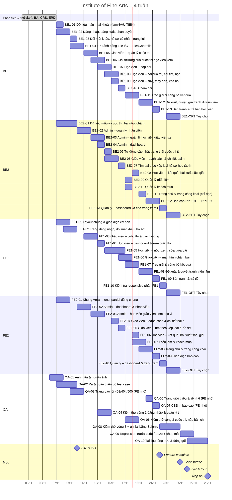

# Phần 3 – Kế hoạch tiến độ & Phân công công việc

**Dự án:** Institute of Fine Arts (Học viện Mỹ thuật) – eProject Aptech Học kỳ 3
**Vai trò soạn thảo:** Project Manager (PM) – kiêm nhiệm bởi BE1 (trưởng nhóm)
**Thời gian:** 4 tuần = 28 ngày (Day 1 = ngày Kickoff, Day 28 = ngày nộp bài cuối)
**Công nghệ:** .NET 10 · ASP.NET Core MVC (C#) · Entity Framework Core · SQL Server · Razor + Bootstrap 5 · File I/O lưu ảnh · GitHub

> Tài liệu này là **Project Plan** của nhóm, là nguồn để viết các mục "Kế hoạch dự án (Project Plan)" và "Báo cáo đánh giá và theo dõi dự án (Project Review and Monitoring Report)". Phân công chi tiết (Task Sheet) nằm trong `docs/Phan_cong_task.xlsx`.

---

## 0. Thành viên nhóm & vai trò

| Mã | Vai trò | Năng lực | Trách nhiệm chính |
|---|---|---|---|
| **BE1** | Trưởng nhóm, Backend chính, kiêm PM | Mạnh nhất nhóm | Kiến trúc, CSDL, tài khoản mẫu, đăng nhập & phân quyền, File I/O, cuộc thi, nộp bài, chấm bài, trao giải, đề xuất & bán tranh; review & merge mọi PR; kèm BE2; gửi email STATUS / DOUBT / nộp bài |
| **BE2** | Backend | Đang học | Dữ liệu mẫu, quản lý nhân viên & học viên, các trang chỉ đọc (bài nộp, kết quả), trạng thái tự động, triển lãm, khách mua, trang chủ, báo cáo, Manager; tài liệu Problem Definition, CRS, ERD, Installation Guide |
| **FE1** | Frontend (cặp với BE1) | Khá | Layout chung, GUI Standards, màn hình đăng nhập, cuộc thi, nộp bài, chấm bài, trao giải, đề xuất & bán tranh; User Guide phần GUEST/STUDENT/STAFF; hướng dẫn Razor cho QA |
| **FE2** | Frontend (cặp với BE2) | Khá | Khung Area & menu, partial dùng chung, màn hình Admin, danh sách bài nộp, kết quả học viên, triển lãm, trang chủ, báo cáo, Manager; Interface Design; User Guide phần ADMIN/MANAGER |
| **QA** | Kiểm thử + FE nhỏ | Đang học | Ảnh mẫu, test case, 3 vòng kiểm thử + regression, Selenium IDE, chụp màn hình; trang lỗi, trang giới thiệu, CSS in; biên bản họp, form báo cáo tiến độ; Certificate, Table of Contents, Project Plan, Task Sheet, Final Check List, ghép Project Report |

**Nguyên tắc cho BE2 và QA (đang học):**
- BE2 nhận phần **CRUD và trang chỉ đọc**; phần có luật nghiệp vụ khó và nằm trên đường găng do BE1 làm. BE1 **làm mẫu task đầu tiên cùng BE2** (BE2-02) và review mọi PR của BE2.
- QA không nằm trên đường găng – nếu QA trễ, việc lập trình không bị dừng. Task FE của QA là trang nhỏ, độc lập (trang lỗi, trang giới thiệu, CSS in), FE1 hướng dẫn.
- Kẹt quá **30 phút** → hỏi ngay trong nhóm chat.

> Việc lập trình chi tiết từng người (thứ tự, phụ thuộc, file được sửa) nằm trong **`docs/Phan_cong_task.xlsx`**. Mục 3–4 dưới đây được sinh từ chính file đó.

---

## 1. Quy trình tổng thể (các giai đoạn)

```
Khởi động → Phân tích BA → Thiết kế (CSDL, wireframe UI, kiến trúc) → Phát triển theo sprint
→ Kiểm thử → Hoàn thiện tài liệu → Đóng gói & nộp bài (1 lần duy nhất) → Demo / bảo vệ
```

| # | Giai đoạn | Thời gian | Mục tiêu | Đầu ra chính |
|---|---|---|---|---|
| P1 | Khởi động (Kickoff) | Day 1 | Mọi người hiểu đề, thống nhất công cụ, vai trò, lịch họp | Biên bản Kickoff, repo GitHub, nhóm chat, bảng Kanban |
| P2 | Phân tích BA | Day 1–3 | Hiểu đúng & đủ yêu cầu; liệt kê chức năng theo 4 vai trò + Guest | Problem Definition, Customer Requirement Specification (CRS), danh sách User Story + tiêu chí chấp nhận, danh sách câu hỏi DOUBT |
| P3 | Thiết kế | Day 4–6 | Chốt CSDL, giao diện và khung kiến trúc trước khi code hàng loạt | ERD + script tạo bảng, wireframe tất cả màn hình, GUI Standards Document, sơ đồ kiến trúc/package |
| P4 | Phát triển theo sprint | Day 6–23 | Xây dựng M01→M11 theo thứ tự phụ thuộc, sau đó M12+ (tùy chọn) | Mã nguồn chạy được, mỗi module có test case |
| P5 | Kiểm thử | Liên tục từ Day 8; tập trung Day 21–26 | Phát hiện & sửa lỗi; kiểm thử hồi quy toàn hệ thống | Unit Testing Check List, bảng test case có kết quả Pass/Fail, danh sách bug |
| P6 | Tài liệu | Nháp liên tục; hoàn thiện Day 23–27 | Đủ 13 tài liệu theo đặc tả + User Guide | Bộ báo cáo dự án (Word/PDF) |
| P7 | Đóng gói & nộp | Day 27–28 | 1 file ZIP đầy đủ, nộp **một lần duy nhất** | `Batch_Group_ProjectTitle.zip`, email "PROJECT SUBMISSION:" + Phiếu phản hồi |
| P8 | Demo / bảo vệ | Sau Day 28 (theo lịch trung tâm) | Trình bày luồng nghiệp vụ, trả lời câu hỏi | Kịch bản demo, slide ngắn (nếu GV yêu cầu) |

### 1.1. Làm gì TRƯỚC và VÌ SAO (thứ tự phụ thuộc)

| Thứ tự | Việc | Vì sao phải làm trước |
|---|---|---|
| 1 | **Phân tích BA** (đọc kỹ đề, user story theo vai trò) | Hiểu sai đề là rủi ro lớn nhất – sửa ở giai đoạn này rẻ nhất. Ví dụ: đề ghi **Staff** quản lý cuộc thi/giải thưởng/triển lãm, **Manager** chỉ xem + quản lý triển lãm, **Admin** quản lý nhân viên & học viên. |
| 2 | **ERD + script SQL** | Mọi module đều đọc/ghi CSDL. Đổi bảng khi đã code nhiều là tốn kém nhất (sửa Entity, migration, Service, View). |
| 3 | **Skeleton project + M01 Auth** (đăng nhập, phân quyền 4 vai trò) | Tất cả màn hình đều cần biết "ai đang đăng nhập" và chặn quyền theo URL. Layout chung (header/menu theo vai trò) cũng phụ thuộc vào đây. |
| 4 | **M03, M04** (Admin quản lý Staff/Student) | Tạo ra người dùng thật để các module sau có dữ liệu (Staff chấm bài, Student nộp bài). |
| 5 | **Luồng lõi: M05 Competition → M06 Submission → M07 Evaluation → M08 Award** | Đây là "xương sống" của đề bài, phụ thuộc tuần tự: không có cuộc thi thì không nộp bài; không có bài thì không chấm; không chấm thì không trao giải. |
| 6 | **M02 Trang chủ** | Cần dữ liệu từ M05/M06/M08 (cuộc thi sắp/đang diễn ra, tổng số bài nộp, học viên đạt giải cuộc thi trước). |
| 7 | **M09 Exhibition & bán tranh** | Phụ thuộc M07 (chỉ gửi tranh đã xếp loại tốt đi triển lãm). |
| 8 | **M10 Báo cáo, M11 Manager xem** | Chỉ là truy vấn/hiển thị trên dữ liệu đã có → làm sau cùng trong phần bắt buộc. |
| 9 | **M12+ tùy chọn** (email, xuất PDF/Excel, biểu đồ, thumbnail, quên mật khẩu) | Chỉ làm khi phần bắt buộc đã đạt Definition of Done. Không bao giờ đánh đổi phần bắt buộc lấy phần "điểm cộng". |

---

## 2. Mô hình làm việc: Scrum-lite, 4 sprint × 1 tuần

### 2.1. Các sprint

| Sprint | Ngày | Mục tiêu sprint (Sprint Goal) | Module |
|---|---|---|---|
| **Sprint 1** | Day 1–7 | Hiểu đề, thiết kế xong, có project chạy được + đăng nhập phân quyền | Phân tích, ERD, wireframe, skeleton, **M01** |
| **Sprint 2** | Day 8–14 | Quản lý người dùng, cuộc thi, nộp bài (upload File I/O), trang chủ | **M03, M04, M05, M06, M02** |
| **Sprint 3** | Day 15–21 | Chấm bài, trao giải, triển lãm & bán tranh, báo cáo, màn hình Manager → **Feature complete** | **M07, M08, M09, M10, M11** |
| **Sprint 4** | Day 22–28 | Tùy chọn (nếu kịp), sửa lỗi, **code freeze Day 24**, kiểm thử hồi quy, tài liệu, đóng gói, nộp | **M12+**, QA, Docs, Release |

### 2.2. Nghi thức (ceremonies)

| Hoạt động | Khi nào | Thời lượng | Người chủ trì | Nội dung |
|---|---|---|---|---|
| **Daily stand-up** | Mỗi ngày 8h30 (hoặc 21h nếu học buổi tối) – họp online/nhóm chat | 15 phút | BE1 | Mỗi người trả lời 3 câu: *Hôm qua làm gì? Hôm nay làm gì? Có vướng gì không?* QA ghi biên bản ngắn. |
| **Sprint Planning** | Đầu sprint: Day 1, 8, 15, 22 | 45–60 phút | BE1 | Chọn task từ Backlog vào cột "To Do" của sprint, ước lượng (S/M/L), gán người. |
| **Sprint Review (demo nội bộ)** | Cuối sprint: Day 7, 14, 21, 27 | 30–45 phút | Người làm chức năng demo | Demo chức năng đã xong trên nhánh `develop`, QA chạy thử theo test case. |
| **Retrospective** | Ngay sau Review | 15 phút | QA ghi | 3 câu: *Điều gì tốt? Điều gì chưa tốt? Tuần sau thay đổi gì?* |
| **Code review** | Mỗi Pull Request | ≤ 24h | BE1 (review mọi PR); BE2 hoặc FE1 (review code của BE1) | Không merge PR nếu chưa được review. |

### 2.3. Bảng Kanban trên GitHub Projects

Cột: `Backlog` → `Ready` → `In Progress` → `In Review (PR)` → `Testing` → `Done`

- Mỗi thẻ (Issue) đặt tên theo mẫu: `[M06] Student upload tranh JPEG` ; nhãn (label): `backend`, `frontend`, `test`, `docs`, `data`, `bug`, `optional`, `priority:high`.
- Giới hạn WIP: mỗi người **tối đa 2 thẻ** ở cột In Progress.
- QA cập nhật cột `Testing` → `Done` (hoặc mở Issue `bug` mới) sau khi chạy test case.

### 2.4. Definition of Ready (DoR) – thẻ đủ điều kiện để bắt đầu làm

- [ ] Có mô tả user story: "Là <vai trò>, tôi muốn <chức năng> để <mục đích>".
- [ ] Có tiêu chí chấp nhận (acceptance criteria) rõ ràng, có thể kiểm thử.
- [ ] Bảng/cột CSDL liên quan đã có trong ERD đã chốt.
- [ ] Có wireframe màn hình (với thẻ có giao diện).
- [ ] Các thẻ phụ thuộc đã Done (ví dụ M07 cần M06 Done).
- [ ] Đã gán người phụ trách và ước lượng (S ≤ 0,5 ngày, M ≤ 1 ngày, L ≤ 2 ngày; lớn hơn phải tách nhỏ).

### 2.5. Definition of Done (DoD) – thẻ được coi là hoàn thành

- [ ] Code chạy được bằng `dotnet run` (hoặc F5), không lỗi biên dịch, không lỗi console khi dùng chức năng.
- [ ] **Mọi khối mã đều có chú thích (comment)** – yêu cầu bắt buộc của đặc tả.
- [ ] Phân quyền đúng: vai trò khác truy cập URL sẽ bị chặn (403/redirect).
- [ ] Validation phía server (Bean Validation) + thông báo lỗi tiếng Việt/Anh thống nhất theo GUI Standards.
- [ ] PR đã được review và merge vào `develop`.
- [ ] QA đã chạy test case của thẻ → Pass; bug (nếu có) đã sửa hoặc ghi nhận.
- [ ] Đã có ảnh chụp màn hình lưu vào `docs/screenshots/<module>/`.
- [ ] Script SQL / seed data đã cập nhật nếu đổi CSDL.

---

## 3. Lịch thực hiện

### 3.1. Day 1–5: phân tích & thiết kế (trước khi chia task lập trình)

| Ngày | Công việc | Người | Đầu ra |
|---|---|---|---|
| Day 1 | **Kickoff**: đọc đề, thống nhất vai trò, công cụ, giờ stand-up; tạo repo GitHub, Kanban, nhóm chat; cài môi trường (.NET SDK 10, Visual Studio/VS Code, SQL Server, Git) | Cả nhóm (BE1 chủ trì) | Biên bản kickoff (QA), repo + Kanban (BE1) |
| Day 2–3 | **Phân tích BA**: chức năng theo vai trò, use case, quy tắc nghiệp vụ; gom câu hỏi chưa rõ | BE1 + BE2 | docs/plan/01, danh sách câu hỏi |
| Day 2–5 | Gửi email **DOUBT:** nếu đề còn chỗ mơ hồ ảnh hưởng tới CSDL/luồng nghiệp vụ | BE1 | Email DOUBT |
| Day 3 | Nháp Problem Definition · nháp Project Plan | BE2 · QA | `docs/documentation/03_…`, `05_…` |
| Day 4 | Nháp CRS · wireframe các màn hình | BE2 · FE1 + FE2 | `04_…`, `docs/wireframes/` |
| Day 4–5 | **Thiết kế CSDL** (ERD, 11 bảng) → tầng dữ liệu + migration (BASE-01, BASE-02) | BE1 (BE2 vẽ ERD) | docs/plan/02 mục 6, `database/01_schema.sql` |
| Day 5–6 | Ảnh mẫu & nguồn ảnh (QA-01) | QA | `database/seed-images/` |
| Day 6–8 | GUI Standards Document | FE1 (FE2 review) | `08_GUIStandards.docx` |

### 3.2. Day 6–23: lập trình theo tuần (tóm tắt từ Phan_cong_task.xlsx)

| Tuần | BE1 | BE2 | FE1 | FE2 | QA |
|---|---|---|---|---|---|
| **Tuần 1** (Day 1–7) | BE1-01 Dữ liệu mẫu – tài khoản (làm ĐẦU TIÊN)<br>BE1-02 Đăng nhập, đăng xuất, phân quyền | BE2-01 Dữ liệu mẫu – cuộc thi, bài nộp, chấm, giải, triển lãm | FE1-01 Layout chung & giao diện cơ bản<br>FE1-02 Trang đăng nhập, đổi mật khẩu, hồ sơ | FE2-01 Khung Area, menu, partial dùng chung | QA-01 Ảnh mẫu & nguồn ảnh<br>QA-02 Rà & hoàn thiện bộ test case |
| **Tuần 2** (Day 8–14) | BE1-03 Đổi mật khẩu, hồ sơ cá nhân, trang lỗi<br>BE1-04 Lưu ảnh bằng File I/O + FilesController<br>BE1-05 Giáo viên – quản lý cuộc thi<br>BE1-06 Giải thưởng của cuộc thi; học viên xem cuộc thi<br>BE1-07 Học viên – nộp bài<br>BE1-08 Học viên – bài của tôi, chi tiết, hạn nộp<br>BE1-09 Học viên – sửa, thay ảnh, xóa bài | BE2-02 Admin – quản lý nhân viên<br>BE2-03 Admin – quản lý học viên; giáo viên xem học viên<br>BE2-04 Admin – dashboard<br>BE2-05 Tự động cập nhật trạng thái cuộc thi & triển lãm<br>BE2-06 Giáo viên – danh sách & chi tiết bài nộp (chỉ đọc) | FE1-03 Giáo viên – cuộc thi & giải thưởng<br>FE1-04 Học viên – dashboard & xem cuộc thi<br>FE1-05 Học viên – nộp, xem, sửa, xóa bài | FE2-02 Admin – dashboard & nhân viên<br>FE2-03 Admin – học viên; giáo viên xem học viên<br>FE2-04 Giáo viên – danh sách & chi tiết bài nộp | QA-03 Trang báo lỗi 403/404/500 (FE nhỏ)<br>QA-04 Kiểm thử vòng 1: đăng nhập & quản lý tài khoản |
| **Tuần 3** (Day 15–21) | BE1-10 Chấm bài<br>BE1-11 Trao giải & công bố kết quả<br>BE1-12 Đề xuất, duyệt, gửi tranh đi triển lãm<br>BE1-13 Bán tranh & trả tiền học viên | BE2-07 Tìm bài theo xếp loại; hồ sơ học tập học viên (chỉ đọc)<br>BE2-08 Học viên – kết quả, bài xuất sắc, giải thưởng (chỉ đọc)<br>BE2-09 Quản lý triển lãm<br>BE2-10 Quản lý khách mua<br>BE2-11 Trang chủ & trang công khai (chỉ đọc)<br>BE2-12 Báo cáo RPT-01 … RPT-07<br>BE2-13 Quản lý – dashboard và các trang xem (chỉ đọc) | FE1-06 Giáo viên – màn hình chấm bài<br>FE1-07 Trao giải & công bố kết quả<br>FE1-08 Đề xuất & duyệt tranh triển lãm<br>FE1-09 Bán tranh & trả tiền<br>FE1-10 Kiểm tra responsive phần FE1 | FE2-05 Giáo viên – tìm theo xếp loại & hồ sơ học tập<br>FE2-06 Học viên – kết quả, bài xuất sắc, giải<br>FE2-07 Triển lãm & khách mua<br>FE2-08 Trang chủ & trang công khai<br>FE2-09 Giao diện báo cáo<br>FE2-10 Quản lý – dashboard & trang xem | QA-05 Trang giới thiệu & liên hệ (FE nhỏ)<br>QA-07 CSS in báo cáo (FE nhỏ)<br>QA-06 Kiểm thử vòng 2: cuộc thi, nộp bài, chấm bài<br>QA-08 Kiểm thử vòng 3 + ghi lại bằng Selenium IDE |
| **Tuần 4** (Day 22–28) | BE1-OPT Tùy chọn | BE2-OPT Tùy chọn | FE1-OPT Tùy chọn | FE2-OPT Tùy chọn | QA-09 Regression trước code freeze + chụp màn hình<br>QA-10 Tài liệu tổng hợp & đóng gói |

### 3.3. Mốc và việc chung theo ngày

| Ngày | Việc | Người |
|---|---|---|
| Day 7 | Sprint Review 1: đăng nhập chạy được, có dữ liệu mẫu, layout + menu theo vai trò | Cả nhóm |
| **Day 9** | **Gửi email STATUS #1** (mục 6) + Project Review & Monitoring Report kỳ 1 | QA soạn, BE1 gửi |
| Day 12–13 | Kiểm thử vòng 1 (đăng nhập, quản lý tài khoản) | QA |
| Day 14 | Sprint Review 2: cuộc thi + nộp bài chạy được | Cả nhóm |
| Day 16–17 | Kiểm thử vòng 2 (cuộc thi, nộp bài, chấm bài) | QA |
| Day 16 / 20 | Algorithms: nháp / chốt | BE1 + QA |
| Day 21 | **Feature complete** – Sprint Review 3 | Cả nhóm |
| Day 21–23 | Kiểm thử vòng 3 + Selenium IDE; làm tùy chọn (M12+) nếu phần bắt buộc đã xong | QA; BE/FE |
| Day 22 | User Guide bản nháp | FE1 + FE2 |
| **Day 24** | **Code freeze 18:00** – chỉ sửa lỗi; Unit Testing Check List chốt; Installation Guide nháp | Cả nhóm; QA; BE2 |
| **Day 25** | **Gửi email STATUS #2** + Report kỳ 2; User Guide & Interface Design chốt | QA soạn, BE1 gửi; FE1, FE2 |
| Day 26 | Cài thử trên máy sạch; backup DB bản cuối; xuất `01_schema.sql`, `02_seed_data.sql`; Certificate; ghép Project Report | QA + BE2; BE1 |
| Day 27 | Final Check List; đóng gói ZIP; kiểm tra chéo; diễn tập demo | QA + FE2; cả nhóm |
| **Day 28** | **Nộp bài** (email `PROJECT SUBMISSION:`, chỉ 1 lần) | BE1 |

Hạn của từng tài liệu: docs/plan/04 mục 6.2.

### 3.4. Biểu đồ Gantt (Mermaid – Day 1 minh họa là 02/11/2026)



---

## 4. Phân công theo người

### 4.1. Số task và số giờ

| Người | Task bắt buộc | Giờ | Task tùy chọn | Giờ |
|---|---|---|---|---|
| BE1 | 13 | 107 | 1 | 10 |
| BE2 | 13 | 96 | 1 | 12 |
| FE1 | 10 | 73 | 1 | 8 |
| FE2 | 10 | 72 | 1 | 8 |
| QA | 10 | 68 | 0 | 0 |

Tài liệu nộp do ai viết: docs/plan/04 mục 6.2.

### 4.2. Ma trận RACI theo hạng mục

R = Thực hiện · A = Chịu trách nhiệm cuối · C = Được tham vấn · I = Được thông báo

| Hạng mục | BE1 | BE2 | FE1 | FE2 | QA |
|---|---|---|---|---|---|
| Phân tích yêu cầu, CRS | A/R | R | C | C | I |
| Problem Definition | A | R | I | I | C |
| ERD, tầng dữ liệu, migration | A/R | R (vẽ ERD) | I | I | I |
| Dữ liệu mẫu (DbSeeder) | A/R (tài khoản) | R | I | I | C (ảnh mẫu) |
| Wireframe, GUI Standards | C | I | A/R | R | I |
| Đăng nhập, File I/O, cuộc thi, nộp bài, chấm, trao giải, bán tranh | A/R | C | R (View) | I | C |
| Admin, trang chỉ đọc, triển lãm, khách mua, trang chủ, báo cáo, Manager | A | R | I | R (View) | C |
| Code review & merge PR | A/R | R (review code BE1) | C | C | I |
| Test case & kiểm thử thủ công | A | C | C | C | R |
| Unit test & Unit Testing Check List | A/R | R | I | I | R (trình bày) |
| Algorithms | A/R | I | I | I | R (flowchart) |
| Interface Design Document | C | I | C | A/R | R (ảnh chụp) |
| User Guide | C | I | R | R | A (làm thử) |
| Installation Guide | A | R | I | I | R (cài thử) |
| Biên bản họp, form báo cáo tiến độ, email STATUS | A (gửi) | I | I | I | R |
| Backup code + DB | A/R | R (push) | R (push) | R (push) | R (push) |
| Đóng gói ZIP + nộp bài | A/R | C | C | R (kiểm tra chéo) | R |

### 4.3. Kèm cặp thành viên đang học

| Cặp | Hình thức | Mục tiêu |
|---|---|---|
| **BE2 ↔ BE1** | Day 6–10: làm chung dữ liệu mẫu và bước (1)–(2) của BE2-02; sau đó 20 phút/ngày giải đáp + review mọi PR của BE2 | CRUD với EF Core, transaction, DataAnnotations, cách tổ chức Service |
| **QA ↔ BE1** | 30 phút sau Sprint Review: BE1 giải thích luồng vừa xong, QA bổ sung test case | Hiểu nghiệp vụ, viết test case đúng |
| **QA ↔ FE1** | Day 8 (trang lỗi), Day 19 (trang giới thiệu), Day 20 (CSS in): FE1 hướng dẫn Razor/Bootstrap | Sửa được View đơn giản |
| **BE2 ↔ FE2** | Mỗi task: chốt ViewModel trước rồi mới làm | Thói quen thỏa thuận "hợp đồng" BE–FE |

- Giao việc bằng **checklist cụ thể từng bước** (mô tả task trong Phan_cong_task.xlsx đã đánh số bước).
- Không phê bình trước nhóm; góp ý trong PR bằng câu hỏi gợi mở. Ghi nhận đóng góp của từng người trong Task Sheet để công bằng khi chấm.

---

## 5. Mốc quan trọng (Milestones) & tiêu chí hoàn thành

| Mốc | Ngày | Tên | Tiêu chí hoàn thành (phải đạt tất cả) |
|---|---|---|---|
| MS0 | Day 1 | Kickoff | Repo GitHub, Kanban, nhóm chat đã tạo; mọi máy cài xong môi trường |
| MS1 | Day 7 | Thiết kế xong + Nền tảng | CRS đã chốt; ERD final + `01_schema.sql` chạy được; wireframe đủ màn hình; project chạy; **M01 đăng nhập đúng 4 vai trò** |
| MS2 | Day 9 | **STATUS #1 đã gửi** | Email "STATUS:" + ZIP (source, SQL, screenshots) + form Báo cáo tiến độ lần 1 |
| MS3 | Day 14 | Nộp bài chạy được | M02–M06 Done: Admin tạo Staff/Student; Staff tạo cuộc thi; Student upload/sửa/xóa/tải ảnh qua File I/O; trang chủ hiển thị số liệu |
| MS4 | Day 18 | Luồng lõi E2E | Competition → Submission → Evaluation (kể cả DISQUALIFIED tự động) → Award chạy trọn vẹn, test E2E Pass |
| MS5 | Day 21 | **Feature complete** | M01–M11 đạt DoD; không còn bug Blocker; tag `v0.9` |
| MS6 | Day 24 | **Code freeze** (18:00) | `main` = `v1.0-rc`; mọi khối mã có comment; chỉ còn sửa bug Blocker/Critical |
| MS7 | Day 25 | **STATUS #2 đã gửi** | Email "STATUS:" + ZIP bản `v1.0-rc` + form Báo cáo tiến độ lần 2 (cuối cùng) |
| MS8 | Day 27 | Sẵn sàng phát hành | Bộ tài liệu 13 mục + User Guide hoàn chỉnh; DB `.bak` final; dry-run trên máy sạch thành công |
| MS9 | Day 28 | **Nộp bài cuối (1 lần)** | Final Check List 100%; email "PROJECT SUBMISSION:" + ZIP + Phiếu phản hồi |

**Ngày dự phòng (buffer):** Day 27 (buffer chính thức) + nửa cuối Day 21 và Day 23. Nếu Sprint 3 trễ, **cắt M12+ trước tiên**, sau đó lùi M10/M11 sang Day 22–23 — **không bao giờ dời Code freeze quá Day 25 và không dời ngày nộp**.

---

## 6. Kế hoạch 2 lần báo cáo tiến độ (Status Report)

Theo đặc tả: dự án < 30 ngày → **email 1 trong khoảng Day 7–10**, **email 2 trước ngày kết thúc 3 ngày**. Nhóm chọn:

| | STATUS #1 | STATUS #2 (cuối cùng) |
|---|---|---|
| **Ngày gửi** | **Day 9** (dư 1 ngày dự phòng trước hạn Day 10) | **Day 25** (Day 28 − 3) |
| **Người soạn / gửi** | QA soạn & gom file, BE1 duyệt & gửi | QA soạn & gom file, BE1 duyệt & gửi |
| **Tiến độ tổng thể** | ~35%: Phân tích + thiết kế xong; M01 Done; M03, M04 đang làm | ~95%: M01–M11 Done (+ M12 nếu có); code freeze; đang hoàn thiện tài liệu |
| **Việc đã xong** | CRS, ERD, script SQL, wireframe, GUI Standards nháp, skeleton, M01 | Toàn bộ module bắt buộc, kiểm thử hồi quy vòng 2, ERD/Algorithms/Interface Design bản final |
| **Việc tiếp theo** | M05, M06, M02, luồng chấm bài | User Guide, ghép tài liệu, DB backup, dry-run, nộp Day 28 |
| **Khó khăn (nếu có)** | Ví dụ: cấu hình SQL Server/chuỗi kết nối, chưa rõ quyền quản lý triển lãm | Ví dụ: tối ưu hiển thị ảnh lớn, thời gian viết tài liệu |
| **File đính kèm (ZIP)** | `src` (zip mã nguồn, không gồm `bin/`, `obj/`), `database/01_schema.sql`, `02_seed_data.sql`, ERD (PNG), 5–8 screenshots (Login, menu 4 vai trò, Admin CRUD), wireframe PDF, form Báo cáo tiến độ đã điền | `src` bản `v1.0-rc`, script SQL final, screenshots tất cả module, bản nháp tài liệu, form Báo cáo tiến độ đã điền phần lần 2 |
| **Tên ZIP** | `Batch_Group_InstituteOfFineArts_STATUS1.zip` | `Batch_Group_InstituteOfFineArts_STATUS2.zip` |

### 6.1. Mẫu email STATUS

```
Tiêu đề: STATUS: [Batch_Group] Institute of Fine Arts – Báo cáo tiến độ lần 1 (Day 9)

Kính gửi Nhóm eProjects,

Nhóm [Group] – khóa [Batch] xin gửi báo cáo tiến độ lần 1 của eProject "Institute of Fine Arts".
- Thời gian dự án: [dd/MMM/yyyy] – [dd/MMM/yyyy] (28 ngày)
- Tiến độ tổng thể: khoảng 35%

1. Công việc đã hoàn thành:
   - Phân tích yêu cầu, Đặc tả yêu cầu khách hàng (CRS)
   - Sơ đồ ERD và script tạo CSDL SQL Server
   - Wireframe các màn hình, GUI Standards (bản nháp)
   - Khung dự án ASP.NET Core MVC (.NET 10), chức năng đăng nhập & phân quyền 4 vai trò (Admin, Manager, Staff, Student)
2. Công việc đang thực hiện: Quản lý nhân viên, học viên (Admin)
3. Kế hoạch tiếp theo: Quản lý cuộc thi, nộp bài (upload ảnh bằng File I/O), trang chủ
4. Khó khăn / thắc mắc: [ghi rõ hoặc "Không có"]

File đính kèm: Batch_Group_InstituteOfFineArts_STATUS1.zip
(mã nguồn, script CSDL, ảnh chụp màn hình, ERD, form Báo cáo tiến độ)

Trân trọng,
[Họ tên BE1] – Trưởng nhóm, thay mặt nhóm: [BE1], [BE2], [FE1], [FE2], [QA]
```

STATUS #2 dùng cùng mẫu, đổi "lần 2 (cuối cùng) (Day 25)", tiến độ ~95%, liệt kê module M01–M11 đã xong.

### 6.2. Điền form "Bao cao tien do eProject (V1).xls"

| Nhóm ô trong form | Nội dung điền |
|---|---|
| Thông tin học viên | Họ và tên, Mã số học viên, Chương trình học, Học kỳ (Sem 3), Tên trung tâm – điền cho trưởng nhóm, ghi tên các thành viên vào Ghi chú |
| Thông tin eProject | Tên eProject: Institute of Fine Arts; Thời gian thực hiện: 28 ngày; Ngày bắt đầu/kết thúc theo định dạng **DD/MMM/YYYY** (ví dụ 02/Nov/2026) |
| Báo cáo tiến độ lần 1 | Ngày gửi (Day 9); Ảnh chụp màn hình (tên các file đính kèm); Mô tả / Tài liệu đánh giá (tóm tắt mục 6 ở trên); Ghi chú (khó khăn) |
| Báo cáo tiến độ lần 2 (cuối cùng) | Tương tự, điền ở Day 25 (giữ nguyên phần lần 1) |
| Nhận xét của học viên | Điền khi nộp bài cuối: góp ý của nhóm eProjects đã giúp gì; Phản hồi/Ghi chú |

> Lưu cùng một file form, cập nhật dần qua 2 lần, và đính kèm bản đã điền đủ vào ZIP nộp cuối cùng.

---

## 7. Quản lý rủi ro

Thang đo: Xác suất (Thấp/TB/Cao) × Ảnh hưởng (Thấp/TB/Cao).

| # | Rủi ro | Xác suất | Ảnh hưởng | Biện pháp phòng ngừa | Phương án khi xảy ra | Người theo dõi |
|---|---|---|---|---|---|---|
| R1 | **Thành viên đang học (BE2, QA) không hoàn thành việc** | Cao | Thấp–TB | Không giao việc trên đường găng; checklist từng bước; kèm cặp hằng ngày; việc chia nhỏ ≤ 0,5 ngày | BE/FE nhận lại phần quan trọng; BE2/QA chuyển sang việc đơn giản hơn (chụp màn hình, nhập dữ liệu) | BE1 |
| R2 | **Trễ tiến độ** (đặc biệt M06, M07, M09) | TB | Cao | Làm theo thứ tự phụ thuộc; Kanban + stand-up phát hiện sớm; buffer Day 27; M12+ là "Could" | Cắt M12+; giảm phạm vi M10 (giữ 1 báo cáo bắt buộc); làm thêm giờ cuối tuần; không dời code freeze quá Day 25 | BE1 |
| R3 | **Mất dữ liệu / hỏng máy / virus** | TB | Cao | Push code **mỗi ngày**; backup DB `.bak` hằng ngày lên Google Drive nhóm; script SQL nằm trong repo | Clone lại từ GitHub; restore `.bak` gần nhất hoặc chạy `01_schema.sql` + `02_seed_data.sql` | BE1 (DB), mỗi người (code) |
| R4 | **Xung đột Git (merge conflict)** | Cao | TB | Mỗi người 1 nhánh feature; pull `develop` mỗi sáng; chia file rõ ràng (BE1/BE2: C# – Services/Data/Controllers, FE1/FE2/QA: Views/wwwroot); chỉ BE1 tạo migration; PR nhỏ | BE1 giải quyết conflict cùng người liên quan; không bao giờ `push --force` lên `develop/main` | BE1 |
| R5 | **Lỗi upload file** (đường dẫn Windows, file lớn, sai định dạng, tên tiếng Việt, mất ảnh khi đổi máy) | Cao | Cao | Đặt tên file bằng Guid; cấu hình `Upload:RootPath` trong `appsettings.json`; giới hạn `[RequestSizeLimit]` + `Upload:MaxFileSizeBytes`; kiểm tra MIME + phần mở rộng JPEG; bộ ảnh test của QA | Ghi lỗi chi tiết; thư mục `uploads/` mẫu được đóng gói trong ZIP cùng seed | BE1, QA |
| R6 | **Hiểu sai đề** (ví dụ: ai quản lý cuộc thi/triển lãm; điều kiện DISQUALIFIED; Student sửa bài sau hạn) | TB | Cao | Bảng đối chiếu yêu cầu ↔ module (CRS) được cả nhóm duyệt Day 3; gửi **DOUBT:** sớm | Điều chỉnh trong sprint kế tiếp; ghi giả định (assumption) vào tài liệu | BE1 |
| R7 | Môi trường không đồng nhất (khác phiên bản .NET SDK, SQL Server, cổng, collation) | TB | TB | Cùng .NET SDK 10 (file `global.json` cố định phiên bản); chuỗi kết nối Windows Authentication, khác biệt riêng từng máy để trong User Secrets; hướng dẫn cài trong README | BE1 hỗ trợ qua chia sẻ màn hình; dùng máy BE1 làm máy demo | BE1 |
| R8 | Thiếu/không đạt tài liệu (13 mục) | TB | Cao | Viết nháp song song từ Day 3; QA làm chủ bộ tài liệu, mỗi người viết tài liệu được giao (docs/plan/04 mục 6.2); template sẵn | Dồn nguồn lực Day 26–27; BE/FE viết phần kỹ thuật | QA |
| R9 | Nộp bài thiếu file (chỉ được nộp 1 lần) | Thấp | Rất cao | Final Check List; dry-run Day 27 trên máy sạch; 2 người kiểm tra chéo ZIP | Không có phương án khắc phục sau khi nộp → phải phòng ngừa tuyệt đối | BE1 + QA |
| R10 | Thành viên ốm/vắng đột xuất | TB | TB | Code có comment + PR mô tả rõ; tài liệu trên Drive chung | Phân lại việc trong stand-up; BE1 ưu tiên việc găng | BE1 |
| R11 | Lỗi bảo mật cơ bản (lộ mật khẩu, truy cập trái quyền, upload file độc hại) | TB | TB | BCrypt; phân quyền URL + kiểm tra chủ sở hữu bài nộp ở Service; anti-forgery token của ASP.NET Core (CSRFity; không lưu file thực thi | Sửa trước code freeze; test case truy cập trái quyền | BE1, QA |

---

## 8. Quy trình Git làm việc nhóm (cho người mới)

### 8.1. Mô hình nhánh

| Nhánh | Mục đích | Ai được merge |
|---|---|---|
| `main` | Bản ổn định để nộp/demo (chỉ cập nhật ở Day 14, 21, 24, 28) | Chỉ BE1 |
| `develop` | Nhánh tích hợp hằng ngày | BE1 (sau review) |
| `feature/M06-upload-submission` | Tính năng mới, theo mã module | Người làm tính năng |
| `fix/M07-late-disqualified` | Sửa lỗi | Người sửa |
| `docs/documentation/`, `database/seed-images/`, `docs/testing/` | Tài liệu, dữ liệu mẫu, test case | QA (tài liệu, test case), BE2 (dữ liệu mẫu) |

Quy tắc commit: `[M06] Thêm kiểm tra định dạng JPEG khi upload` (mã module + động từ + nội dung). Bảo vệ nhánh `main` và `develop` trên GitHub: bắt buộc PR, ít nhất 1 người duyệt.

### 8.2. Từng bước hằng ngày

```bash
# Lần đầu (Day 1)
git clone https://github.com/<to-chuc>/institute-of-fine-arts.git
cd institute-of-fine-arts
git config user.name "Ho Ten"
git config user.email "email@example.com"
git checkout develop

# Mỗi sáng: lấy code mới nhất
git checkout develop
git pull origin develop

# Bắt đầu một thẻ mới (ví dụ thẻ M06)
git checkout -b feature/M06-upload-submission

# Trong ngày: lưu tiến độ thường xuyên
git status                      # xem file thay đổi
git add src/InstituteOfFineArts.Web/...  # thêm đúng file cần commit (tránh "git add ." bừa bãi)
git commit -m "[M06] Lưu ảnh JPEG vào thư mục uploads bằng File I/O"

# Trước khi đẩy lên: cập nhật develop vào nhánh của mình
git fetch origin
git merge origin/develop        # có conflict -> sửa file, rồi git add + git commit
dotnet build                    # chắc chắn vẫn build được (hoặc F5 trong Visual Studio)

# Cuối ngày (BẮT BUỘC): đẩy code lên GitHub = backup
git push -u origin feature/M06-upload-submission
```

### 8.3. Pull Request & Review

1. Trên GitHub: **New pull request** → base `develop` ← compare `feature/...`.
2. Tiêu đề: `[M06] Student upload tranh JPEG`; mô tả: làm gì, cách test, ảnh chụp màn hình, liên kết Issue (`Closes #12`).
3. Người review: BE1 (cho code của BE2, FE1, FE2, QA); BE2 hoặc FE1 (cho code của BE1).
4. Checklist review: chạy được; có comment; đúng phân quyền; không commit `bin/`, `obj/`, `uploads/` thật, mật khẩu DB thật; tên biến rõ nghĩa.
5. Sửa theo góp ý → push tiếp lên cùng nhánh (PR tự cập nhật) → BE1 **Squash and merge** → xóa nhánh.
6. Kéo thẻ Kanban sang `Testing` để QA kiểm thử.

`.gitignore` tối thiểu: `bin/`, `obj/`, `.vs/`, `.vscode/`, `uploads/` (ảnh mẫu để ở `database/seed-images/`), `appsettings.*.local.json`, `*.bak`.

### 8.4. Sao lưu hằng ngày

| Loại | Cách làm | Tần suất | Người |
|---|---|---|---|
| Mã nguồn | `git push` nhánh đang làm lên GitHub | Cuối mỗi ngày (bắt buộc) | Mọi người |
| CSDL | `BACKUP DATABASE InstituteOfFineArts TO DISK = 'D:\backup\IFA_dayNN.bak' WITH INIT;` rồi chép lên Google Drive nhóm | Hằng ngày (giữ 3 bản gần nhất + bản Day 14, 21, final) | BE1 |
| Script CSDL | `01_schema.sql` (xuất từ migration), `02_seed_data.sql` (xuất ở Day 26) nằm trong `database/` | Mỗi lần đổi | BE1 |
| Ảnh mẫu & tài liệu | Thư mục Google Drive chung + bản trong repo (`docs/`, `database/seed-images/`) | Hằng ngày | QA |
| Mốc phiên bản | Tag `v0.1` (D7), `v0.2` (D14), `v0.9` (D21), `v1.0-rc` (D24), `v1.0` (D28) | Theo mốc | BE1 |

---

## 9. Kế hoạch giao tiếp

| Kênh | Mục đích | Tần suất / thời điểm | Người phụ trách |
|---|---|---|---|
| Nhóm chat (Zalo/Messenger/Discord) | Trao đổi nhanh, báo kẹt việc, nhắc lịch | Hằng ngày; trả lời trong vòng 2 giờ (giờ hành chính) | Cả nhóm (QA quản trị nhóm) |
| Daily stand-up (online hoặc tại Lab) | Đồng bộ tiến độ | 15 phút/ngày | BE1 chủ trì, QA ghi biên bản |
| Họp sprint (Planning / Review / Retro) | Lập kế hoạch, demo, cải tiến | Day 1, 7, 8, 14, 15, 21, 22, 27 | BE1 |
| GitHub Projects + Issues + PR | Theo dõi task, bug, review code | Liên tục | Cả nhóm |
| Google Drive nhóm | Tài liệu, ảnh mẫu, backup DB, biên bản | Liên tục | QA |
| Gặp giảng viên (GV hướng dẫn) tại Lab | Hỏi nhanh về phạm vi, nhờ xem demo | Mỗi buổi Lab | BE1 (+ người liên quan) |
| Email **"DOUBT:"** gửi Nhóm eProjects | Làm rõ yêu cầu đề bài | Khi: (1) đề mơ hồ ảnh hưởng tới CSDL/luồng nghiệp vụ; (2) nhóm tranh luận > 1 ngày không chốt được; (3) GV Lab không trả lời được. **Gửi sớm (Day 2–5)**, gom nhiều câu hỏi vào 1 email | BE1 gửi, BE2 soạn danh sách câu hỏi |
| Email **"STATUS:"** | Báo cáo tiến độ bắt buộc | Day 9, Day 25 | BE1 |
| Email **"PROJECT SUBMISSION:"** | Nộp bài cuối + Phiếu phản hồi | Day 28 (1 lần duy nhất) | BE1 |

**Mẫu email DOUBT:**

```
Tiêu đề: DOUBT: [Batch_Group] Institute of Fine Arts – Làm rõ quyền quản lý triển lãm

Kính gửi Nhóm eProjects,
Trong đề bài, cả Staff và Manager đều có chức năng "quản lý thông tin triển lãm sắp tổ chức".
Nhóm hiểu là: Staff và Manager đều được thêm/sửa/xóa triển lãm; chỉ Staff được gửi tranh đến triển lãm.
Xin xác nhận cách hiểu này có đúng không?
Trân trọng, [Họ tên] – nhóm [Group]
```

Quy tắc chung: quyết định quan trọng (đổi CSDL, cắt tính năng) phải ghi vào biên bản và cập nhật Issue trên GitHub; mọi người được thông báo trong nhóm chat.

---

## 10. Checklist ngày cuối trước khi nộp (Day 27–28)

> **CHỈ ĐƯỢC NỘP MỘT LẦN DUY NHẤT – sau khi nộp không thể bổ sung hay thay đổi file.** QA đọc to từng dòng, BE1 và FE1 xác nhận, FE2 kiểm tra chéo trên máy sạch.

### 10.1. Cấu trúc ZIP

Tên file: **`Batch_Group_ProjectTitle.zip`** → ví dụ `T1.2410.E1_Group3_InstituteOfFineArts.zip` (thay đúng mã khóa và nhóm).

Cấu trúc thư mục bên trong ZIP: **docs/plan/04 mục 8.1** (chỉ mô tả ở một nơi để không lệch nhau).

### 10.2. Danh sách kiểm tra

| # | Hạng mục kiểm tra | Người | ☐ |
|---|---|---|---|
| 1 | Mã nguồn bản `v1.0` (tag trên `main`) build được bằng `dotnet build -c Release` | BE1 | ☐ |
| 2 | Không có thư mục `bin/`, `obj/`, `.vs/`, file mật khẩu cá nhân trong ZIP | FE2 | ☐ |
| 3 | Mọi khối mã có comment (rà soát nhanh từng thư mục) | BE1 + FE1 | ☐ |
| 4 | Restore `.bak` thành công trên máy sạch; hoặc chạy `01_schema.sql` + `02_seed_data.sql` không lỗi | BE2 | ☐ |
| 5 | Ảnh mẫu hiển thị đúng sau khi chép thư mục `uploads/` theo Installation Guide | QA | ☐ |
| 6 | Đăng nhập được bằng **tài khoản mẫu của cả 4 vai trò** (ADMIN, MANAGER, STAFF, STUDENT) + trang chủ Guest | QA | ☐ |
| 7 | Luồng demo chạy trọn: tạo cuộc thi → nộp bài → chấm → trao giải → triển lãm → bán tranh → báo cáo | QA + FE2 | ☐ |
| 8 | Bộ tài liệu đủ 13 mục: Certificate of Completion, Table of Contents, Problem Definition, Customer Requirement Specification, Project Plan, E-R Diagrams, Algorithms, GUI Standards Document, Interface Design Document, Task Sheet, Project Review and Monitoring Report, Unit Testing Check List, Final Check List | QA | ☐ |
| 9 | User Guide có: yêu cầu cài đặt, cấu hình `appsettings.json`, cách chạy, **thông tin đăng nhập ứng dụng & CSDL** | FE1 | ☐ |
| 10 | Form Báo cáo tiến độ đã điền đủ lần 1 & lần 2; Phiếu phản hồi đã chọn đánh giá ở các ô màu vàng | QA | ☐ |
| 11 | Tên ZIP đúng mẫu `Batch_Group_ProjectTitle`; giải nén thử không lỗi; dung lượng hợp lý | FE2 | ☐ |
| 12 | Email tiêu đề bắt đầu bằng **"PROJECT SUBMISSION:"**, nêu tên dự án, nhóm, danh sách thành viên, nội dung ZIP | BE1 | ☐ |
| 13 | Cả nhóm xác nhận "Đồng ý nộp" trong nhóm chat trước khi bấm gửi | Cả nhóm | ☐ |
| 14 | Lưu lại bản ZIP đã nộp + ảnh chụp email đã gửi trên Drive nhóm | BE1 | ☐ |

**Mẫu tiêu đề email nộp bài:** `PROJECT SUBMISSION: [Batch_Group] Institute of Fine Arts – Final Submission`

---

*Tài liệu được cập nhật sau mỗi Sprint Review (Day 7, 14, 21, 27). Mọi thay đổi về mốc thời gian phải được BE1 (PM) duyệt và thông báo cho cả nhóm.*
